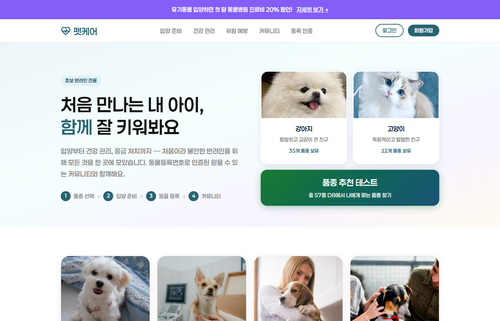
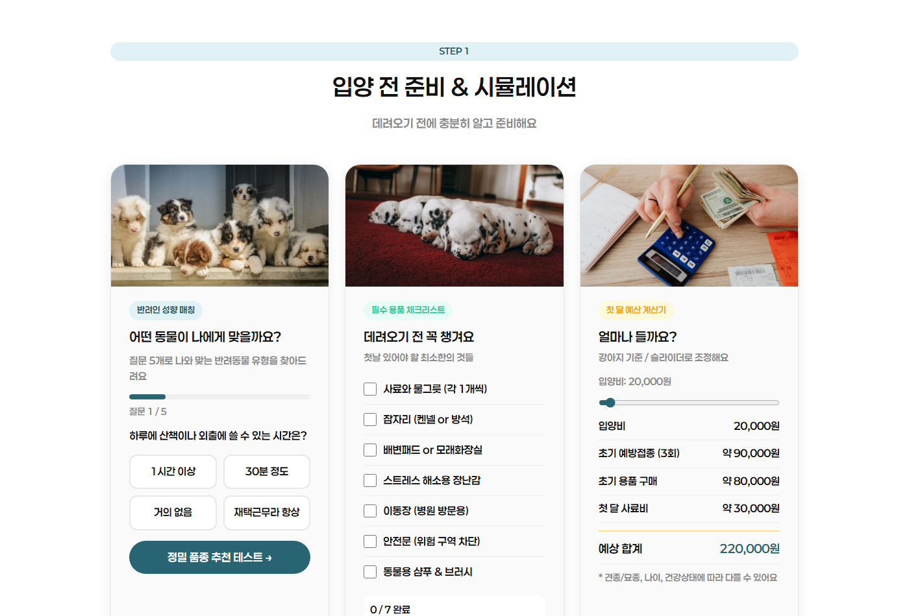
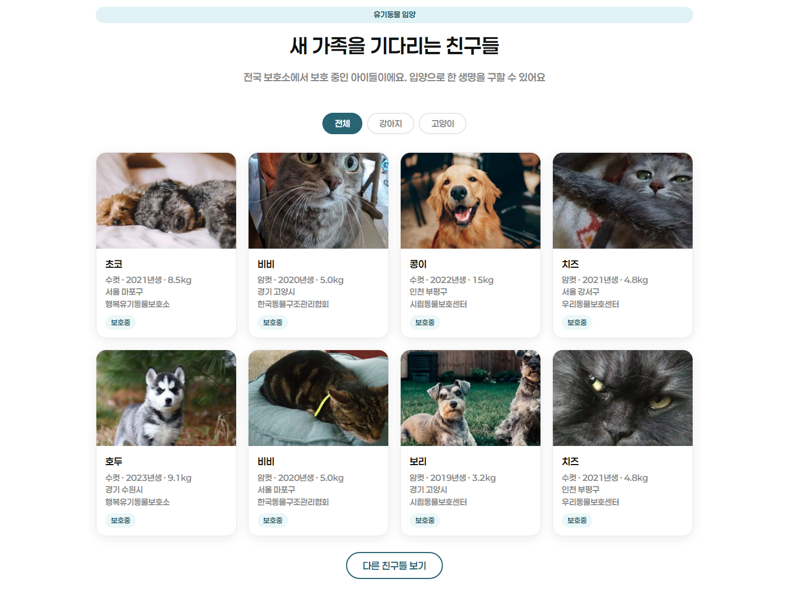
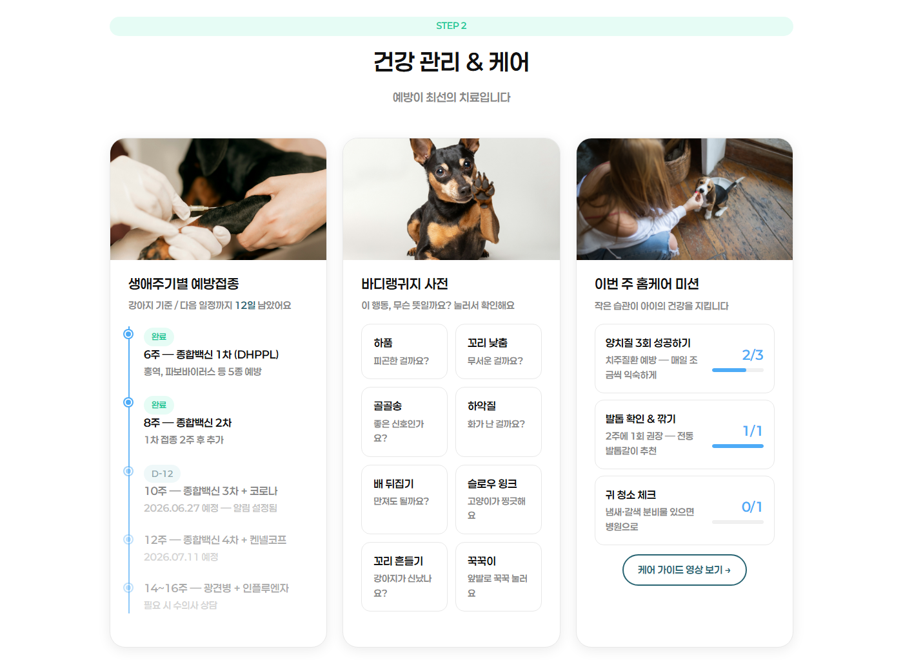
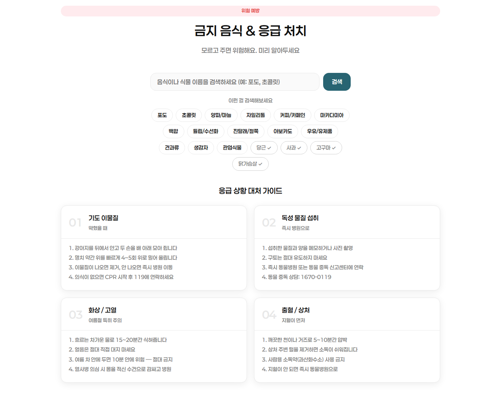
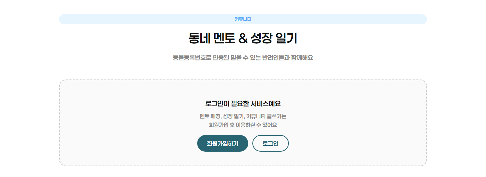
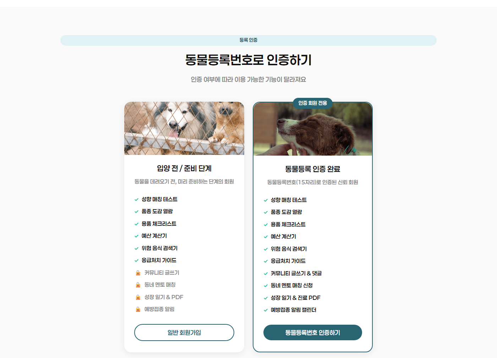
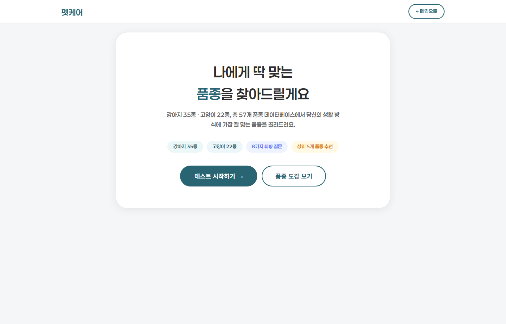

# Web-PRG · 웹 프로그래밍 실습

HTML · CSS · JavaScript 수업 실습과 웹 프로젝트 모음.

| 폴더 | 내용 |
|---|---|
| `petcare/` | 펫케어: 초보 반려인을 위한 케어 서비스 웹. 입양 전 준비·시뮬레이션, 유기동물 입양 정보, 건강 관리, 금지 음식·응급 처치, 동네 멘토·성장 일기, 품종 퀴즈 |
| `todolist/` | 파스텔 루틴 투두리스트 |
| `web/Class/` | 수업 회차별 실습: chap04~chap13, chap17, chap19, 15·16·18·20회차 |
| `web_practice/` | 첫 HTML 실습: 자기소개 페이지, 종합 실습 1~3, BLT 샌드위치 소개 페이지 |

---

## 1. 펫케어

초보 반려인을 위한 입양 준비·건강 관리·위험 예방·커뮤니티 통합 웹. 프레임워크 없이 HTML, CSS, 바닐라 JavaScript와 의존성 없는 Node 서버로 구성.



### 실행

```
cd petcare
node server.js        # http://localhost:3000
```

- 유기동물 정보는 공공데이터포털 유기동물 조회 API, 지도는 카카오 지도 API 사용
- API 키 설정
  - `config.example.js`를 `config.js`로 복사 후 공공데이터포털·카카오 JavaScript 키 입력
  - `keys.example.json`을 `keys.local.json`으로 복사 후 공공데이터포털 인증키 입력
  - 서버 쪽 키는 환경 변수 `PETCARE_LIST_KEY`, `PETCARE_PHOTO_KEY`로도 지정 가능
- `config.js`, `keys.local.json`은 `.gitignore` 대상, 저장소에는 예시 파일만 포함
- 키 없이 실행하면 데모 데이터로 표시

### 파일 구성

| 파일 | 역할 |
|---|---|
| `index.html` | 메인 화면 전체 마크업, 모달 5종 |
| `style.css` | 색상 변수, 섹션·카드·모달 스타일, 768px 기준 반응형, 동작 줄이기 설정 대응 |
| `script.js` | 로그인·인증 상태, 퀴즈, 체크리스트, 예산 계산, 위험 음식 검색, 유기동물 목록, 카카오 지도, 갤러리 |
| `server.js` | 정적 파일 제공, `/api/adopt` 프록시 |
| `breed-quiz.html` | 품종 추천 퀴즈와 품종 도감, 마크업·스타일·스크립트를 한 파일에 포함 |

### 화면 구성과 구현 방식

| 섹션 | 기능 | 구현 |
|---|---|---|
| 상단 | 서비스 소개, 강아지·고양이 선택 카드, 품종 추천 테스트 배너 | 선택 카드는 `active` 클래스와 `aria-pressed` 전환 |
| 입양 전 준비 | 성향 퀴즈, 필수 용품 체크리스트, 첫 달 예산 계산기 | 퀴즈는 질문 5개 배열을 순서대로 렌더링하고 진행 막대 갱신, 마지막 질문에서 결과 모달 표시. 체크리스트는 체크된 항목 수 집계. 예산은 입양비 슬라이더 0~500,000원 값에 고정 비용 200,000원을 더해 합계 표시 |
| 유기동물 입양 | 전체·강아지·고양이 필터, 보호 동물 카드 8개 | `/api/adopt` 응답 또는 데모 데이터를 카드로 렌더링, 아래 데이터 흐름 참고 |
| 갤러리 | 사진 6장 슬라이더 | 화면 너비 768px 이상은 3장, 미만은 1장 표시. `translateX` 이동, 창 크기 변경 시 150ms 디바운스 후 재계산 |
| 건강 관리 | 예방접종 타임라인, 바디랭귀지 사전, 홈케어 미션 | 타임라인·미션은 정적 마크업. 바디랭귀지 항목 클릭 시 제목·설명을 모달에 채워 표시 |
| 위험 예방 | 음식·식물 위험도 검색, 빠른 검색 버튼, 응급 처치 가이드 4종 | 아래 위험 음식 검색 참고. 응급 처치 가이드는 정적 마크업 |
| 커뮤니티 | 내 주변 펫 지도, 동네 멘토 추천, 성장 일기 | 로그인 전에는 잠금 안내만 표시. 멘토 연결·일기 작성·PDF 내보내기는 동물등록 인증 회원만 허용 |
| 등록 인증 | 준비 단계 회원과 인증 회원의 이용 범위 비교 | 정적 마크업, 버튼으로 회원가입·인증 모달 호출 |

모달은 `open` 클래스 토글 방식이며 바깥 영역 클릭과 ESC 키로 닫힘. 알림은 2.8초간 표시되는 토스트 하나를 재사용.

| 입양 전 준비 | 유기동물 입양 |
|---|---|
|  |  |

| 건강 관리 | 금지 음식·응급 처치 |
|---|---|
|  |  |

| 커뮤니티 로그인 전 | 등록 인증 |
|---|---|
|  |  |

### localStorage 상태 관리

서버 데이터베이스 없이 브라우저 localStorage에 회원 상태 저장.

| 키 | 값 |
|---|---|
| `petcare_accounts` | 이메일을 키로 하는 계정 객체. 이름, 비밀번호, 인증 여부, 등록번호 목록 |
| `petcare_user` | 현재 로그인한 사용자. 이름, 이메일, 인증 여부, 등록번호 목록 |

- 회원가입: 이름 입력 여부, 이메일 형식, 비밀번호 6자 이상, 비밀번호 확인 일치 검사 후 저장. 같은 이메일 중복 가입 차단
- 로그인: `petcare_accounts`의 비밀번호와 비교, 계정에 저장된 인증 상태와 등록번호 복원
- 로그아웃: `petcare_user`만 삭제
- 페이지 로드 시 `petcare_user` 유무로 상단 메뉴와 커뮤니티 표시 상태 결정
- 동물등록 인증: 숫자 15자리 입력 시에만 제출 버튼 활성화. 외부 조회 없이 형식만 검사하고, 계정에 인증 여부와 등록번호를 추가 저장. 여러 마리 등록 가능
- 비밀번호를 평문으로 저장하는 학습용 구현이며 코드 주석에도 실제 서비스 방식이 아님을 명시
- 성장 일기는 화면에만 추가되고 저장되지 않음. 사용자 입력은 `textContent`로 넣어 스크립트 삽입 차단

### server.js와 `/api/adopt` 프록시

브라우저에서 공공데이터포털 API를 직접 호출하지 않고 같은 출처의 로컬 서버를 거치는 구조. 서버 주석에 적힌 목적은 브라우저 CORS 우회이며, `script.js` 주석에 적힌 목적은 인증키를 서버에서만 사용해 브라우저에 노출하지 않는 것.

`server.js`는 Node 기본 모듈 `http`, `https`, `fs`, `path`만 사용.

- `/api/adopt` 외의 요청은 정적 파일로 응답. `/`는 `index.html`로 연결하고, 확장자별 MIME 타입 지정, 루트 폴더 밖 경로는 403 처리
- `/api/adopt` 처리 순서
  1. 오늘 기준 최근 30일을 조회 기간으로 설정, 8건 요청
  2. 쿼리의 `upkind`를 그대로 전달. 프론트는 강아지 `417000`, 고양이 `422400` 사용
  3. 리스트용 키로 먼저 호출하고 결과 코드가 `00`이 아니면 사진용 키로 재시도
  4. 호출 실패 시 502와 오류 메시지 반환
  5. 응답 항목이 하나일 때 객체로 오는 경우를 배열로 통일
  6. 사진, 품종, 성별, 나이, 체중, 발견 지역, 보호소, 상태, 종으로 필드 이름을 정리해 반환. 품종명 앞의 `[개]` 같은 접두어 제거, 품종명에 고양이가 포함되면 고양이로 분류
- 인증키는 URL 자동 인코딩을 피하기 위해 쿼리 문자열에 직접 결합

### 키가 없을 때 데모 데이터 전환

`loadAdopt()` 흐름.

1. `config.js`의 `dataGoKrKey`가 비어 있으면 API 호출 생략
2. 키가 있으면 `/api/adopt` 호출. 응답 오류나 예외는 콘솔 경고만 남김
3. 받은 항목이 없으면 `demoAdopt()` 결과로 대체
4. 실데이터를 받은 경우에만 공공데이터포털 실시간 정보 안내 문구 표시

데모 데이터는 이름·나이·체중·지역·보호소를 코드에 고정한 8마리. 전체 필터는 강아지와 고양이를 번갈아 배치하고, 성별은 무작위 지정. 사진은 강아지 `placedog.net`, 고양이 `cataas.com` 무료 이미지를 카드 번호로 고정해 사용. 사진 로드 실패 시 사진 영역을 비움.

`config.js`의 키는 프록시 호출 여부를 정하는 데만 쓰이고, 실제 API 호출에는 서버의 `keys.local.json` 또는 환경 변수 키 사용.

### 카카오 지도 연동

- `config.js`에 `kakaoKey`가 있을 때만 카카오 지도 SDK 스크립트를 동적으로 추가. `autoload=false`, `libraries=services` 옵션 사용 후 `kakao.maps.load()`에서 초기화
- 키가 없으면 지도 자리에 키 입력 안내 문구 유지, SDK 로드 실패 시 키와 도메인 등록 확인 안내 표시
- 브라우저 위치 정보를 5초 제한으로 요청. 허용 시 내 위치 중심과 마커, 거부·미지원 시 서울 마포구 기본 좌표 사용
- 멘토 3명의 좌표에 마커 표시, 클릭 시 이름 정보창 표시
- 지도 생성 직후와 동물병원 찾기 버튼 클릭 시 장소 검색 서비스로 동물병원 키워드 검색. 지도 중심 반경 5km, 거리순 상위 5곳을 목록과 마커로 표시
- 지도는 커뮤니티 영역 안에 있어 로그인 후 화면에 표시

### 위험 음식 검색

- 이름 묶음, 위험 등급, 설명을 한 줄로 적은 배열을 이름별 사전으로 펼쳐 사용. 동의어는 같은 설명 공유
- 등급은 매우 위험, 주의, 안전 3단계이며 등급별 색상 지정
- 검색어 공백 제거 후 정확히 일치하는 이름을 먼저 찾고, 없으면 검색어와 이름이 서로 포함되는 항목으로 부분 일치 검색
- 결과가 없으면 동물병원 문의 안내 표시. Enter 키와 빠른 검색 버튼 지원

### 품종 추천 퀴즈 `breed-quiz.html`



- 품종 데이터: 강아지 35종, 고양이 22종, 총 57종. 품종마다 크기, 체중, 활동량·털빠짐·초보자 적합도·애교·독립성·조용함·미용 난이도·가족 친화·훈련성·건강 5단계 점수, 아파트 적합 여부, 저알러지 여부, 설명, 장단점, 케어 팁 보유. 수명과 특징 태그는 별도 객체로 관리
- 질문 8단계: 동물 종류, 주거 환경, 활동 시간, 털빠짐·알러지, 경험, 원하는 성격, 크기, 중요 항목. 고양이 선택 시 크기 단계를 건너뛰어 7단계 진행. 중요 항목은 최대 3개 선택
- 답할 때마다 주거 환경·털빠짐·크기 조건으로 남은 후보 수를 다시 계산해 표시
- 점수 계산 `calcScore()`
  - 100점에서 시작
  - 원룸이면 대형견 60점, 아파트 부적합 40점 감점. 아파트면 초대형 50점 감점
  - 알러지가 있으면 저알러지 품종이 아닐 때 80점 감점, 털빠짐 점수에 비례해 추가 감점
  - 선택한 활동 시간과 품종 활동량의 차이 1당 8점 감점
  - 초보자는 초보자 적합도에 따라 가감, 경험자는 키우기 어려운 품종에 소폭 가점
  - 원하는 성격과 중요 항목에 해당하는 점수가 3보다 높으면 가점, 낮으면 감점
  - 강아지는 원하는 크기와 다르면 30점 감점
  - 최종 점수는 5~100 범위로 제한
- 결과: 선택한 종 전체를 점수순으로 정렬해 상위 5개를 매칭률과 함께 표시. 상세 정보 펼치기, 품종 상세 모달 제공
- 품종 도감: 종류·크기 필터, 카드 클릭 시 상세 모달
- 이미지: 목록은 품종 영문명 태그와 품종별 고정 번호로 `loremflickr.com` 사진 사용. 상세 모달은 강아지 `dog.ceo`, 고양이 `thecatapi.com` 품종 사진을 요청하고 실패 시 `loremflickr.com`으로 대체
- 메인 화면의 성향 퀴즈 5문항은 진행 표시용이며, 결과 모달 문구는 답변과 관계없이 고정. 정밀 추천은 이 페이지로 연결

---

## 2. 투두리스트

매일 반복하는 루틴 관리와 메모, 화면 꾸미기 기능을 갖춘 단일 페이지 앱. `index.html` 한 파일에 마크업과 스크립트, `style.css`에 테마·글꼴 스타일 포함. 자세한 기능 소개는 `todolist/README.md` 참고.


### 화면 구성

- 상단: 프로필 사진, 응원 문구. 홈·메모 탭으로 이동할 때마다 문구 목록에서 무작위 선택, 설정 탭에서는 닉네임 인사 표시
- 홈: 루틴 추가·체크·삭제, 순서 변경, 제목 클릭 시 직접 수정
- 메모: 메모 작성·삭제, 작성 시각 기록, 최신 메모가 위에 표시
- 설정: 프로필, 컬러 테마 6종, 배경 이미지와 표시 방식·선명도, 글꼴 4종, 전체 초기화
- 하단 내비게이션 바로 탭 전환, 탭은 `active` 클래스로 표시 전환

### 구현 방식

- 상태 저장: 모든 데이터를 localStorage에 JSON으로 저장. 값이 없으면 기본 루틴 2개와 기본 설정으로 시작

  | 키 | 값 |
  |---|---|
  | `app_todos` | 루틴 목록, 내용과 완료 여부 |
  | `app_memos` | 메모 목록, 내용과 작성 시각 |
  | `app_profile` | 닉네임, 프로필 이미지 |
  | `app_settings` | 테마, 사용자 배경, 배경 표시 방식, 선명도, 글꼴 |
  | `app_todo_title`, `app_memo_title` | 직접 수정한 제목 |
  | `app_last_reset_date` | 마지막 초기화 날짜 |

- 매일 초기화: 한국 시간 기준 날짜를 계산해 마지막 초기화 날짜와 다르면 모든 루틴의 완료 체크 해제. 페이지 로드와 홈 탭 진입 시 확인
- 순서 변경: PC는 HTML5 드래그 앤 드롭 이벤트, 모바일은 손잡이 아이콘의 터치 이벤트와 `elementFromPoint()`로 놓을 위치 계산. 배열에서 항목을 옮긴 뒤 저장하고 다시 렌더링
- 테마: `body` 클래스를 테마와 글꼴 조합으로 교체. 테마별 배경 이미지 `bg1.png`~`bg6.png` 연결, 사용자 배경이 있으면 우선 적용
- 사용자 이미지: 프로필·배경 사진을 `FileReader`로 Data URL 변환 후 저장
- 배경 표시: 가득 맞춤, 원래 비율, 바둑판 반복 3가지. 선명도 슬라이더 값을 반투명 덮개 레이어의 불투명도로 적용
- 글꼴: `@font-face`로 `font1.ttf`~`font4.ttf` 등록, 선택한 클래스를 저장하고 다음 실행 시 라디오 버튼 상태까지 복원
- 전체 초기화: 확인 창 후 `localStorage.clear()`, 기본값으로 다시 렌더링
- `manifest.json`으로 홈 화면 추가와 전체 화면 실행 지원, 서비스 워커는 없음

---

## 3. 수업 실습

### `web/Class/`

| 회차 | 주제 |
|---|---|
| chap04 | HTML 기본 태그: 제목·문단, 목록, 표, 이미지, 링크, 오디오·비디오 |
| chap05 | 폼: 입력 요소, 버튼, 날짜·시간, 선택 상자, 라디오·체크박스, 회원가입·로그인 폼 |
| chap06 | CSS 적용 방식, 선택자, 우선순위와 상속 |
| chap07 | 글꼴, 색상, 텍스트 스타일, 목록·표 스타일, 웹 폰트 |
| chap08 | 박스 모델, 테두리·여백, display, float, position, 다단 레이아웃 |
| chap09 | 배경 이미지, 선형·원형 그라디언트 |
| chap10 | em·rem·vw 단위, 미디어 쿼리, object-fit |
| chap11 | Flexbox |
| chap12 | CSS Grid, 반응형 갤러리 |
| chap13 | 속성·결합 선택자, 가상 클래스·가상 요소, calc·clamp·minmax, filter |
| 15 | JavaScript 삽입 방식, alert·confirm·prompt, document.write, console |
| 16 | 변수, 형 변환, 조건문, switch, 반복문 |
| chap17 | 함수, 화살표 함수, 콜백, 이벤트 처리 |
| 18 | 배열, Date, window·location·screen 객체, 팝업 |
| chap19 | DOM 탐색·생성·삭제, classList, 이벤트, 라이트박스·팝업 레이어 |
| 20 | localStorage, 투두리스트 예제 |
| Practice | Flexbox, 박스 채우기, 실습 페이지 |

### `web_practice/`

| 파일 | 내용 |
|---|---|
| `01/` | 자기소개 페이지 |
| `practice_1.html`, `practice_2.html` | 종합 실습 1·2 |
| `practice_3.html`, `서지섭/` | BLT 샌드위치 소개 페이지 |
