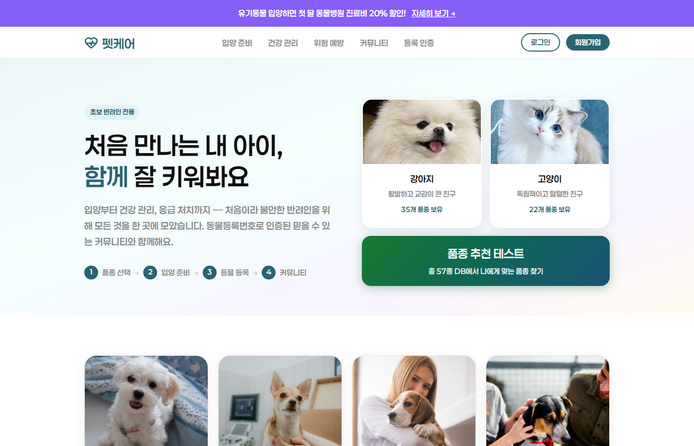
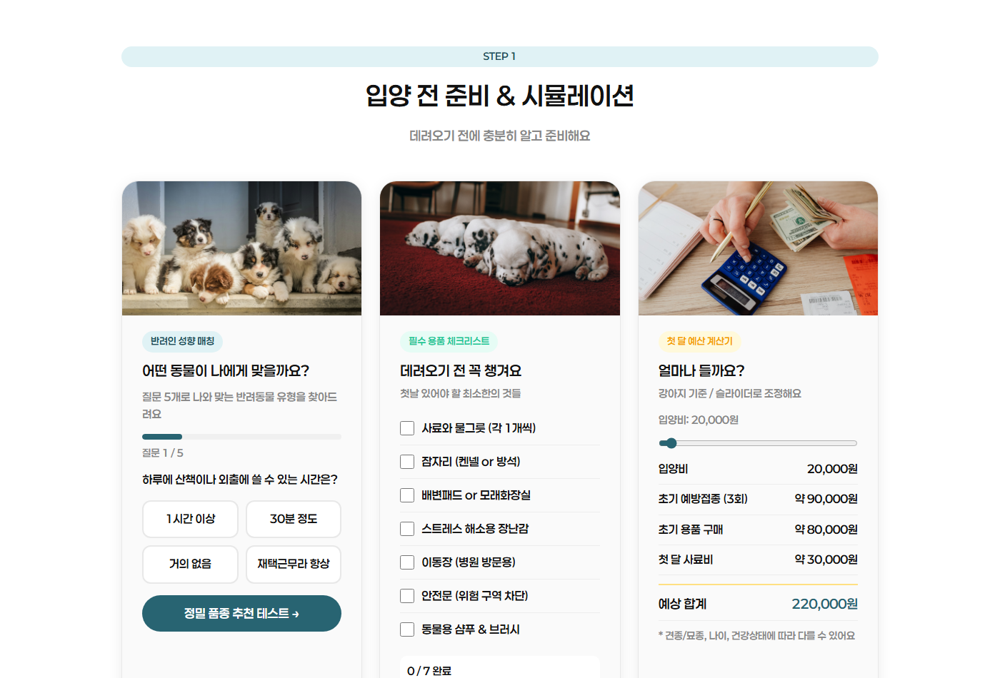
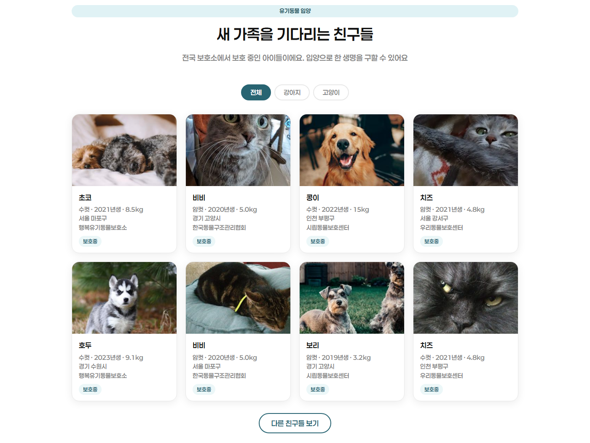
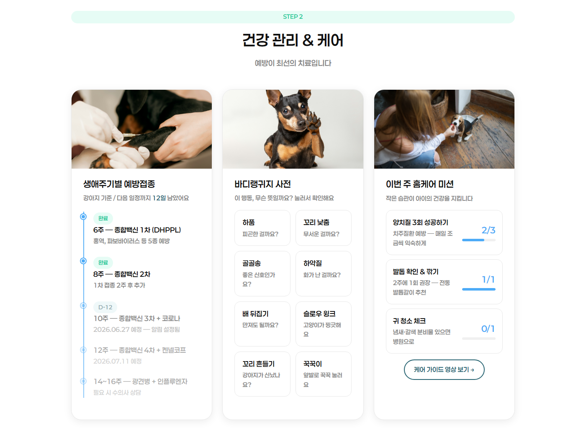
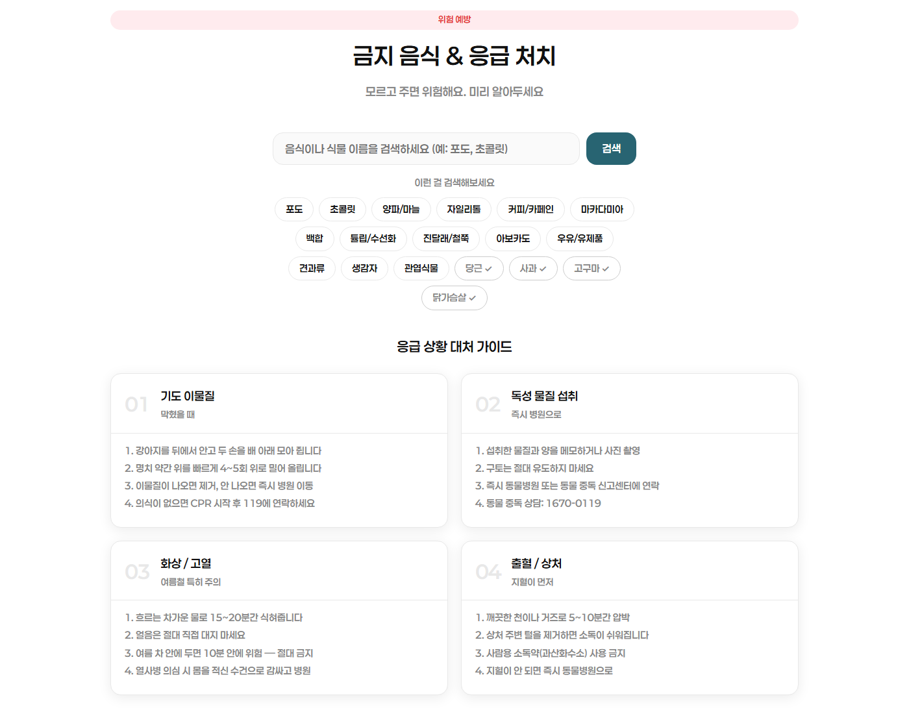
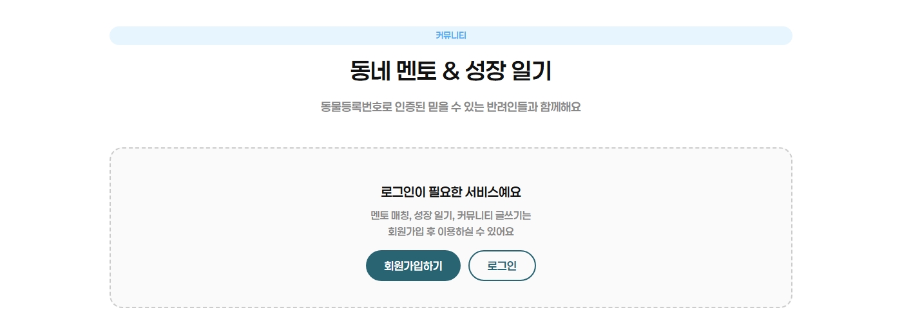
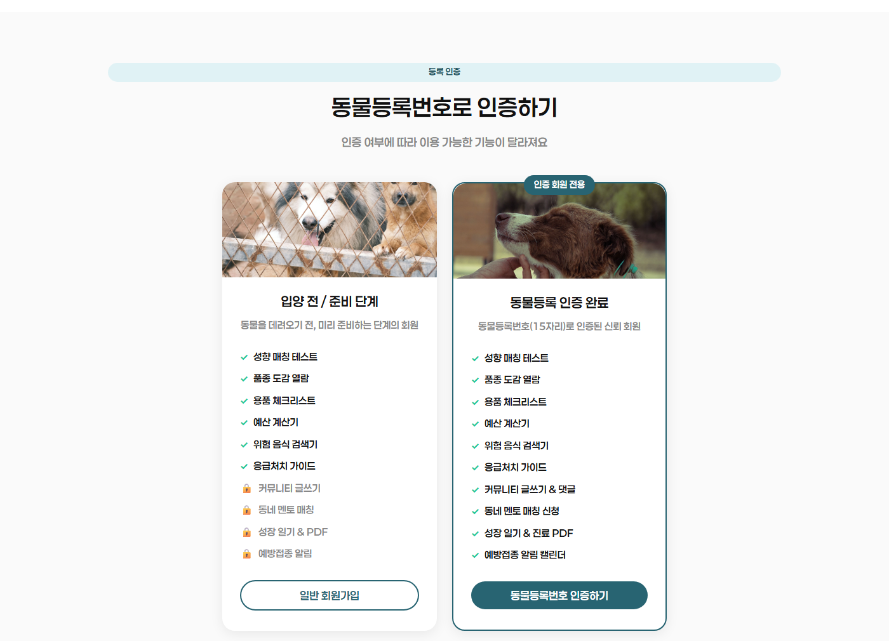
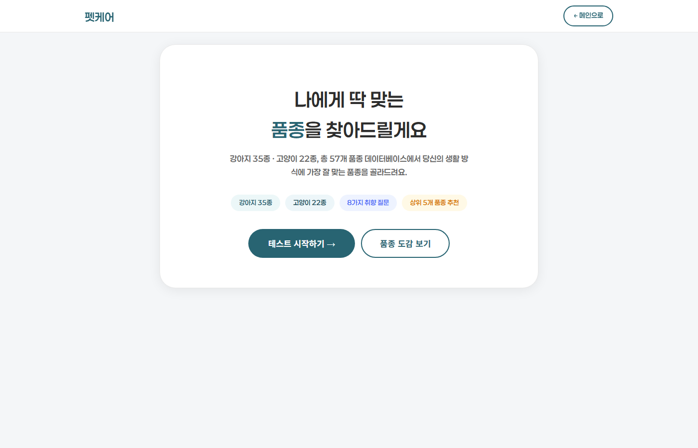

# petcare · 펫케어 반려동물 케어 웹 서비스

초보 반려인을 위한 입양 준비·건강 관리·위험 예방·커뮤니티 통합 웹. 프레임워크 없이 HTML, CSS, JavaScript와 Node 기본 모듈 서버로 구성.



화면별 구현 방식, localStorage 상태 관리, API 중계 흐름, 카카오 지도 연동, 위험 음식 검색, 품종 추천 퀴즈의 상세 설명: [저장소 첫 화면 1. 펫케어](../README.md#1-펫케어)

## 화면

로컬 서버로 실행한 섹션별 화면.

| 입양 전 준비 | 유기동물 입양 |
|---|---|
|  |  |

| 건강 관리 | 금지 음식·응급 처치 |
|---|---|
|  |  |

| 커뮤니티 로그인 전 | 등록 인증 |
|---|---|
|  |  |

| 품종 추천 퀴즈 `breed-quiz.html` |   |
|---|---|
|  |   |

## 기술 스택과 선택 이유

| 역할 | 기술 | 선택 이유 | 대안과 비교 |
|---|---|---|---|
| 화면 동작 | JavaScript ES2020 | 화면 상태가 적어 DOM을 바로 갱신하는 방식으로 충분. `breed-quiz.html`에서 쓴 선택적 연결 `?.` 기준 버전 | React는 빌드 도구가 필요 |
| 데이터 요청 | `fetch` | 브라우저 내장 기능이라 추가 설치가 없고, 요청과 응답 처리 코드가 순서대로 읽힘 | XMLHttpRequest는 콜백 구조, axios는 별도 설치 |
| 중계 서버 | Node.js 24 | 화면과 같은 JavaScript, 기본 모듈 `http`·`https`·`fs`·`path`만으로 중계 서버 구성. 개발 시점 최신 Active LTS | Express는 추가 설치, Python 서버는 언어가 둘로 나뉨 |
| API 중계 구조 | `/api/adopt` 프록시 | 공공데이터포털 인증키를 서버에만 두어 브라우저 노출 방지, 브라우저의 다른 출처 요청 제한 해결 | 브라우저에서 바로 호출하면 키가 그대로 노출 |
| 회원 상태 | localStorage | 서버 DB 없이 기기 브라우저에 저장 | 서버 DB는 별도 운영 필요 |

## 파일별 내용

| 파일 | 내용 |
|---|---|
| [index.html](index.html) | 메인 화면 전체 마크업, 입양 준비·유기동물·건강 관리·위험 예방·커뮤니티·등록 인증 섹션과 모달 |
| [style.css](style.css) | 색상 변수, 섹션·카드·모달 스타일, 768px 기준 반응형, 동작 줄이기 설정 대응 |
| [script.js](script.js) | 로그인·인증 상태, 성향 퀴즈, 체크리스트, 예산 계산, 위험 음식 검색, 유기동물 목록, 카카오 지도, 갤러리 슬라이더 |
| [server.js](server.js) | 정적 파일 제공, 공공데이터포털 유기동물 조회 API를 중계하는 `/api/adopt` |
| [breed-quiz.html](breed-quiz.html) | 품종 추천 퀴즈와 품종 도감, 마크업·스타일·스크립트를 한 파일에 포함 |
| [config.example.js](config.example.js) | 브라우저용 설정 예시, 공공데이터포털·카카오 JavaScript 키 자리 |
| [keys.example.json](keys.example.json) | 서버용 인증키 예시 |

리소스: `images/` 화면 사진·아이콘, `RiaSans-Bold.ttf` 화면 기본 글꼴.

## 실행 방법

```
cd petcare
node server.js        # http://localhost:3000
```

- `config.example.js`를 `config.js`로, `keys.example.json`을 `keys.local.json`으로 복사한 뒤 키 입력. 서버 키는 환경 변수 `PETCARE_LIST_KEY`, `PETCARE_PHOTO_KEY`로도 지정 가능
- `config.js`, `keys.local.json`은 `.gitignore` 대상이라 저장소에는 예시 파일만 포함
- 키 없이 실행하면 데모 데이터로 표시
