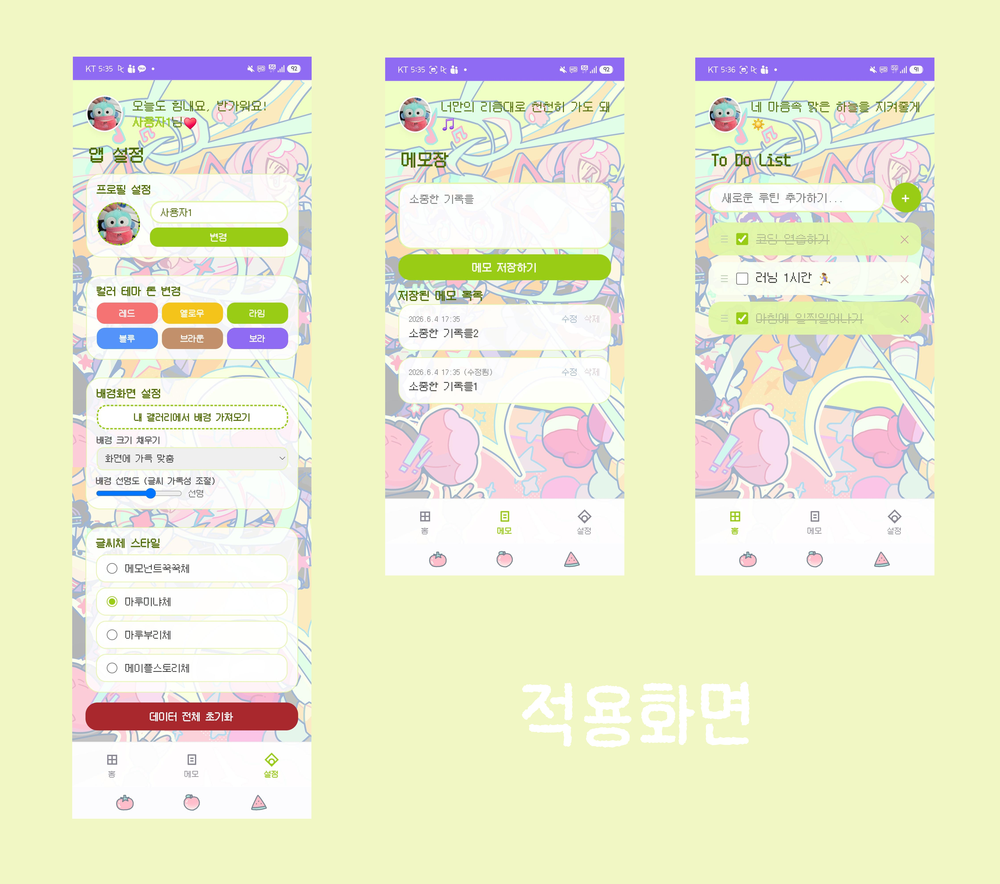
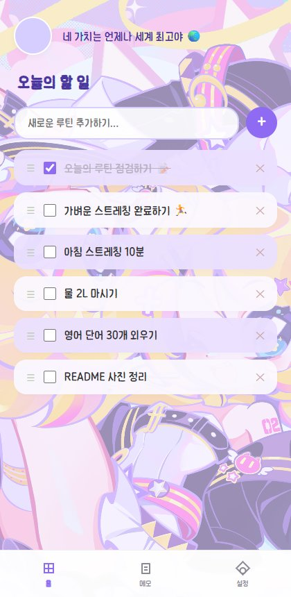
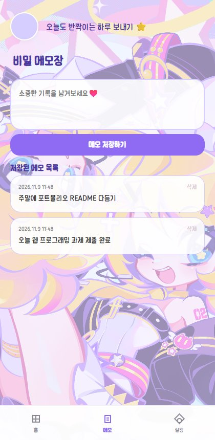
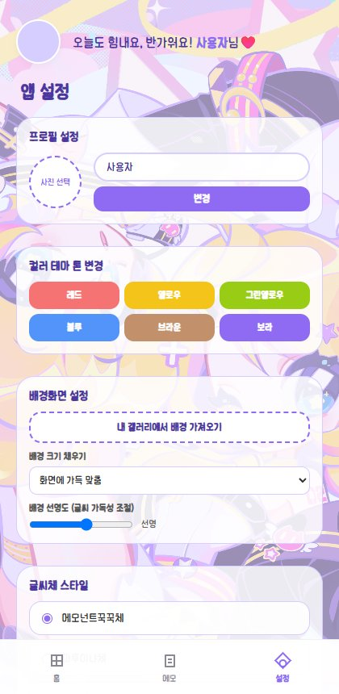
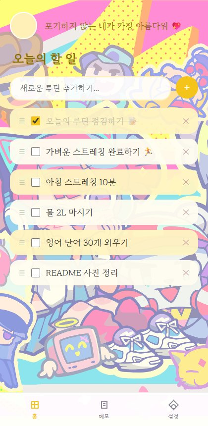

# todolist · 파스텔 루틴 투두리스트

매일 반복하는 루틴과 메모를 관리하고 프로필·테마·배경·글꼴을 꾸미는 웹 기반 투두리스트. 홈 화면에 추가하면 주소 표시줄 없는 앱 화면으로 실행.

## 주요 기능

| 화면 | 기능 |
|---|---|
| 홈 | 루틴 추가·체크·삭제. 한국 시간 자정이 지나면 완료 체크 자동 해제. PC는 끌어서, 휴대폰은 손잡이를 터치해 순서 변경. "오늘의 할 일" 제목을 눌러 원하는 문구로 수정 |
| 응원 문구 | 탭을 옮기거나 앱을 열 때마다 상단에 무작위 응원 메시지 표시 |
| 메모 | 작성 날짜·시각이 함께 기록되는 메모 작성·삭제, 최신 메모가 위에 표시 |
| 설정 | 닉네임과 갤러리 사진으로 프로필 설정. 보라·레드·옐로우·그린옐로우·블루·브라운 테마 6종. 갤러리 사진 배경 지정과 표시 방식·선명도 조절. 메모넌트꾹꾹체·마루미냐체·마루부리체·메이플스토리체 글꼴 4종. 전체 초기화 |
| 화면 이동 | 하단 내비게이션 바로 홈·메모·설정 전환. 마지막 항목이 내비게이션 바에 가려지지 않도록 아래 여백 확보 |

## 실행 화면

너비 420px 화면에서 루틴 4개를 등록하고 2개를 체크한 뒤 탭과 테마를 바꿔 가며 찍은 화면.

| 홈 · 루틴 등록과 체크 | 메모 · 작성 시각과 함께 저장 |
|---|---|
|  |  |

| 설정 · 프로필, 테마, 배경, 글꼴 | 노란 테마와 세 번째 글꼴 적용 |
|---|---|
|  |  |

## 다룬 개념

| 개념 | 뜻과 사용 방법 |
|---|---|
| localStorage | 브라우저에 문자열을 키와 값으로 저장하는 저장소. 새로 고침하거나 브라우저를 다시 열어도 유지. 배열·객체는 `JSON.stringify`로 문자열로 바꿔 저장하고 `JSON.parse`로 복원 |
| DOM 다시 그리기 | 데이터 배열을 바꾼 뒤 목록 영역을 비우고 배열 기준으로 요소를 새로 만들어 붙이는 방식. 추가·삭제·순서 변경 모두 같은 흐름 |
| 드래그 앤 드롭 | PC에서는 HTML5 `dragstart`·`dragover`·`drop` 이벤트, 휴대폰에서는 `touchstart`·`touchmove`·`touchend`와 손가락 위치의 요소를 찾는 `document.elementFromPoint()` 사용 |
| 시간대 날짜 계산 | 기기 시간대와 관계없이 한국 시간 기준 날짜를 구해 마지막 초기화 날짜와 비교 |
| `FileReader` | 사용자가 고른 이미지 파일을 Data URL 문자열로 읽는 브라우저 API. 프로필·배경 사진 저장에 사용 |
| CSS 클래스 교체 | `body` 클래스를 테마와 글꼴 조합으로 바꿔 화면 전체의 색과 글꼴을 한 번에 변경 |
| `@font-face` | 글꼴 파일을 등록해 웹 페이지에서 쓰는 CSS 규칙 |
| Web App Manifest | 앱 이름·아이콘·실행 방식을 적은 JSON 파일. `"display": "standalone"`으로 홈 화면 추가 후 주소 표시줄 없는 독립 화면 실행 |

## 파일별 내용

| 파일 | 내용 |
|---|---|
| [index.html](index.html) | 홈·메모·설정 화면 마크업과 전체 스크립트. 저장·불러오기, 루틴·메모 렌더링, 순서 변경, 매일 초기화, 테마·배경·글꼴 적용 |
| [style.css](style.css) | 테마별 색, 배경 덮개 레이어, 하단 내비게이션 바, `@font-face` 글꼴 등록 |
| [manifest.json](manifest.json) | 앱 이름, 아이콘, 독립 화면 실행 설정 |

리소스: 테마별 배경 이미지 `bg1.png`~`bg6.PNG`, 글꼴 파일 `font1.ttf`~`font4.ttf`, 앱 아이콘 `icon.png`, 화면 캡처 `todolist.png`.

## 저장 데이터

| 키 | 값 |
|---|---|
| `app_todos` | 루틴 목록, 내용과 완료 여부 |
| `app_memos` | 메모 목록, 내용과 작성 시각 |
| `app_profile` | 닉네임, 프로필 이미지 |
| `app_settings` | 테마, 사용자 배경, 배경 표시 방식, 선명도, 글꼴 |
| `app_todo_title`, `app_memo_title` | 사용자가 수정한 제목 |
| `app_last_reset_date` | 마지막 초기화 날짜 |

## 구현 방식

- 매일 초기화: 페이지를 열 때와 홈 탭에 들어올 때 한국 시간 기준 오늘 날짜와 `app_last_reset_date`를 비교, 다르면 모든 루틴의 완료 체크 해제
- 순서 변경: 놓을 위치를 계산해 배열에서 항목을 옮긴 뒤 저장하고 목록을 다시 그림
- 배경: 가득 맞춤·원래 비율·바둑판 반복 3가지 표시 방식. 선명도 슬라이더 값을 반투명 덮개 레이어의 불투명도로 적용. 사용자 배경이 있으면 테마 배경보다 우선
- 글꼴: 선택한 글꼴 클래스를 저장하고 다음 실행 때 라디오 버튼 선택 상태까지 복원
- 전체 초기화: 확인 창을 거친 뒤 `localStorage.clear()`, 기본 루틴과 기본 설정으로 다시 시작
- 서비스 워커가 없어 오프라인 캐시는 지원하지 않음

## 실행 방법

`index.html`을 브라우저로 열면 바로 실행. 휴대폰에서는 브라우저 메뉴의 홈 화면에 추가로 앱처럼 설치.
