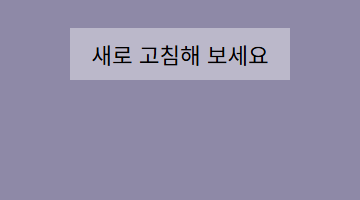
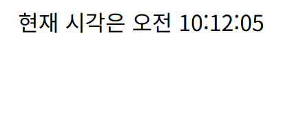
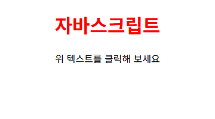

# 15 · JavaScript 작성 위치와 입출력

인라인·내부·외부 스크립트 작성 방식과 대화 상자·문서 출력, 클릭하면 색이 바뀌는 제목과 새로 고침마다 바뀌는 배경색 구현.

Do it! 교재 예제와 연습문제 기반.

## 화면

입력 창이 뜨는 예제는 예시 값을 넣어 실행한 화면.

| [internal.html](internal.html) · 새로 고침마다 바뀌는 배경색 | [js-time.html](js-time.html) · 현재 시각 출력 |
|---|---|
|  |  |

| [dwrite.html](dwrite.html) · 입력받은 이름으로 환영 문구 출력 | [script-1.html](script-1.html) · 클릭하면 빨간색으로 바뀌는 제목 |
|---|---|
|  |  |

## 다룬 개념

| 개념 | 뜻과 사용 방법 |
|---|---|
| 인라인 스크립트 | HTML 태그 속성값에 바로 적는 스크립트. 버튼의 `onclick` 속성에 알림 창 코드를 넣어 클릭 때 실행 |
| 내부 스크립트 | HTML 문서 안 `<script>` 태그에 적는 코드. 브라우저가 문서를 읽는 순서대로 실행 |
| 외부 스크립트 | 코드를 별도 `.js` 파일로 분리하고 `<script src>`로 연결하는 방식. 여러 문서가 같은 코드를 함께 사용 |
| `alert()`와 `prompt()` | 브라우저가 띄우는 대화 상자. `alert`는 알림 문구 표시, `prompt`는 글자를 입력받아 문자열로 돌려줌 |
| `document.write()` | 문서 본문에 글자나 태그를 써 넣는 출력 방법. 입력받은 이름과 현재 시각 출력에 사용 |
| 함수 선언과 호출 | 여러 줄의 코드를 이름으로 묶어 두고 이름 뒤 `()`로 실행하는 문법. `random(number)`가 정수 난수를 돌려주고 `bgChange()`가 이를 받아 배경색 결정 |
| `Math.random()`과 `Math.floor()` | 0 이상 1 미만 난수를 만드는 메서드와 소수점 아래를 버리는 메서드. RGB 색 값을 무작위로 만드는 데 사용 |
| `Date` 객체 | 날짜와 시각을 다루는 내장 객체. `new Date()`로 현재 시각을 만들고 `toLocaleTimeString()`으로 지역 형식 시각 문자열로 변환 |
| 요소 선택과 스타일 변경 | `getElementById()`, `querySelector()`로 HTML 요소를 찾아 변수에 담고 `style.color`, `style.backgroundColor` 값을 바꿔 화면 변경 |
| `onclick` 이벤트 속성 | 요소를 클릭했을 때 실행할 함수를 담는 속성. 제목 요소에 함수를 대입해 클릭 시 글자색을 빨간색으로 변경 |

## 파일별 내용

| 파일 | 내용 | 핵심 코드 |
|---|---|---|
| [inline.html](inline.html) | 버튼 태그 속성에 알림 창 코드를 넣어 클릭 시 메시지 표시 | `onclick="alert(...)"` |
| [internal.html](internal.html) | 문서 안 스크립트에서 RGB 난수로 배경색을 만들어 새로 고침마다 다른 색 적용 | `Math.random()`, `document.body.style.backgroundColor` |
| [external.html](external.html) | 외부 파일 js/external.js를 연결해 새로 고침마다 무작위 배경색 적용 | `<script src="./js/external.js">` |
| [script-1.html](script-1.html) | 파란 제목을 클릭하면 빨간색으로 바꾸는 내부 스크립트 | `getElementById("heading")`, `onclick`, `style.color` |
| [script-2.html](script-2.html) | 예제 시작 파일. script-1과 같은 제목 화면, 외부 스크립트를 연결할 자리 | `<h1 id="heading">` |
| [dwrite.html](dwrite.html) | 입력 창으로 이름을 받아 환영 문구를 문서에 출력 | `prompt()`, `document.write()` |
| [js-time.html](js-time.html) | 현재 시각을 지역 형식으로 바꿔 문서에 출력 | `new Date()`, `toLocaleTimeString()` |
| [inout.html](inout.html) | 이름 입력 창 표시, 알림 창과 확인 창 코드는 주석 처리 | `prompt()` |
| [alert.html](alert.html) | 예제 시작 파일. 알림 창 코드를 넣을 빈 스크립트 영역 | 빈 `<script>` |
| [confirm.html](confirm.html) | 예제 시작 파일. 확인 창 코드를 넣을 빈 스크립트 영역 | 빈 `<script>` |
| [prompt-1.html](prompt-1.html) | 예제 시작 파일. 기본값이 있는 입력 창 코드를 넣을 빈 스크립트 영역 | 빈 `<script>` |
| [prompt-2.html](prompt-2.html) | 예제 시작 파일. 기본값 없는 입력 창 코드를 넣을 빈 스크립트 영역 | 빈 `<script>` |
| [clog.html](clog.html) | 예제 시작 파일. 환영 제목만 있는 화면, 콘솔 출력 코드를 넣을 자리 | `<h1>` |
| [greeting.html](greeting.html) | 예제 시작 파일. 환영 제목과 이름 출력 코드를 넣을 빈 스크립트 영역 | 빈 `<script>` |

### js/

| 파일 | 내용 | 핵심 코드 |
|---|---|---|
| [external.js](js/external.js) | external.html에 연결한 무작위 배경색 코드, internal.html 스크립트와 같은 내용 | `random()`, `bgChange()` |
| [changeBg.js](js/changeBg.js) | external.js와 같은 무작위 배경색 코드 | `random()`, `bgChange()` |
| [change-color.js](js/change-color.js) | `#heading` 요소 클릭 시 글자색을 빨간색으로 바꾸는 코드 | `querySelector('#heading')`, `onclick` |
| [myscript.js](js/myscript.js) | change-color.js와 같은 글자색 변경 코드 | `querySelector('#heading')`, `onclick` |

`css/`: inline.html, internal.html, external.html 화면을 가운데 정렬하는 공통 스타일 main.css.

## 스크립트 작성 위치 비교

| 구분 | 인라인 | 내부 | 외부 |
|---|---|---|---|
| 작성 위치 | 태그 속성값 | 문서 안 `<script>` | 별도 `.js` 파일 |
| 예제 | inline.html | internal.html, script-1.html | external.html |
| 알맞은 곳 | 한 줄짜리 짧은 동작 | 한 문서에서만 쓰는 코드 | 여러 문서가 함께 쓰는 코드 |
