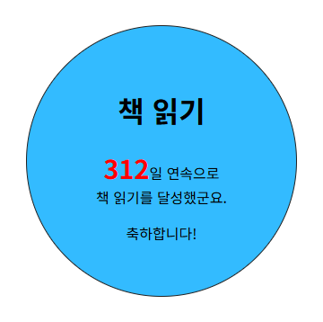
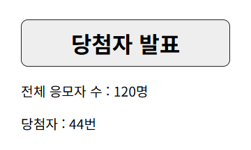
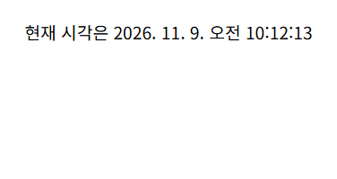
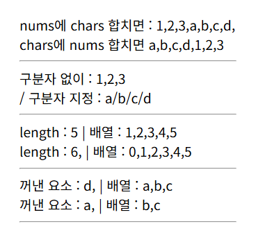
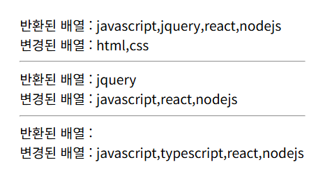
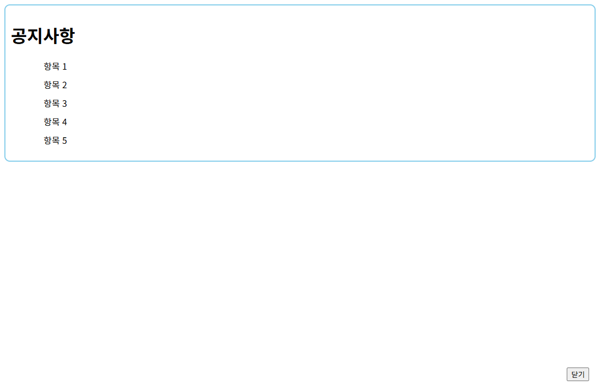

# 18/results · 예제 완성 코드

[상위 폴더 README](../README.md)에서 다룬 개념과 나머지 예제 확인.

## 화면

| [days.html](days.html) · 책 읽기 경과 일수 | [event.html](event.html) · 당첨자 추첨 |
|---|---|
|  |  |

| [time-2.html](time-2.html) · 현재 날짜와 시각 | [array-2.html](array-2.html) · 배열 메서드 결과 |
|---|---|
|  |  |

| [array-3.html](array-3.html) | [notice.html](notice.html) |
|---|---|
|  |  |

## 파일

상위 폴더 예제 시작 파일과 같은 이름으로 짝을 이루는 완성 코드.

| 파일 | 내용 | 핵심 코드 |
|---|---|---|
| [array-1.html](array-1.html) | 배열 요소를 `length`만큼 반복하며 문단으로 출력 | `numbers.length`, `numbers[i]` |
| [array-2.html](array-2.html) | 두 배열 합치기, 구분자로 잇기, 앞뒤 요소 추가와 추출 결과 출력 | `concat()`, `join('/')`, `push()`, `unshift()`, `pop()`, `shift()` |
| [array-3.html](array-3.html) | `splice` 인수 개수에 따른 요소 삭제와 삽입 결과 출력 | `splice(2)`, `splice(1, 1)`, `splice(1, 0, 'typescript')` |
| [array-4.html](array-4.html) | 시작 인덱스만 준 경우와 끝 인덱스까지 준 경우의 `slice` 결과 비교 | `slice(2)`, `slice(2, 4)` |
| [time-1.html](time-1.html) | 현재 날짜와 시각을 문서에 출력 | `new Date()` |
| [time-2.html](time-2.html) | 현재 날짜와 시각을 지역 형식으로 출력 | `toLocaleString()` |
| [days.html](days.html) | 시작 날짜부터 오늘까지 지난 일수를 계산해 원형 화면에 표시 | `getTime()`, `Math.round()`, `innerText` |
| [event.html](event.html) | 응모자 수를 입력받아 당첨자 한 명 추첨 | `Math.random()`, `Math.floor()` |
| [notice.html](notice.html) | 닫기 버튼으로 팝업 창 닫기 | `window.close()` |
| [notice_open.html](notice_open.html) | 버튼으로 공지사항 팝업 창 열기 | `window.open('notice.html', '', 'width=500, height=400')` |
| [popup.html](popup.html) | 문서를 열면 notice.html을 팝업 창으로 표시 | `window.open()` |
| [position.html](position.html) | 팝업 창 이름과 왼쪽·위쪽 위치 지정 | `left=100, top=200` |
| [popup-check.html](popup-check.html) | 문서를 열 때 팝업을 띄우고 차단되면 안내 알림 | `onload`, `newWin == null` |
| [center.html](center.html) | 화면 크기에서 창 크기를 빼 가운데 좌표를 구하는 함수로 팝업 표시 | `openCenter()`, `screen.availWidth` |
| [screen.html](screen.html) | 화면 전체 크기와 사용 가능 크기 출력 | `screen.width`, `screen.availHeight` |
| [location.html](location.html) | 현재 주소·호스트·포트 출력, 버튼으로 출판사 홈페이지 이동 | `location.href`, `location.replace()` |
