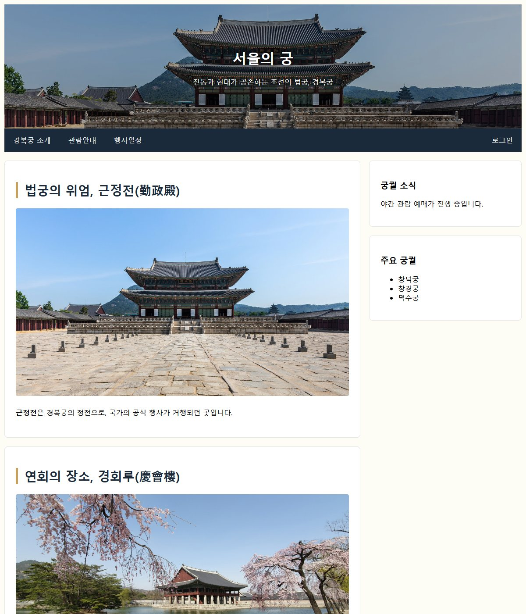
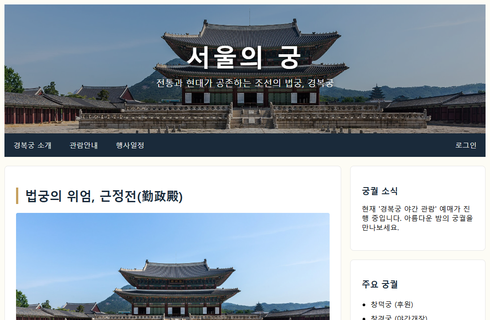

# Practice/labs · 경복궁 소개 페이지 float·Flexbox 버전

[상위 폴더 README](../README.md)에서 다룬 개념과 나머지 예제 확인.

## 화면

| [palaces_v2.html](palaces_v2.html) · Flexbox로 다시 배치한 경복궁 소개 | [palaces.html](palaces.html) |
|---|---|
|  |  |

## 파일

chap10 경복궁 소개 페이지를 float와 Flexbox로 각각 다시 배치한 응용 화면.

| 파일 | 내용 | 핵심 코드 |
|---|---|---|
| [palaces.html](palaces.html) | 경복궁 소개 페이지 float 버전. 어둡게 덮은 근정전 사진 머리글, 위에 붙는 메뉴, 사진 카드 본문과 사이드 칸. chap10 `palaces_responsive.html`에서 미디어 쿼리를 뺀 형태 | `float: left`, `width: 70%`, `.row:after { clear: both; }`, `position: sticky` |
| [palaces_v2.html](palaces_v2.html) | 같은 경복궁 소개 페이지를 Flexbox로 다시 배치. 로그인 메뉴만 오른쪽 끝, 좁은 화면에서 두 칸을 위아래로 배치 | `display: flex`, `margin-left: auto`, `flex: 7`, `flex: 3`, `@media screen and (max-width: 800px)` |
