# web/Class · 회차별 HTML·CSS·JavaScript 예제

Do it! 교재 예제와 연습문제를 회차 폴더별로 정리한 모음. 폴더마다 대표 화면 사진, 다룬 개념, 파일별 내용, 핵심 코드를 README로 정리. 폴더 이름을 누르면 해당 README로 이동.

펫케어·투두리스트 같은 응용 프로젝트와 전체 학습 범위는 [저장소 첫 화면 README](../../README.md) 참고.

## HTML

| 폴더 | 주제 | 만든 화면 | 대표 화면 |
|---|---|---|---|
| [web_practice](../../web_practice) | HTML 문서 구조와 태그 | 레드향 소개, 교내 방송국 모집 안내와 지원 양식, 자기소개 페이지, BLT 샌드위치 소개 페이지 | 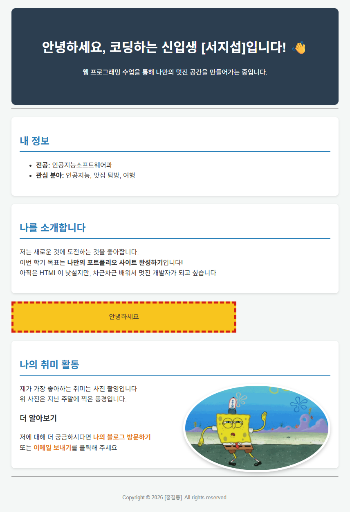 |
| [chap04](chap04) | 텍스트·목록·표·이미지·링크·멀티미디어 태그 | 레드향 상품 소개 페이지, 탐라국 입춘굿 포스터 | 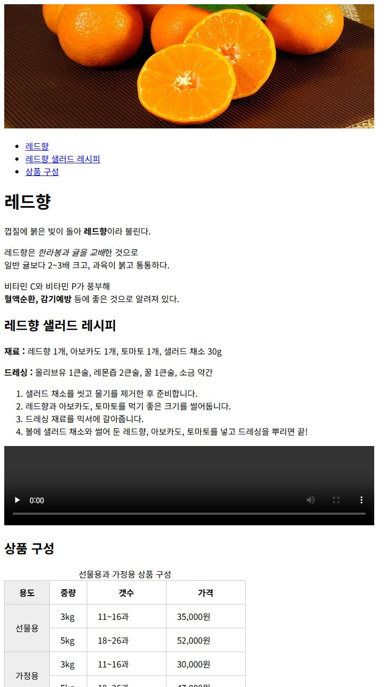 |
| [chap05](chap05) | 웹 폼 | 레드향 주문서, 로그인, 회원가입, 봉사동아리 가입 신청서 | 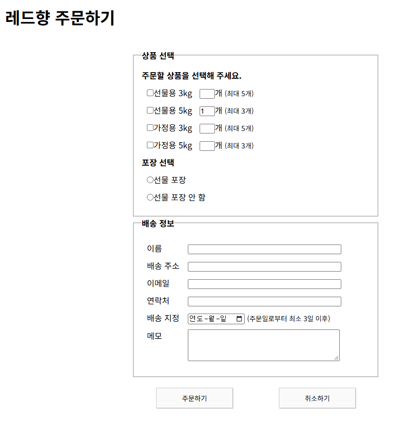 |

## CSS

| 폴더 | 주제 | 만든 화면 | 대표 화면 |
|---|---|---|---|
| [chap06](chap06) | CSS 적용 방식과 선택자 | 인라인·내부·외부 스타일 적용, 선택자 우선순위 비교 화면 | 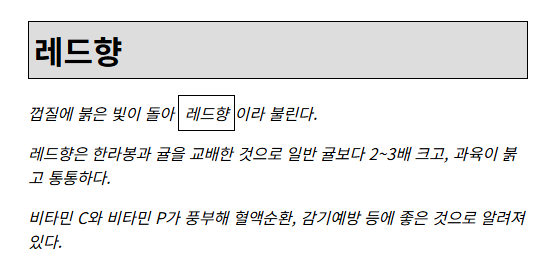 |
| [chap07](chap07) | 텍스트·목록·표 스타일 | 글꼴·줄 높이·그림자를 적용한 레드향 소개, 웹 폰트·아이콘 폰트 주문 안내문 | 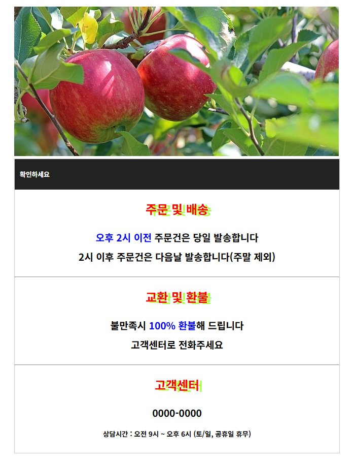 |
| [chap08](chap08) | 박스 모델과 배치 | display·float·position으로 만든 메뉴, 2단·3단 레이아웃, 여행 카드 | 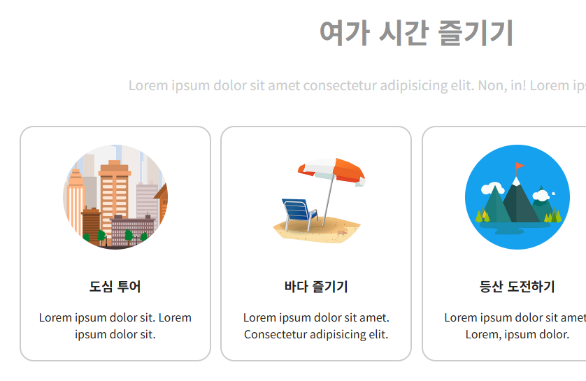 |
| [chap09](chap09) | CSS 배경과 그러데이션 | 배경 이미지 반복·위치·크기 지정, 원형 그러데이션 비교, 고정 배경 제목 화면 |  |
| [chap10](chap10) | 반응형 웹 디자인 | 화면 크기 단위와 미디어 쿼리를 적용한 경복궁 소개, 탐라국 입춘굿 소개 페이지 | 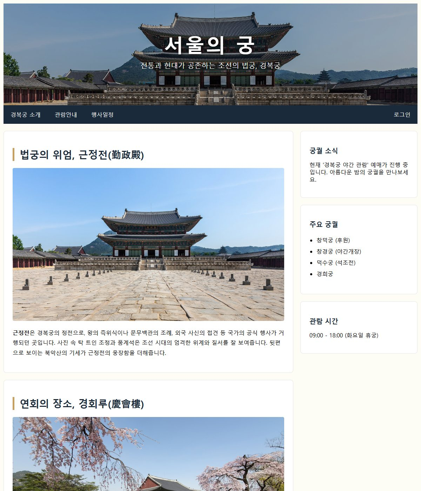 |
| [chap11](chap11) | Flexbox 레이아웃 | 화면 가운데 배치, 팀 소개 카드, 검색 막대, 반응형 사진 목록 | 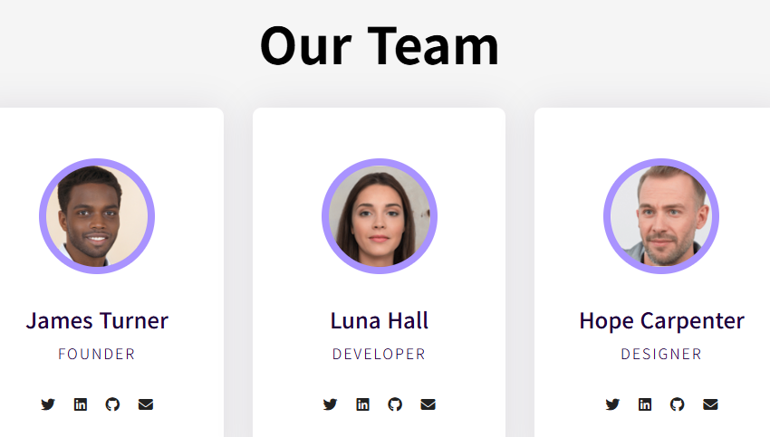 |
| [chap12](chap12) | CSS Grid 레이아웃 | 선 번호·영역 이름 배치, 사진 갤러리 |  |
| [chap13](chap13) | CSS 선택자 활용 | 자식·형제·속성·가상 클래스 선택자로 꾸민 메뉴·표·회원 가입 폼, 벚꽃축제 소개 페이지 | 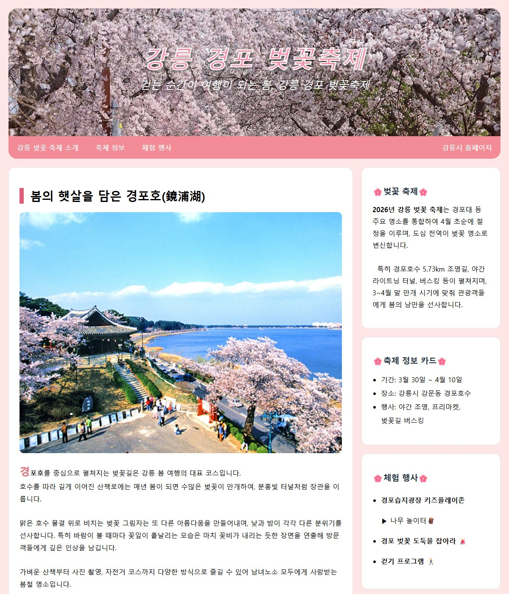 |
| [Practice](Practice) | Flexbox·float 화면 구성 | 메뉴 막대와 본문·사이드바 분할, 프로필 카드, 같은 페이지의 float·Flexbox 두 방식 구성 | 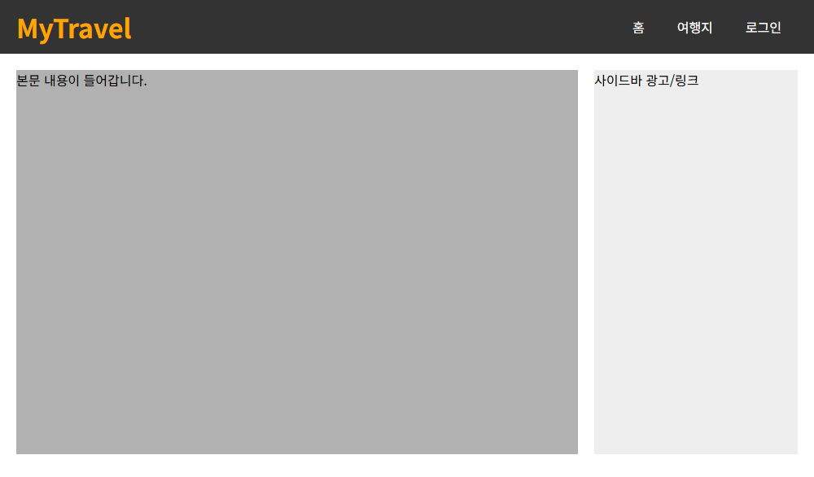 |

## JavaScript

| 폴더 | 주제 | 만든 화면 | 대표 화면 |
|---|---|---|---|
| [15](15) | JavaScript 작성 위치와 입출력 | 대화 상자·문서 출력, 클릭하면 색이 바뀌는 제목, 새로 고침마다 바뀌는 배경색 | 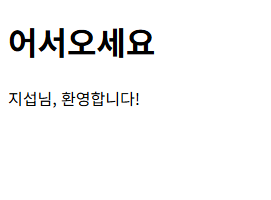 |
| [16](16) | 변수·자료형·조건문·반복문 | 배수 판별, 계절 판별, 구구단, 자리 배치도, 메뉴 선택 | 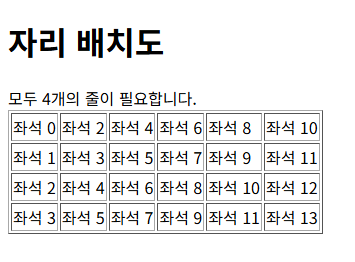 |
| [chap17](chap17) | 함수와 이벤트 | 클릭 이벤트로 배경색·글자색 변경, 음료 자판기 메뉴 | 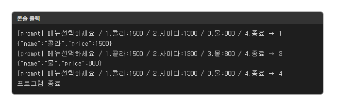 |
| [18](18) | 배열과 내장 객체·브라우저 객체 | 경과 일수 계산, 당첨자 추첨, 실시간 시계, 팝업 창 크기·위치 지정 | 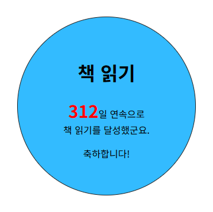 |
| [chap19](chap19) | DOM 조작과 이벤트 처리 | 공부 주제 목록 추가·삭제, 라이트박스, 레이어 팝업, 다크 모드 전환 | 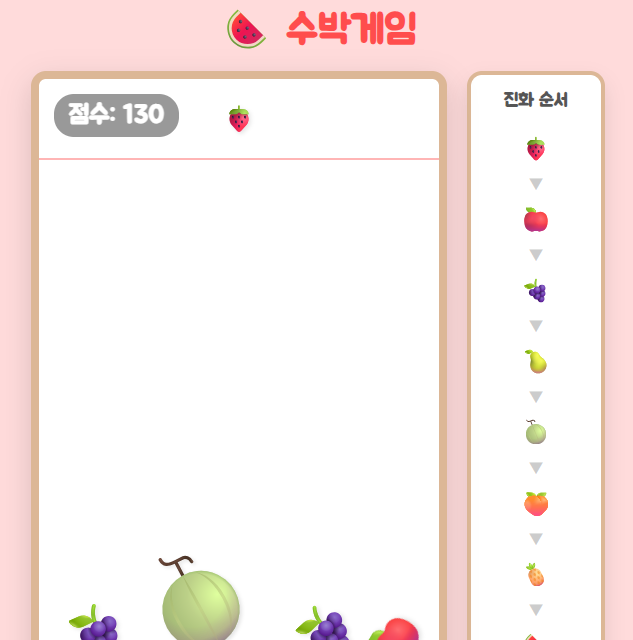 |
| [20](20) | localStorage와 배열 메서드 | `find`·`filter`·`map` 조회 화면, 이름 저장, 테마 기억, 할 일 관리 | 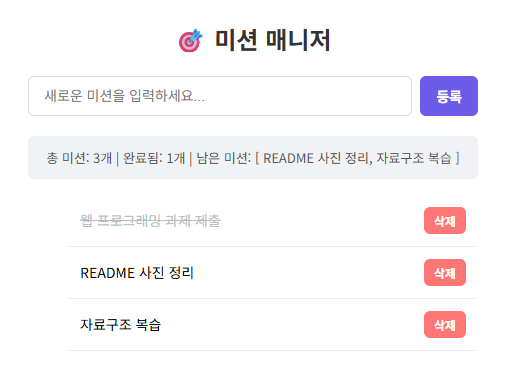 |
