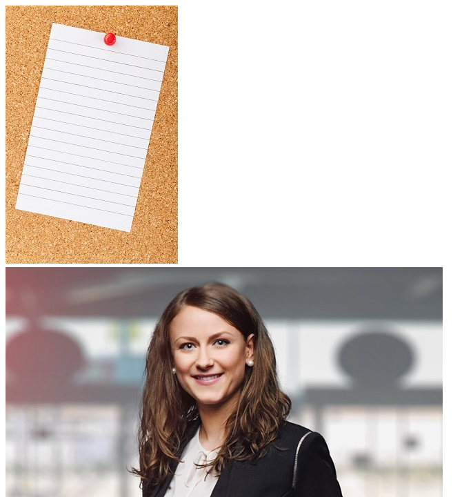

# chap05/css · 폼 예제 스타일 시트와 경로 연습

[상위 폴더 README](../README.md)에서 다룬 개념과 나머지 예제 확인.

## 화면

## 파일

| 파일 | 내용 | 핵심 코드 |
|---|---|---|
| [PathTest.html](PathTest.html) | 상대 경로와 외부 주소로 이미지 표시, 외부 사이트를 새 탭으로 여는 링크 | `src="../images/notice.jpg"`, `target="_blank"` |
| [order.css](order.css) | order.html, placeholder.html 주문서 스타일. 배송 정보 라벨을 왼쪽에 띄우고 버튼을 가로로 배치 | `float:left`, `display:flex` |
| [order2.css](order2.css) | order.css와 같은 주문서 스타일에서 버튼을 `<button>` 기준으로 지정하고 첫 버튼 강조. 이 폴더 HTML에서는 연결하지 않음 | `form > div > button:first-of-type` |
| [form2.css](form2.css) | required.html 배송 정보 폼 스타일. 라벨 너비, 입력창 너비, 버튼 그림자 | `#shipping li label`, `box-shadow` |
| [register.css](register.css) | register-2.html 회원가입 폼 스타일. 라벨 너비, 입력창 크기, 드롭다운 크기, 버튼 마우스 오버 색 | `li label`, `#buttons input:hover` |
| [notice.css](notice.css) | notice.html 공지사항 스타일. 화면 가운데 정렬과 배경 이미지 | `display:flex`, `background:url('../images/notice.jpg')` |

`images/`: 로그인 그림 버튼, 공지사항 배경, 경로 확인용 사진.
