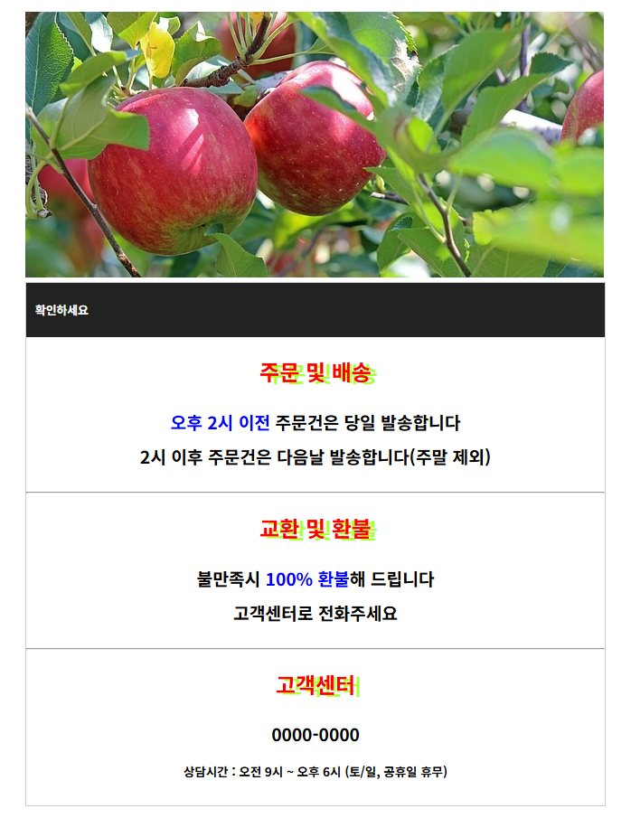
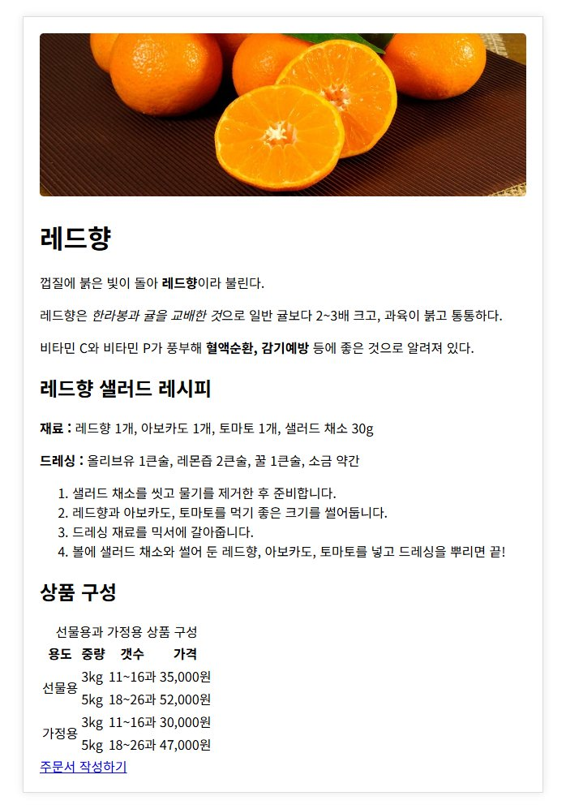
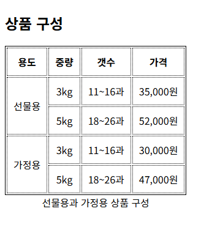
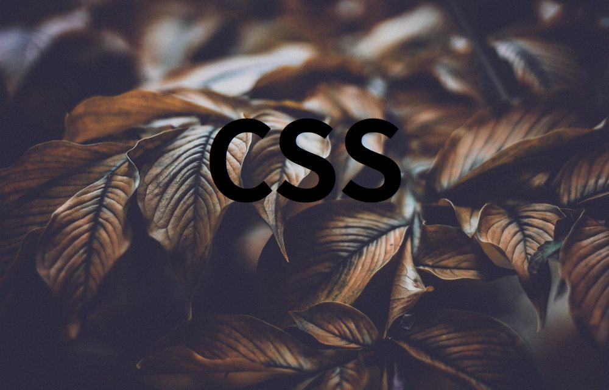

# chap07 · 텍스트·목록·표 스타일

레드향 소개와 꿀사과 주문 안내문에 글꼴, 글자색, 줄 높이, 정렬, 그림자를 적용하고 목록·표 스타일과 웹 폰트·아이콘 폰트로 화면 구성.

Do it! 교재 예제와 연습문제 기반.

## 화면

| [lab.html](lab.html) · 주문·배송 안내문 | [lab2.html](lab2.html) · 그림자 상자 안 레드향 소개 |
|---|---|
|  |  |

| [table-2.html](table-2.html) · 테두리를 지정한 상품 구성 표 | [color.html](color.html) · 배경 사진 위 CSS 제목 |
|---|---|
|  |  |

## 다룬 개념

| 개념 | 뜻과 사용 방법 |
|---|---|
| `font-size` | 글자 크기. `px`는 고정 크기, `em`은 부모 글자 크기의 배수. 제목 `3em`, 문단 `24px`, 강조 단어 `1.5em`으로 지정 |
| `font-weight`·`font-style` | 글자 굵기와 기울임. `900`, `bold`로 굵기, `italic`으로 기울임 지정 |
| `font-family` | 글꼴 지정. 쉼표로 여러 글꼴을 나열하면 앞 글꼴이 없을 때 다음 글꼴로 표시 |
| 웹 폰트 | 사용자 컴퓨터에 없는 글꼴을 인터넷에서 받아 표시하는 방식. Google Fonts `<link>`로 Rubik 글꼴을 불러와 제목에 적용 |
| 아이콘 폰트 | 아이콘을 글자처럼 쓰는 글꼴. Font Awesome CDN을 연결하고 `<i class="fa-solid fa-house">`로 메뉴 앞에 아이콘 표시 |
| `color` | 글자색. `magenta` 같은 색 이름, `#ff0000` 같은 16진수, `rgb()` 값으로 지정 |
| `text-decoration` | 밑줄, 윗줄, 취소선 같은 선 장식. `none`으로 링크 밑줄 제거 |
| `text-transform` | 영문 대소문자 변환. `capitalize`는 첫 글자 대문자, `uppercase`는 전체 대문자, `lowercase`는 전체 소문자 |
| `text-shadow` | 글자 그림자. 가로 거리, 세로 거리, 번짐 정도, 색 순서로 지정 |
| `letter-spacing`·`word-spacing` | 글자 사이 간격과 단어 사이 간격 |
| `text-align` | 줄 안에서 글자의 가로 정렬. `right` 오른쪽, `center` 가운데, `justify` 양쪽 맞춤 |
| `line-height` | 줄 높이. 영역 높이와 같은 값을 주면 한 줄 글자가 세로 가운데에 위치 |
| 목록 스타일 | `list-style-type`으로 불릿·번호 모양, `list-style-image`로 불릿 그림, `list-style-position: inside`로 번호를 목록 안쪽에 배치 |
| 표 스타일 | `border`로 표와 셀 테두리, `border-collapse: collapse`로 겹친 테두리를 한 줄로, `caption-side: bottom`으로 캡션을 표 아래에 배치 |
| 배경 이미지 | `background: url() no-repeat fixed`와 `background-size: cover`로 화면 전체를 채운 배경 사진 |

## 파일별 내용

### 글꼴

| 파일 | 내용 | 핵심 코드 |
|---|---|---|
| [font.html](font.html) | 글자 크기 예제 시작 파일. 스타일 없는 레드향 소개 | |
| [tstyle.html](tstyle.html) | 제목은 `em`, 문단은 `px`로 크기를 주고 강조 단어 굵기, 마지막 문단 기울임 지정 | `font-size: 3em`, `font-weight: 900`, `font-style: italic` |
| [webfont.html](webfont.html) | Google Fonts의 Rubik 글꼴을 배경 사진 위 큰 제목에 적용 | `fonts.googleapis.com`, `font-family: "Rubik", sans-serif` |
| [icon.html](icon.html) | Font Awesome CDN을 연결하고 가로 메뉴 첫 항목에 집 아이콘 표시 | `<i class="fa-solid fa-house">`, `display: flex` |
| [list-navi.html](list-navi.html) | 테두리 상자 모양의 세로 메뉴, 항목마다 Font Awesome 아이콘 표시 | `<nav>`, `fa-solid fa-icons`, `padding: 20px 40px` |

### 색과 텍스트 효과

| 파일 | 내용 | 핵심 코드 |
|---|---|---|
| [color.html](color.html) | 글자색 예제 시작 파일. 배경 사진 위에 큰 CSS 제목 | `background-size:cover` |
| [rgba.html](rgba.html) | 배경 사진 위 일본어 문구 세 줄에 색 이름으로 글자색 지정 | `color: magenta`, `color: greenyellow` |
| [text-decoration.html](text-decoration.html) | 장식 없음, 밑줄, 윗줄, 취소선 비교와 밑줄 없는 링크 | `text-decoration: line-through`, `text-decoration: none` |
| [text-transform.html](text-transform.html) | 영문 단어를 첫 글자 대문자, 전체 대문자, 전체 소문자로 변환 | `text-transform: capitalize`, `uppercase`, `lowercase` |
| [text-shadow.html](text-shadow.html) | 그림자 거리, 번짐, 색을 다르게 준 제목 세 줄 | `text-shadow: 5px 5px 3px #ffa500`, `text-shadow: 7px -7px 15px #000` |
| [spacing.html](spacing.html) | 문장의 단어 간격과 글자 간격, 클래스별 글자 간격 비교 | `word-spacing`, `letter-spacing: 0.5em` |
| [line-1.html](line-1.html) | 같은 문단을 기본, 글자 크기의 0.7배, 2.5배 줄 높이로 비교 | `line-height: 0.7em`, `line-height: 2.5em` |
| [line-2.html](line-2.html) | 검은 띠 제목을 줄 높이로 세로 가운데 정렬 | `height: 100px`, `line-height: 100px` |
| [text-align.html](text-align.html) | 문단마다 오른쪽 정렬, 가운데 정렬, 양쪽 맞춤 클래스 지정 | `text-align: right`, `text-align: justify` |

### 목록

| 파일 | 내용 | 핵심 코드 |
|---|---|---|
| [list-1.html](list-1.html) | 순서 없는 목록에 점 그림 불릿, 순서 목록에 로마 숫자 번호를 안쪽 배치 | `list-style-image: url("./images/dot.png")`, `list-style-type: upper-roman`, `list-style-position: inside` |
| [list-2.html](list-2.html) | 불릿 이미지 예제 시작 파일. 도서 시리즈 목록 | |
| [list-3.html](list-3.html) | 목록 들여쓰기 예제 시작 파일. 같은 도서 시리즈 목록 두 개 | |

### 표

| 파일 | 내용 | 핵심 코드 |
|---|---|---|
| [table-1.html](table-1.html) | 표 바깥은 굵은 연두색 테두리, 셀은 점선, 테두리를 한 줄로 합치고 캡션을 표 아래에 배치 | `border-collapse: collapse`, `caption-side:bottom`, `border : 1px dotted black` |
| [table-2.html](table-2.html) | 표 실선 테두리와 셀 점선 테두리가 따로 그려진 상품 구성 표. 테두리 한 줄 합치기 예제 시작 파일 | `caption-side: bottom`, `border:1px dotted black` |
| [css/basic.css](css/basic.css) | 600px 가운데 컨테이너와 표 테두리 스타일. 이 폴더 HTML에서는 연결하지 않음 | `border-collapse: collapse` |

### 연습문제와 응용

| 파일 | 내용 | 핵심 코드 |
|---|---|---|
| [quiz-1.html](quiz-1.html) | 연습문제 1 시작 파일. 통계청 가구 수 표와 빈 `<style>` | `<caption>`, `<thead>` |
| [sol-1.html](sol-1.html) | 연습문제 1 풀이. 캡션을 표 아래 오른쪽에 두고 숫자를 오른쪽 정렬, 마지막 연도 열에 배경색 | `caption-side: bottom`, `<col class="col-2022">`, `td { text-align: right; }` |
| [quiz-2.html](quiz-2.html) | 연습문제 2 시작 파일. 가정용 꿀사과 주문·배송 안내문, 검은 띠 제목 스타일까지 지정 | `#check`, `h1 { background: #222; }` |
| [sol-2.html](sol-2.html) | 연습문제 2 풀이. 소제목 빨간 가운데 정렬, 강조 문구 파란색, 상담 시간 작은 글씨 | `.accent { color: #0000ff; }`, `.smalltext`, `line-height: 2em` |
| [lab.html](lab.html) | sol-2.html 안내문에 제목 띠 세로 가운데 정렬과 소제목 그림자를 더한 화면 | `line-height: 40px`, `text-shadow: 7px 2px greenyellow` |
| [lab2.html](lab2.html) | 외부 스타일 시트로 레드향 소개 페이지를 그림자 있는 가운데 상자 안에 배치 | `<link href="./css/style2.css">`, `rowspan='2'` |
| [css/style2.css](css/style2.css) | lab2.html 상자 스타일. 가운데 상자, 은은한 그림자, 사진 모서리 둥글게 처리 | `box-shadow: 0 0 10px rgba(0,0,0,0.1)`, `border-radius: 5px` |

### 자바스크립트

| 파일 | 내용 | 핵심 코드 |
|---|---|---|
| [test.html](test.html) | 이름을 입력받아 콘솔에 환영 문구 출력, 취소하면 안내 문구 출력 | `prompt()`, `typeof`, `console.log()` |
| [test2.html](test2.html) | 나눗셈과 나머지 연산 결과를 콘솔에 출력 | `a / b`, `a % b` |

`images/`: 배경 사진, 불릿용 점 그림, 레드향·꿀사과 안내문 사진.
