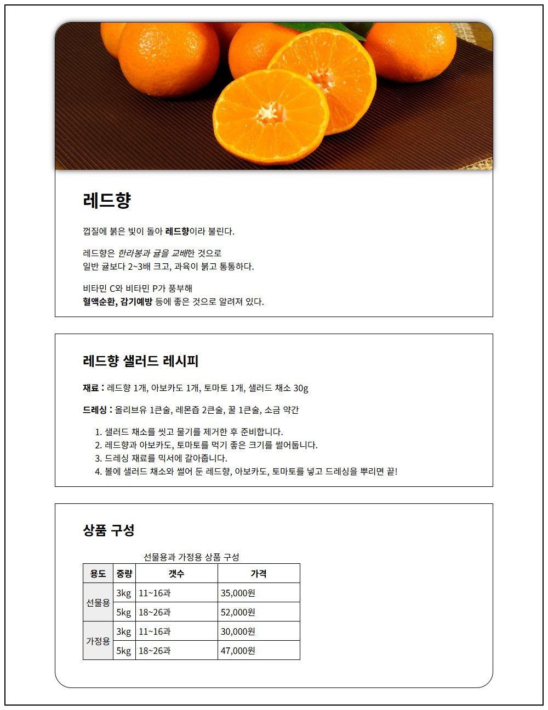

# chap08/lab · 박스 모델로 꾸민 레드향 소개

[상위 폴더 README](../README.md)에서 다룬 개념과 나머지 예제 확인.

## 화면

## 파일

chap04 레드향 소개 페이지에 박스 모델 스타일을 입힌 응용 화면.

| 파일 | 내용 | 핵심 코드 |
|---|---|---|
| [lab.html](lab.html) | 소개, 레시피, 상품 구성을 800px 박스 세 개로 나누고 맨 위 사진과 박스 위쪽 모서리, 맨 아래 박스 아래쪽 모서리를 둥글게 처리 | `border-top-left-radius: 30px`, `box-shadow: 0px 0px 10px #222`, `margin: 30px auto` |
| [css/poster.css](css/poster.css) | 800px 가운데 컨테이너와 표 테두리 스타일. lab.html에서는 연결하지 않음 | `border-collapse: collapse` |

`images/`: lab.html 맨 위 레드향 사진. `top.jpg`: lab.html에서 쓰지 않는 상단 사진.
