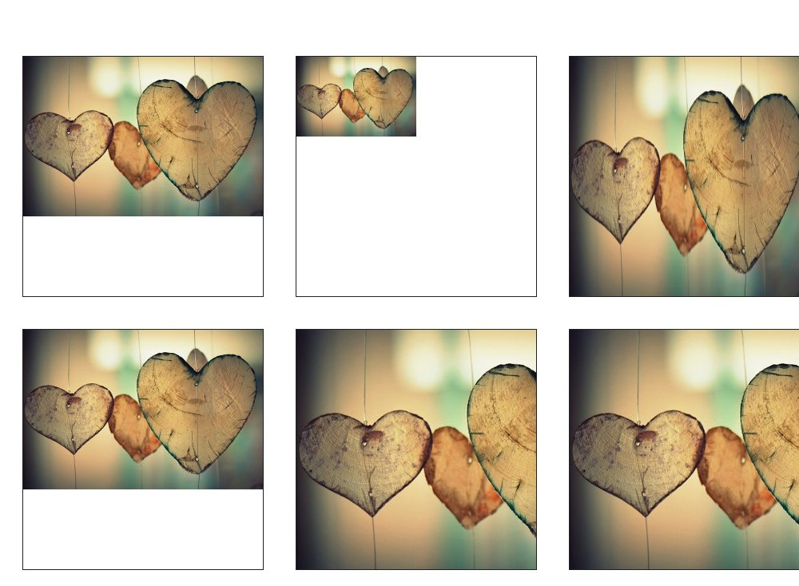
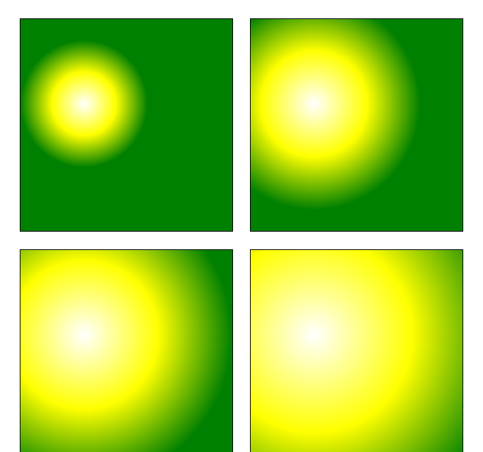
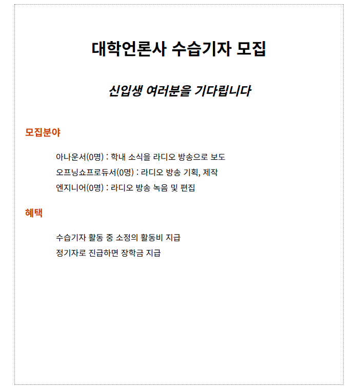
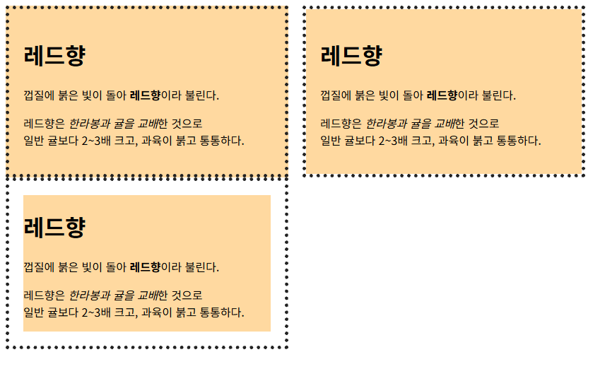

# chap09 · CSS 배경과 그러데이션

배경 이미지의 반복·위치·크기·적용 범위 지정, 원형 그러데이션 크기 비교, 고정 배경 사진 위 제목 화면 구성.

Do it! 교재 예제와 연습문제 기반.

## 화면

| [background.html](background.html) · 고정 배경 위 제목 화면 | [bg-4.html](bg-4.html) · 배경 크기 값 비교 |
|---|---|
|  |  |

| [radial-2.html](radial-2.html) · 원형 그러데이션 크기 비교 | [quiz-2.html](quiz-2.html) · 대학언론사 수습기자 모집 안내 |
|---|---|
|  |  |

| [bg-clip.html](bg-clip.html) · 배경색 칠 범위 비교 |   |
|---|---|
|  |   |

## 다룬 개념

| 개념 | 뜻과 사용 방법 |
|---|---|
| `background-image` | 요소 뒤에 까는 배경 그림. `url()`에 이미지 경로를 넣어 문서 전체나 상자에 지정 |
| `background-repeat` | 배경 이미지가 요소보다 작을 때 반복하는 방식. `no-repeat` 한 번만, `repeat-x` 가로 반복, `repeat-y` 세로 반복 |
| `background-position` | 배경 이미지가 놓이는 자리. `right top` 같은 방향 키워드, `20px 60px` 같은 거리, `50% 50%` 같은 비율로 지정 |
| `background-size` | 배경 이미지 크기. `300px`·`50%` 같은 값, `contain`은 이미지 전체가 보이게 맞춤, `cover`는 요소를 빈틈없이 채우고 넘치는 부분은 잘림 |
| `background-attachment` | 스크롤할 때 배경 이미지의 움직임. `fixed`는 내용만 스크롤되고 배경은 화면에 고정 |
| `background-origin` | 배경 이미지 위치를 잡는 기준 상자. `border-box`는 테두리, `padding-box`는 패딩, `content-box`는 내용 영역 기준 |
| `background-clip` | 배경색이 칠해지는 범위. `border-box`는 테두리 아래까지, `padding-box`는 패딩까지, `content-box`는 내용 영역만 |
| `background` 단축 속성 | 이미지·반복·위치를 한 줄에 함께 지정. `background: url("images/bg4.jpg") no-repeat left top` |
| `radial-gradient()` | 중심에서 바깥으로 색이 번지는 원형 그러데이션. `circle`로 모양, `at 30% 40%`로 중심, `closest-side`·`farthest-corner` 같은 키워드로 색이 끝나는 크기 지정 |

## 파일별 내용

| 파일 | 내용 | 핵심 코드 |
|---|---|---|
| [background.html](background.html) | 화면을 덮는 고정 배경 사진 위에 연두색 그림자를 넣은 흰 제목 배치 | `background-size: cover`, `background-attachment: fixed`, `text-shadow` |
| [background-image.html](background-image.html) | 테두리 상자에 패턴 이미지 한 장을 반복 없이 가운데 배치, 반복·위치 값별 쓰임은 주석으로 정리 | `background-repeat: no-repeat`, `background-position: 50% 50%` |
| [bg-1.html](bg-1.html) | 예제 시작 파일. `images/bg1.jpg`를 문서 배경으로 넣을 빈 화면 | 빈 `<style>`, `
` |
| [bg-2.html](bg-2.html) | 예제 시작 파일. 메뉴 목록의 불릿을 없애고 왼쪽 패딩과 줄 간격을 지정한 상태, 불릿 자리에 배경 이미지를 넣을 화면 | `list-style: none`, `padding-left: 50px`, `line-height: 40px` |
| [bg-3.html](bg-3.html) | 문서 오른쪽 위에 배경 그림을 고정하고, 같은 글 상자 세 개에 배경 이미지 기준 상자를 다르게 지정해 비교 | `background-position: right top`, `background-origin` |
| [bg-4.html](bg-4.html) | 같은 사진을 넣은 상자마다 배경 크기 값만 바꿔 비교 | `background-size: 300px`, `50%`, `100% 100%`, `contain`, `cover` |
| [bg-clip.html](bg-clip.html) | 점선 테두리를 두른 레드향 소개 상자 세 개에 배경색 칠 범위를 다르게 지정 | `background-clip: border-box`, `padding-box`, `content-box` |
| [linear-1.html](linear-1.html) | 예제 시작 파일. 왼쪽 위에서 오른쪽 아래로 파랑에서 흰색으로 바뀌는 선형 그러데이션을 넣을 둥근 모서리 상자 | `.grad`, `border-radius: 10px` |
| [linear-2.html](linear-2.html) | 예제 시작 파일. 45도 방향으로 빨강에서 흰색으로 바뀌는 선형 그러데이션을 넣을 상자 | `.grad` |
| [linear-3.html](linear-3.html) | 예제 시작 파일. 위에서 아래로 파랑, 30% 지점 흰색, 끝 파랑으로 바뀌는 선형 그러데이션을 넣을 상자 | `.grad` |
| [radial-1.html](radial-1.html) | 예제 시작 파일. 흰색·노랑·빨강으로 바뀌는 타원형과 원형 그러데이션을 넣을 상자 두 개 | `.grad1`, `.grad2` |
| [radial-2.html](radial-2.html) | 중심을 같은 위치에 두고 원형 그러데이션 크기 키워드 네 가지를 나란히 비교 | `radial-gradient(circle closest-side at 30% 40%, white, yellow, green)`, `closest-corner`, `farthest-side`, `farthest-corner` |
| [radial-3.html](radial-3.html) | 예제 시작 파일. 그림자를 넣은 원 모양 상자, 20% 20% 지점에서 시작하는 흰색·파랑 원형 그러데이션을 넣을 자리 | `border-radius: 50%`, `box-shadow` |
| [radial-4.html](radial-4.html) | 예제 시작 파일. 노랑·흰색·주황 타원형 그러데이션과 색 위치를 정한 그러데이션을 넣을 상자 두 개 | `.grad1`, `.grad2` |
| [pattern.html](pattern.html) | 예제 시작 파일. 반복 선형 그러데이션 패턴과 반복 원형 그러데이션 패턴을 넣을 상자 두 개 | `.grad1`, `.grad2` |
| [repeating.html](repeating.html) | pattern.html과 같은 예제 시작 파일, 문서 제목과 주석 문구만 다름 | `.grad1`, `.grad2` |
| [quiz-1.html](quiz-1.html) | 연습문제 2 화면. 회색 테두리 상자 안에 웹 디자인 소개 제목과 문단 | `.container`, `line-height: 25px` |
| [quiz-2.html](quiz-2.html) | 연습문제 3 화면. 가운데 둔 점선 상자 안 대학언론사 수습기자 모집 안내문 | `margin: 0 auto`, `list-style-type: none` |
| [css/background-color.css](css/background-color.css) | 목록 항목 순서별로 검정에서 흰색까지 밝아지는 배경색 지정, 연결한 HTML이 없는 스타일 파일 | `li:nth-of-type(1)`, `background-color` |
| [css/background-image.css](css/background-image.css) | background-image.html과 같은 패턴 배경 상자 스타일, 반복·위치 값은 모두 주석으로 정리 | `background-image: url(../images/pattern.png)` |

`images/`: 배경 사진, 패턴 이미지 등 예제 이미지.
