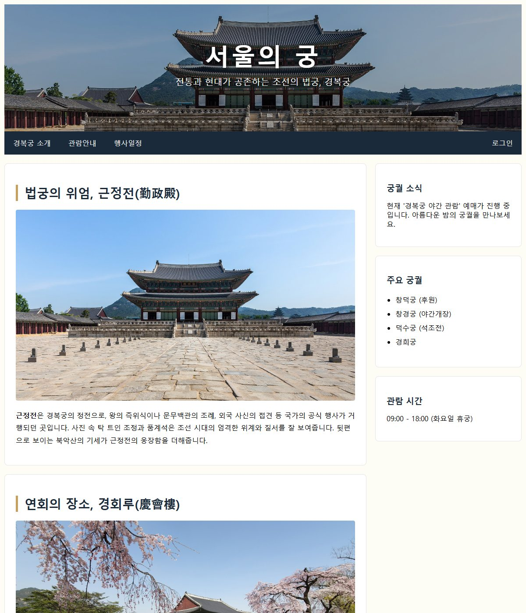
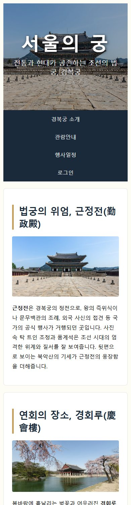
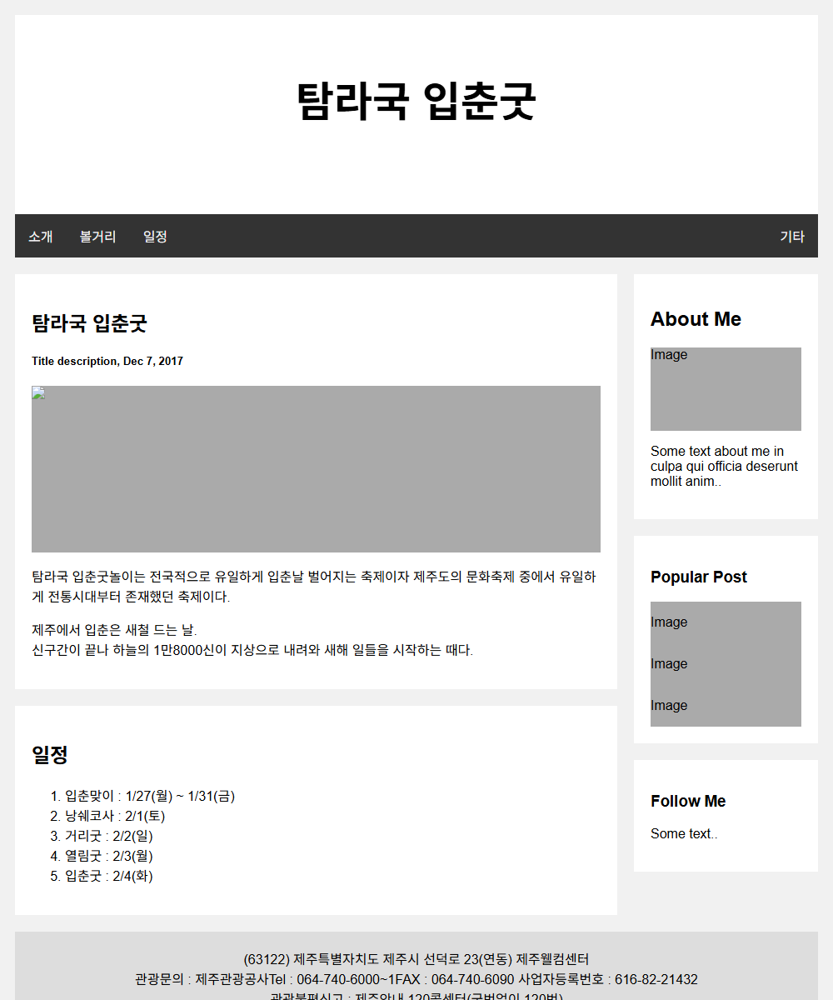
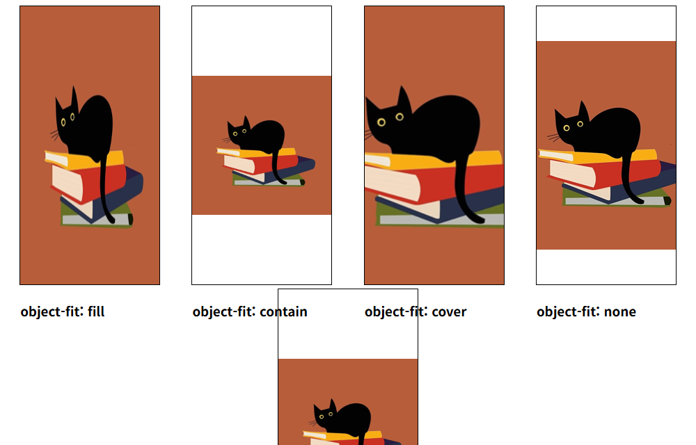

# chap10 · 반응형 웹 디자인

화면 크기에 맞춰 변하는 글자 단위·이미지 크기·미디어 쿼리 적용과 경복궁 소개, 탐라국 입춘굿 소개 반응형 페이지 구성.

Do it! 교재 예제와 연습문제 기반.

## 화면

| [palaces_responsive.html](labs/palaces_responsive.html) · 경복궁 소개 페이지, 넓은 화면 | [palaces_responsive.html](labs/palaces_responsive.html) · 같은 페이지, 너비 390px 화면 |
|---|---|
|  |  |

| [usingTemplate.html](usingTemplate.html) · 탐라국 입춘굿 블로그형 소개 | [object-fit.html](object-fit.html) · object-fit 값별 비교 |
|---|---|
|  |  |

## 다룬 개념

| 개념 | 뜻과 사용 방법 |
|---|---|
| 뷰포트 설정 | 휴대폰 브라우저가 화면 너비를 기기 너비 그대로 쓰게 하는 `<meta>` 설정. `width=device-width, initial-scale=1.0` |
| `em` 단위 | 부모 요소 글자 크기를 1로 보는 상대 단위. `.content`를 `1.5em`으로 키우면 그 안의 `p`는 `1em`이어도 부모를 따라 함께 커짐 |
| `rem` 단위 | 최상위 `html` 요소 글자 크기를 1로 보는 상대 단위. 부모 크기와 관계없이 `html { font-size: 16px; }` 기준으로 계산 |
| `vw` 단위 | 브라우저 창 너비의 1%를 1로 보는 단위. `font-size: 5vw`로 창 너비에 따라 제목 크기 변화 |
| 반응형 이미지 | 창이 좁아지면 이미지도 따라 줄어드는 설정. `max-width: 100%`로 부모 너비를 넘지 않게 하고 `height: auto`로 가로세로 비율 유지 |
| `object-fit` | 크기가 정해진 틀 안에 이미지를 채우는 방식. `fill` 비율 무시하고 꽉 채움, `contain` 비율 유지하며 전체 표시, `cover` 비율 유지하며 빈틈없이 채움, `none` 원래 크기, `scale-down` `none`과 `contain` 중 작은 쪽 |
| 미디어 쿼리 `@media` | 화면 너비 같은 조건이 맞을 때만 적용되는 스타일 묶음. `min-width`, `max-width`로 너비 구간을 나눠 배경 사진·글자색·칸 너비 교체 |
| 절대 위치 배치 | `position: absolute` 요소는 가장 가까운 `position: relative` 조상을 기준으로 자리 지정. 명언 카드의 문구를 카드 안 정해진 위치에 배치 |
| float 두 칸 배치 | `float: left`와 백분율 너비로 본문 칸과 사이드 칸을 나란히 두고, `.row:after`에 `clear: both`를 넣어 부모 높이 유지. 좁은 화면에서는 미디어 쿼리로 두 칸 모두 `width: 100%` |
| `position: sticky` | 스크롤하다 지정 위치에 닿으면 그 자리에 붙어 있는 요소. 메뉴 막대를 `top: 0`에 고정 |

## 파일별 내용

| 파일 | 내용 | 핵심 코드 |
|---|---|---|
| [card.html](card.html) | 명언 카드 두 장. 사진 아래 문구 영역을 카드 기준 절대 위치로 배치 | `position: relative`, `position: absolute`, `top: 300px` |
| [css/style.css](css/style.css) | 명언 카드용 미디어 쿼리. 화면 너비 768px 이상 1439px 이하에서 사진 옆에 문구가 오는 가로형 카드, 1440px 이상에서 카드 두 장 가로 배치 | `@media screen and (min-width:768px) and (max-width:1439px)`, `@media screen and (min-width:1440px)`, `float: left` |
| [em.html](em.html) | 레드향 소개 글의 글자 크기를 `em` 단위로 지정 | `p { font-size: 1em; }`, `.content { font-size: 1.5em; }` |
| [rem.html](rem.html) | 예제 시작 파일. em.html과 같은 레드향 소개 글에 `rem` 단위를 지정할 화면 | 빈 `<style>` |
| [vm.html](vm.html) | 창 너비에 비례해 크기가 바뀌는 가운데 정렬 인사말 제목 | `font-size: 5vw` |
| [image.html](image.html) | 고양이 사진 반응형 이미지 예제, 최대 너비를 지정한 `.top` 클래스 | `.top { max-width: 100%; height: auto; }` |
| [object-fit.html](object-fit.html) | 같은 고양이 사진을 같은 크기 틀에 넣고 `object-fit` 값별 차이 비교 | `object-fit: fill`, `contain`, `cover`, `none`, `scale-down` |
| [mq.html](mq.html) | 미디어 쿼리 예제 시작 파일. 화면을 덮는 밝은 배경 사진과 가운데 제목 | `background-size: cover`, `display: flex` |
| [mq2.html](mq2.html) | 화면 너비 구간마다 배경 사진과 글자색 교체. 1024px 이상 밝은 사진, 768px 이상 1023px 이하 어두운 사진, 767px 이하 작은 화면용 사진 | `@media screen and (min-width: 768px) and (max-width: 1023px)`, `@media screen and (max-width: 767px)` |
| [quiz.html](quiz.html) | 연습문제 시작 파일. 화면 가운데 인사말 제목 | `display: flex`, `height: 100vh` |
| [sol.html](sol.html) | quiz.html과 같은 화면에 미디어 쿼리를 더해 768px 이상 1023px 이하에서 회색 배경과 흰 글자 | `@media screen and (min-width: 768px) and (max-width: 1023px)` |
| [test.html](test.html) | 본문이 비어 있는 HTML 문서 틀 | `<!doctype html>` |
| [usingTemplate.html](usingTemplate.html) | 블로그 템플릿 기반 탐라국 입춘굿 소개 화면. 머리글, 메뉴 막대, 본문·사이드 두 칸, 일정 번호 목록, 바닥글 구성. 800px 이하에서 두 칸을 세로로 쌓고 400px 이하에서 메뉴를 한 줄에 하나씩 표시 | `float: left`, `width: 75%`, `@media screen and (max-width: 800px)`, `.topnav a:hover` |
| [labs/palaces_responsive.html](labs/palaces_responsive.html) | 경복궁 소개 반응형 페이지. 어둡게 덮은 근정전 사진 머리글, 스크롤해도 위에 붙는 메뉴, 근정전·경회루 사진 카드 본문, 궁궐 소식 사이드 칸 | `linear-gradient(rgba(0,0,0,0.3), rgba(0,0,0,0.3)), url(...)`, `position: sticky`, `@media screen and (max-width: 800px)` |

### results 폴더

같은 이름 예제의 완성 파일.

| 파일 | 내용 | 핵심 코드 |
|---|---|---|
| [results/em.html](results/em.html) | em.html과 같은 `em` 단위 예제 | `.content { font-size: 1.5em; }` |
| [results/rem.html](results/rem.html) | `html` 글자 크기를 기준으로 `rem` 단위 지정. `.content` 안 문단도 부모와 관계없이 `1rem` 크기 유지 | `html { font-size: 16px; }`, `.content { font-size: 1.5rem; }`, `p { font-size: 1rem; }` |
| [results/image.html](results/image.html) | 고양이 사진에 `.top` 클래스를 연결한 반응형 이미지 | `class="top"`, `max-width: 100%`, `height: auto` |
| [results/mq.html](results/mq.html) | mq2.html과 같은 미디어 쿼리 예제 | `@media screen and (max-width: 767px)` |
| [results/object-fit.html](results/object-fit.html) | object-fit.html과 같은 예제, 값마다 동작 설명 주석 | `object-fit: scale-down` |

`images/`: 명언 카드·배경·고양이 사진. `labs/images/`: 근정전·경회루 사진. `results/images/`, `results/puppy.jpg`: 완성 파일용 사진.
