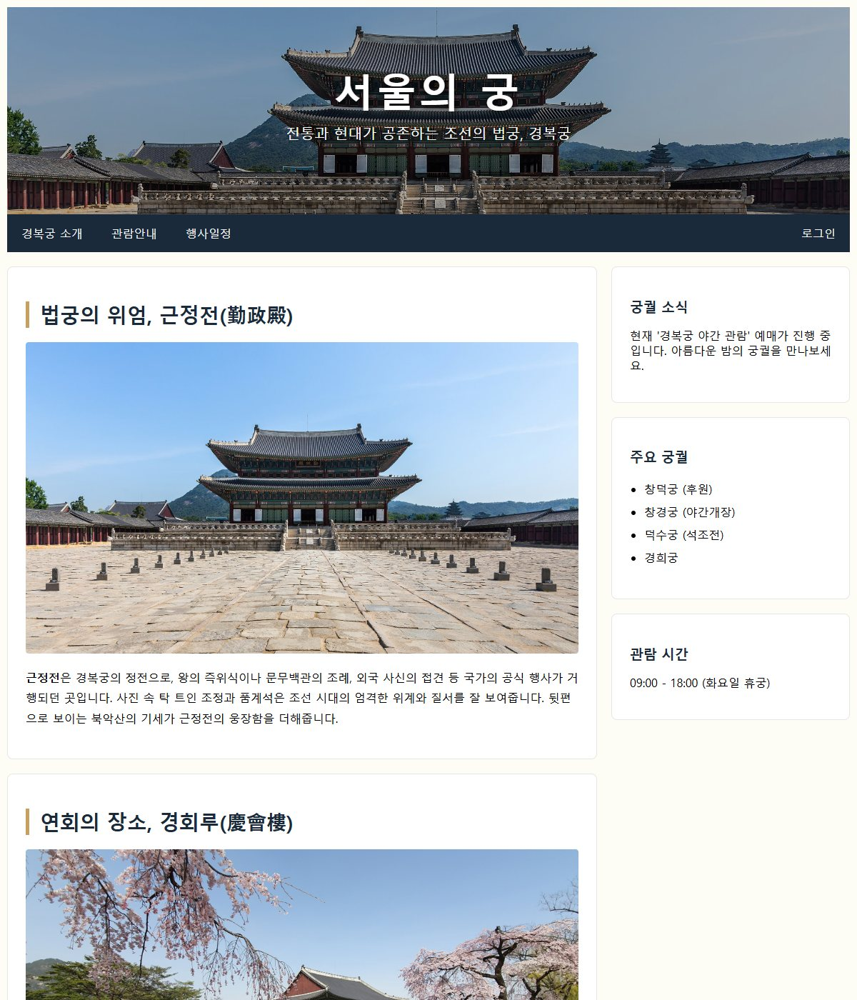
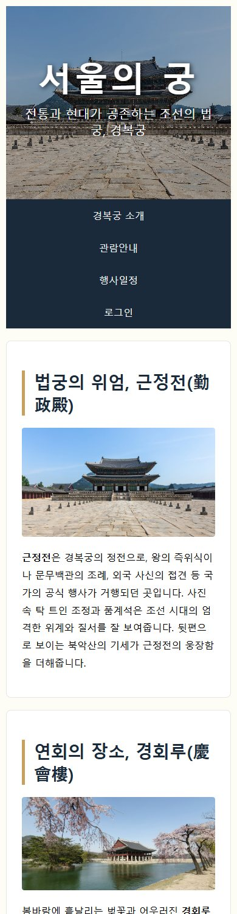

# chap10/labs · 경복궁 소개 반응형 페이지

[상위 폴더 README](../README.md)에서 다룬 개념과 나머지 예제 확인.

## 화면

| [palaces_responsive.html](palaces_responsive.html) · 경복궁 소개 페이지, 넓은 화면 | [palaces_responsive.html](palaces_responsive.html) · 같은 페이지, 너비 390px 화면 |
|---|---|
|  |  |

## 파일

미디어 쿼리로 넓은 화면과 좁은 화면의 배치를 바꾸는 경복궁 소개 페이지.

| 파일 | 내용 | 핵심 코드 |
|---|---|---|
| [palaces_responsive.html](palaces_responsive.html) | 경복궁 소개 반응형 페이지. 어둡게 덮은 근정전 사진 머리글, 스크롤해도 위에 붙는 메뉴, 근정전·경회루 사진 카드 본문, 궁궐 소식 사이드 칸 | `linear-gradient(rgba(0,0,0,0.3), rgba(0,0,0,0.3)), url(...)`, `position: sticky`, `@media screen and (max-width: 800px)` |
