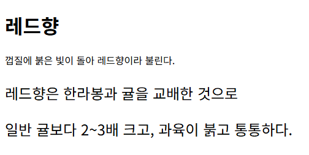
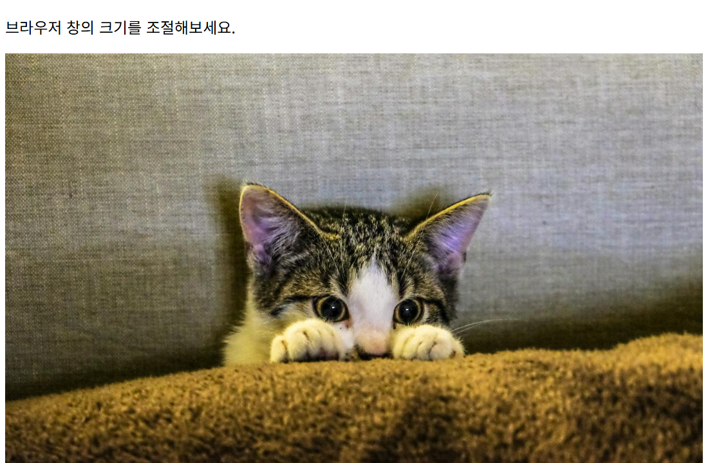
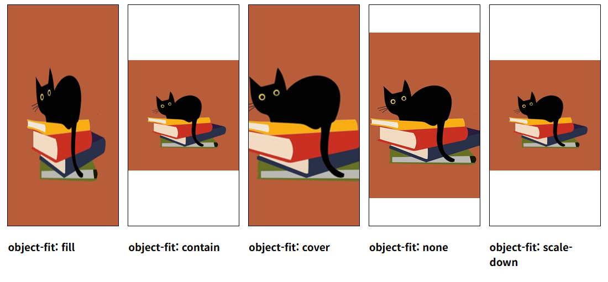

# chap10/results · 예제 완성 코드

[상위 폴더 README](../README.md)에서 다룬 개념과 나머지 예제 확인.

## 화면

| [em.html](em.html) | [image.html](image.html) |
|---|---|
|  |  |

| [mq.html](mq.html) | [object-fit.html](object-fit.html) |
|---|---|
|  |  |

## 파일

같은 이름 예제의 완성 파일.

| 파일 | 내용 | 핵심 코드 |
|---|---|---|
| [em.html](em.html) | 상위 폴더 em.html과 같은 `em` 단위 예제 | `.content { font-size: 1.5em; }` |
| [rem.html](rem.html) | `html` 글자 크기를 기준으로 `rem` 단위 지정. `.content` 안 문단도 부모와 관계없이 `1rem` 크기 유지 | `html { font-size: 16px; }`, `.content { font-size: 1.5rem; }`, `p { font-size: 1rem; }` |
| [image.html](image.html) | 고양이 사진에 `.top` 클래스를 연결한 반응형 이미지 | `class="top"`, `max-width: 100%`, `height: auto` |
| [mq.html](mq.html) | 상위 폴더 mq2.html과 같은 미디어 쿼리 예제 | `@media screen and (max-width: 767px)` |
| [object-fit.html](object-fit.html) | 상위 폴더 object-fit.html과 같은 예제, 값마다 동작 설명 주석 | `object-fit: scale-down` |

`images/`, `puppy.jpg`: 완성 파일용 사진.
