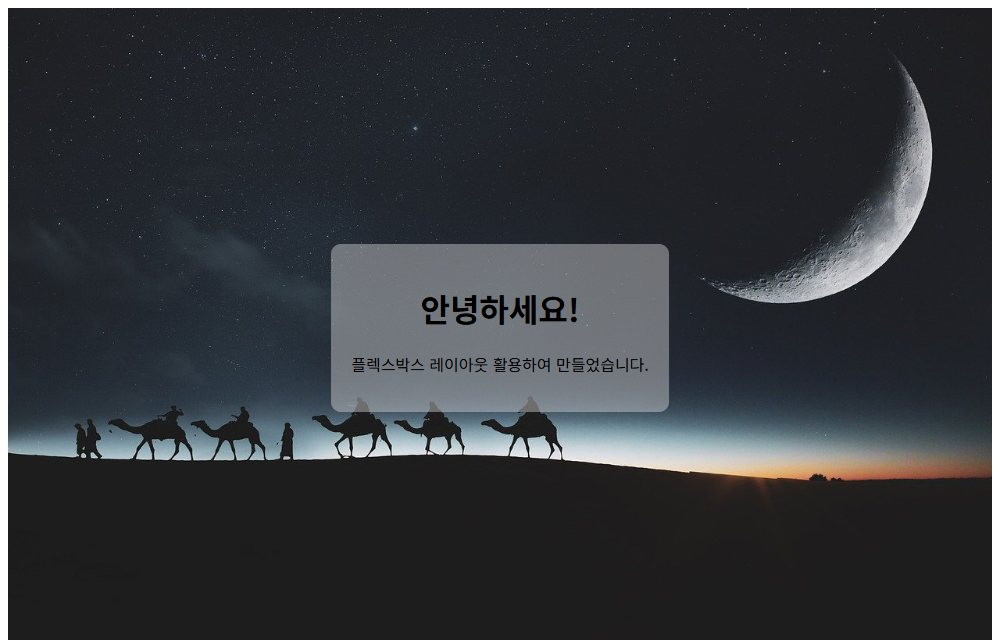
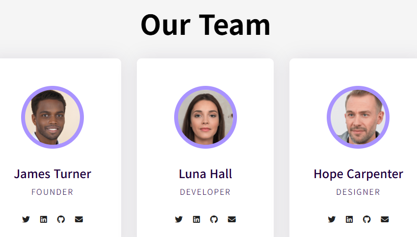
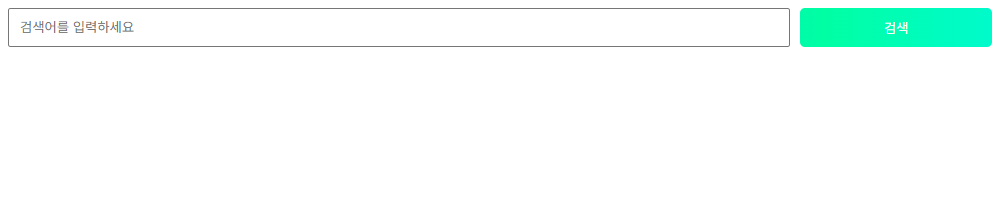
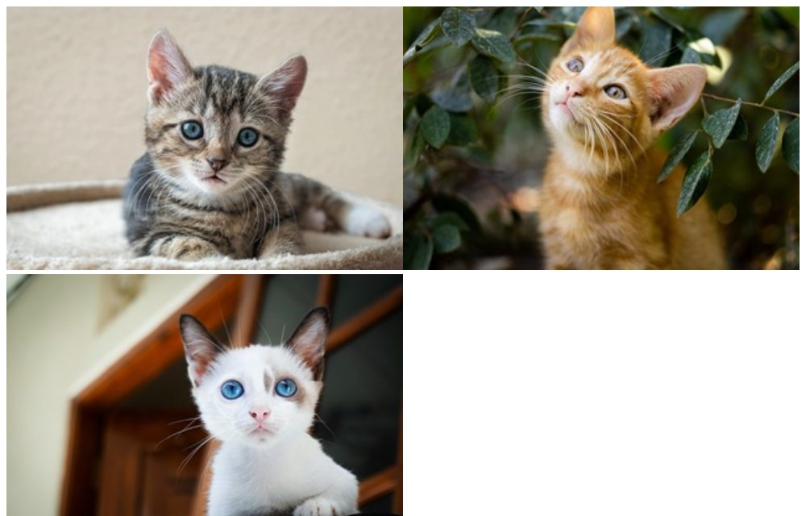
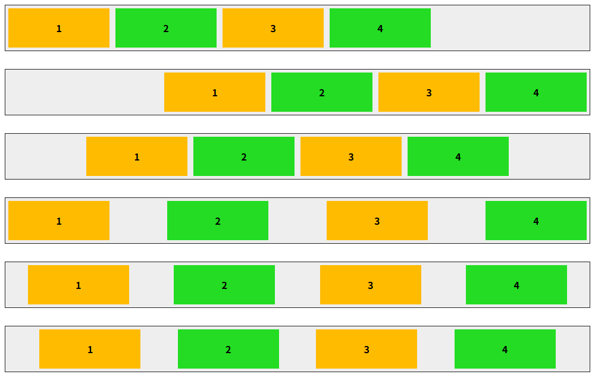

# chap11 · Flexbox 레이아웃

한 방향으로 항목을 늘어놓는 Flexbox의 축 방향·줄바꿈·정렬·항목 크기 지정과 화면 가운데 배치, 팀 소개 카드, 검색 막대, 반응형 사진 목록 구성.

Do it! 교재 예제와 연습문제 기반.

## 화면

| [center2.html](center2.html) · 화면 가운데 인사말 상자 | [our-team.html](our-team.html) · 팀 소개 카드 |
|---|---|
|  |  |

| [flex-12.html](flex-12.html) · 4:1로 나눈 검색 막대 | [quiz-1.html](quiz-1.html) · 반응형 사진 목록 |
|---|---|
|  |  |

| [flex-4.html](flex-4.html) · justify-content 값별 배치 비교 |   |
|---|---|
|  |   |

## 다룬 개념

| 개념 | 뜻과 사용 방법 |
|---|---|
| 플렉스 컨테이너와 항목 | `display: flex`를 지정한 부모가 플렉스 컨테이너, 그 바로 아래 자식이 플렉스 항목. 항목이 한 줄로 나란히 배치됨 |
| 주축과 교차축 | 주축은 항목이 늘어서는 방향, 교차축은 주축과 수직인 방향. 기본 주축은 가로 |
| `flex-direction` | 주축 방향 지정. `row` 왼쪽에서 오른쪽, `row-reverse` 오른쪽에서 왼쪽, `column` 위에서 아래, `column-reverse` 아래에서 위 |
| `flex-wrap`, `flex-flow` | 항목이 컨테이너보다 넓을 때의 줄바꿈 여부. `wrap` 여러 줄, `nowrap` 한 줄 유지. `flex-flow: row wrap`처럼 방향과 줄바꿈을 한 번에 지정 |
| `justify-content` | 주축 방향 정렬. `flex-start` 시작점, `flex-end` 끝점, `center` 가운데, `space-between` 양 끝 항목을 붙이고 사이 간격 균등, `space-around` 항목 둘레 여백 균등, `space-evenly` 모든 간격 균등 |
| `align-items` | 교차축 방향 정렬. `flex-start`, `flex-end`, `center`, `baseline` 글자 기준선 맞춤, `stretch` 교차축 길이만큼 늘림 |
| `align-self` | 항목 하나만 교차축 정렬을 따로 지정. 컨테이너의 `align-items`보다 우선 |
| `align-content` | 항목이 여러 줄일 때 줄 묶음 전체의 교차축 정렬. `flex-wrap: wrap`과 함께 사용 |
| `gap` | 플렉스 항목 사이 간격 |
| `flex-basis` | 남는 공간을 나누기 전 항목의 기본 크기. 주축이 가로면 너비 |
| `flex-grow` | 컨테이너에 남는 공간을 항목끼리 나눠 갖는 비율. 검색 입력창 `4`, 버튼 `1`로 4:1 분배 |
| `flex` 단축 속성 | 늘어나는 비율 `flex-grow`, 줄어드는 비율 `flex-shrink`, 기본 크기 `flex-basis`를 한 번에 지정. `flex: 0 0 33.3%`는 늘지도 줄지도 않는 3분의 1 너비 |
| 가로·세로 가운데 배치 | `justify-content: center`와 `align-items: center`를 함께 지정. 컨테이너 높이를 `100vh`로 잡으면 화면 정중앙 |
| 미디어 쿼리와 Flexbox | 화면 너비 구간마다 항목의 `flex-basis`를 바꿔 한 줄에 놓이는 항목 수 조절 |

## 파일별 내용

| 파일 | 내용 | 핵심 코드 |
|---|---|---|
| [flex-1.html](flex-1.html) | 같은 상자 줄을 주축 방향 네 가지로 배치해 비교 | `flex-direction: row`, `row-reverse`, `column`, `column-reverse` |
| [flex-2.html](flex-2.html) | 상자 여러 개를 줄바꿈 허용과 금지로 나눠 비교 | `flex-flow: row wrap`, `flex-flow: row nowrap` |
| [flex-2-.html](flex-2-.html) | 예제 시작 파일. 방향과 줄바꿈을 한 번에 지정할 상자 줄 두 개 | `#opt1`, `#opt2` |
| [flex-4.html](flex-4.html) | 주축 정렬 값별 상자 배치 비교 | `justify-content: flex-start`, `flex-end`, `center`, `space-between`, `space-around`, `space-evenly` |
| [flex-5.html](flex-5.html) | 높이가 있는 컨테이너에서 교차축 정렬 값별 비교, 글자 크기가 다른 상자로 기준선 맞춤 확인 | `align-items: flex-start`, `center`, `baseline`, `stretch` |
| [flex-6.html](flex-6.html) | 모든 항목은 세로 가운데, 1번 상자만 위쪽, 3번 상자만 세로 가득 배치 | `align-items: center`, `align-self: flex-start`, `align-self: stretch` |
| [flex-7.html](flex-7.html) | 여러 줄로 감싼 항목 묶음에 줄 묶음 정렬 값별 비교 | `flex-flow: row wrap`, `align-content: space-between` |
| [flex-8.html](flex-8.html) | 예제 시작 파일. 항목 사이 간격 10px을 지정할 상자 줄 | `align-items: center` |
| [flex-9.html](flex-9.html) | 예제 시작 파일. 글자 길이가 다른 상자에 기본 크기를 지정할 화면, 간격만 지정한 상태 | `gap: 30px` |
| [flex-basis.html](flex-basis.html) | 글자 길이가 다른 상자들에 같은 기본 크기 지정 | `flex-basis: 150px`, `gap: 10px` |
| [flex-10.html](flex-10.html) | 예제 시작 파일. 기본 크기 150px 상자에 늘어나는 비율을 지정할 화면 | `flex-basis: 150px`, `#box1`~`#box4` |
| [flex-11.html](flex-11.html) | 예제 시작 파일. 기본 크기 300px 상자들이 컨테이너보다 넓은 상태에서 상자별 축소 비율을 지정할 화면 | `flex-basis: 300px`, `width: 800px` |
| [flex-12.html](flex-12.html) | 검색 입력창과 버튼이 남는 공간을 4:1로 나눠 갖는 검색 막대, 버튼 배경에 흐르는 그러데이션 애니메이션 | `flex-grow: 4`, `flex-grow: 1`, `@keyframes aquaFlow` |
| [margin-1.html](margin-1.html) | 예제 시작 파일. 끝점 정렬한 상자 줄에서 첫 번째 상자만 시작점으로 옮길 화면 | `justify-content: flex-end`, `#box1` |
| [margin-2.html](margin-2.html) | 예제 시작 파일. 상자 줄에서 마지막 상자만 끝점으로 옮길 화면 | `justify-content: flex-end`, `#box3` |
| [margin-3.html](margin-3.html) | 예제 시작 파일. 세로 방향 상자 줄에서 첫 번째 상자만 맨 위에 둘 화면 | `flex-direction: column` |
| [center.html](center.html) | 배경 사진을 깐 화면에 버튼 하나를 플렉스 정렬로 가운데 배치 | `display: flex`, `justify-content: center`, `align-items: center` |
| [center2.html](center2.html) | 화면 높이를 채운 배경 사진 위 반투명 인사말 상자를 가운데 배치, 스타일은 외부 파일로 분리 | `<link href="./css/center2.css">` |
| [css/center2.css](css/center2.css) | center2.html 스타일. 컨테이너를 화면 높이로 잡고 내용 상자를 가로·세로 가운데 배치 | `height: 100vh`, `align-items: center`, `rgba(226, 226, 226, 0.411)` |
| [our-team.html](our-team.html) | 팀원 세 명의 소개 카드. 둥근 프로필 사진, 이름·역할, 소셜 아이콘 줄, 마우스를 올리면 보라색 그러데이션 배경 | Font Awesome 아이콘, `css/our-team.css` |
| [css/our-team.css](css/our-team.css) | 카드 안 내용을 세로 방향 가운데 정렬, 소셜 아이콘을 가로 균등 배치, 화면 너비 768px 이상에서 카드 세 장을 한 줄 배치 | `flex-direction: column`, `justify-content: space-between`, `flex: 0 0 33.3%` |
| [index.html](index.html) | chap10 card.html과 같은 명언 카드 두 장의 HTML 구조, 연결 대상 `css/style.css`는 이 폴더에 없음 | `.card`, `.quotes` |
| [quiz-1.html](quiz-1.html) | 연습문제. 고양이 사진 세 장을 화면 너비에 따라 한 줄에 3장, 2장, 1장으로 배치 | `flex: 0 0 33.3%`, `@media (max-width: 1024px)`, `@media (max-width: 768px)` |
| [sol-1.html](sol-1.html) | quiz-1 풀이. 기본 크기 백분율과 간격, 구간을 나눈 미디어 쿼리로 같은 배치 | `flex-basis: 32%`, `gap: 10px`, `@media (min-width: 769px) and (max-width: 1024px)` |

`images/`: 배경·명언 카드·고양이·팀원 프로필 사진 등 예제 이미지.
