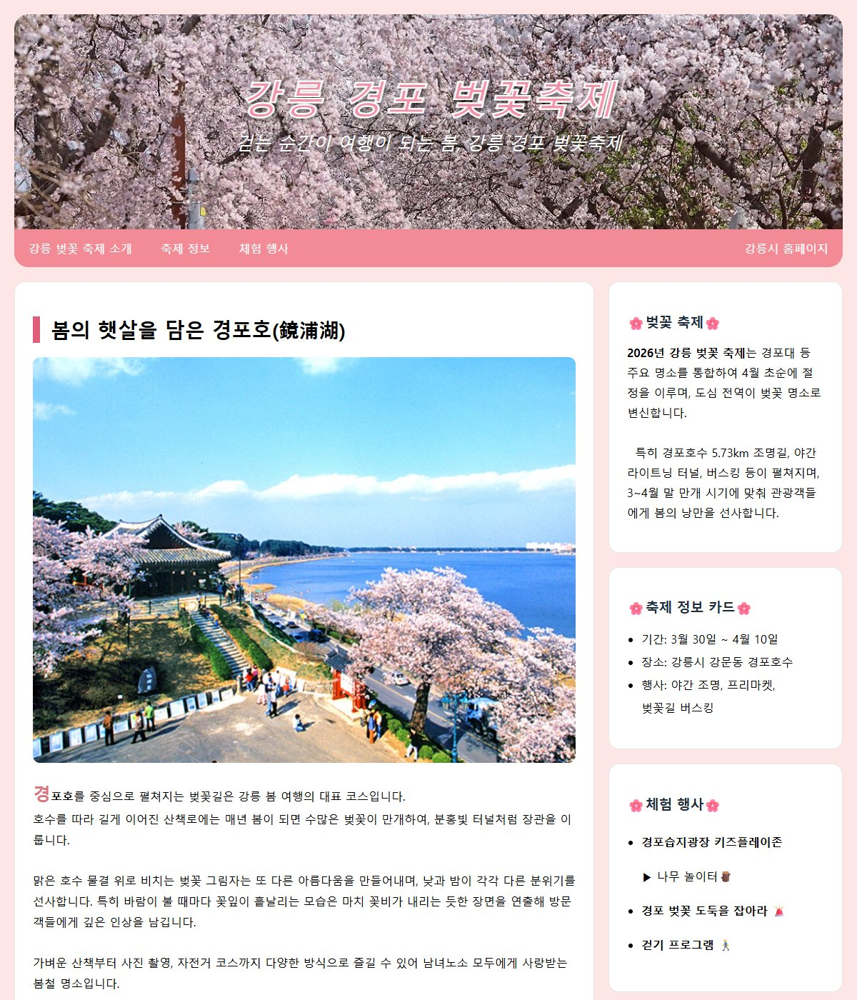
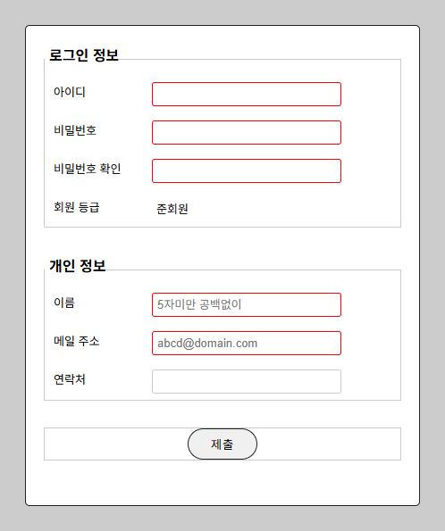
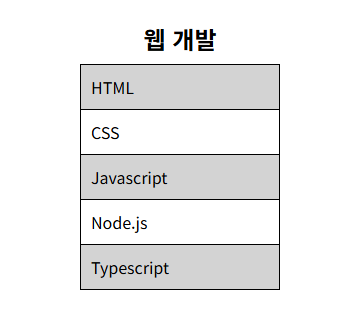
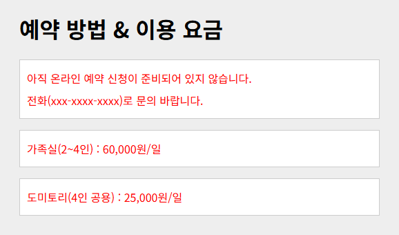

# chap13 · CSS 선택자 활용

자식·형제·속성·가상 클래스·가상 요소 선택자로 원하는 요소만 골라 꾸민 메뉴, 링크, 표, 회원 가입 폼과 강릉 경포 벚꽃축제 소개 페이지 구성. CSS 함수와 `filter` 예제 시작 파일도 함께 수록.

Do it! 교재 예제와 연습문제 기반.

## 화면

| [palaces.html](labs/palaces.html) · 강릉 경포 벚꽃축제 소개 페이지 | [register1.html](register1.html) · 속성 선택자로 꾸민 회원 가입 폼 |
|---|---|
|  |  |

| [sol-1.html](sol-1.html) · 홀수 행에 배경색을 준 목록 표 | [adj.html](adj.html) · 형제 선택자로 강조한 숙소 예약 안내 |
|---|---|
|  |  |

## 다룬 개념

| 개념 | 뜻과 사용 방법 |
|---|---|
| 하위 선택자 `A B` | A 안에 있는 모든 B를 깊이와 관계없이 선택. `.navi a`, `#signup legend`처럼 영역 안 요소 지정 |
| 자식 선택자 `A > B` | A 바로 아래 자식인 B만 선택. `section > p`로 `section` 바로 아래 문단만 고르고 `div` 안 문단은 제외 |
| 형제 선택자 `A ~ B`, `A + B` | 같은 부모를 둔 요소 중 A 뒤에 오는 B 선택. `~`는 뒤의 모든 B, `+`는 바로 다음 B 하나. `h1 ~ p`, `article h2 + p` |
| 속성 선택자 | 태그 속성과 값으로 요소 선택. `[href]` 속성 있음, `[target="_blank"]` 값 일치, `[class~="button"]` 공백으로 나뉜 값 중 하나 일치, `[title\|="us"]` 값이 `us`이거나 `us-`로 시작, `[title^="eng"]` 앞부분 일치, `[href$=hwp]` 끝부분 일치, `[href*="w3"]` 값 어디든 일치 |
| 링크 상태 가상 클래스 | 링크 상태별 스타일. `:link` 방문 전, `:visited` 방문 후, `:hover` 마우스를 올린 상태, `:focus` 키보드로 선택한 상태, `:active` 누르는 순간 |
| `:target` | 주소 끝 `#아이디`와 같은 아이디를 가진 요소. 메뉴를 눌러 이동한 안내 상자 강조 |
| `:checked` | 선택된 라디오 버튼·체크박스. `input:checked + label`로 고른 항목의 레이블 강조 |
| `:not()` | 괄호 안 조건에 맞지 않는 요소만 선택. `input:not([type="radio"])`로 라디오 버튼을 뺀 입력창 지정 |
| 구조 가상 클래스 | 형제 사이 순서로 요소 선택. `:first-child`, `:last-child`, `:only-child`, `:nth-child(even)`·`:nth-child(3n)` 같은 순서 공식, `:nth-of-type()`은 같은 태그끼리의 순서 |
| 가상 요소 | 문서에 없는 부분을 만들어 꾸미는 선택자. `::first-letter` 첫 글자, `::before` 요소 앞에 `content` 속성의 글자 추가 |
| 폼 상태 속성 | 입력창 속성에 따라 모양 구분. `input[required]` 필수 입력 빨간 테두리, `input[readonly]` 읽기 전용 테두리 제거 |

## 파일별 내용

### 결합 선택자

| 파일 | 내용 | 핵심 코드 |
|---|---|---|
| [descendant.html](descendant.html) | 숙소 예약 안내에서 `section` 바로 아래 문단만 파란 글씨, `div` 안 문단은 제외 | `section > p` |
| [child.html](child.html) | 예제 시작 파일. `section`의 자식 `p`만 꾸밀 숙소 예약 안내 화면 | `section`, `div` 안 `p` |
| [sibling.html](sibling.html) | 예제 시작 파일. `h1`과 형제인 모든 `p`를 꾸밀 숙소 예약 안내 화면 | `section`, `h1`, `p` |
| [adj.html](adj.html) | 숙소 예약 안내에서 `h1` 뒤 형제 문단 전체를 빨간 글씨로 표시 | `h1 ~ p` |

### 속성 선택자

| 파일 | 내용 | 핵심 코드 |
|---|---|---|
| [attr-1.html](attr-1.html) | `href`가 있는 메뉴 링크만 배경색과 두꺼운 테두리, `href` 없는 첫 항목은 그대로 | `a[href]` |
| [attr-2.html](attr-2.html) | 새 창으로 열리는 링크 오른쪽에 새 창 아이콘 표시 | `a[target="_blank"]`, `background: url(./images/newwindow.png) no-repeat center right` |
| [attr-3.html](attr-3.html) | 클래스 값에 `button`이 들어 있는 메뉴만 그림자와 둥근 모서리 | `a[class~="button"]` |
| [attr-4.html](attr-4.html) | `title` 값이 언어 코드와 같거나 언어 코드와 하이픈으로 시작하는 링크 앞에 국기 아이콘 | `a[title\|="us"]`, `a[title\|="ja"]` |
| [attr-5.html](attr-5.html) | `title` 값의 앞부분으로 영어·일본어·중국어 링크를 골라 국기 아이콘 | `a[title ^="eng"]`, `a[title ^="jap"]` |
| [attr-6.html](attr-6.html) | 연결 파일 확장자가 hwp, xls인 링크 오른쪽에 파일 종류 아이콘 | `a[href $= hwp]`, `a[href $= xls]` |
| [attr-7.html](attr-7.html) | 주소에 `w3`가 들어 있는 링크만 파란 배경과 흰 글씨 | `a[href *= "w3"]` |

### 가상 클래스·가상 요소

| 파일 | 내용 | 핵심 코드 |
|---|---|---|
| [navi.html](navi.html) | 숙소 메뉴 막대 링크의 상태별 스타일, 마우스를 올리면 연두색, 누르면 자홍색 배경 | `a:link`, `a:visited`, `a:hover`, `a:active` |
| [pclass-1.html](pclass-1.html) | 메뉴를 눌러 이동한 이용 안내 상자를 파란 배경으로 강조 | `#intro:target` |
| [pclass-2.html](pclass-2.html) | 객실 예약 폼에서 선택한 라디오 버튼의 레이블을 빨간 굵은 글씨로 표시 | `input:checked + label` |
| [pclass-3.html](pclass-3.html) | 상자 안 첫째·마지막·유일한 자식과 두 번째 `p`를 골라 각각 배경과 테두리 지정 | `:first-child`, `:last-child`, `:only-child`, `p:nth-of-type(2)` |
| [pclass-4.html](pclass-4.html) | 번호 상자 줄에서 짝수·홀수 번째 배경색을 나누고 3의 배수 번째에 그림자 | `:nth-child(even)`, `:nth-child(odd)`, `:nth-child(3n)` |
| [pclass-5.html](pclass-5.html) | 예제 시작 파일. pclass-3.html과 같은 상자 구조에 구조 가상 클래스를 지정할 화면 | `.container` |
| [pclass-6.html](pclass-6.html) | 객실 예약 폼에서 라디오 버튼을 뺀 입력창만 테두리와 둥근 모서리 지정 | `#signup input:not([type="radio"])` |
| [pclass-7.html](pclass-7.html) | 예제 시작 파일. `:has()`를 적용할 어두운 배경 가로 메뉴, 마우스를 올리면 주황색 글씨 | `nav a:hover`, `transition: 0.3s` |
| [nth.html](nth.html) | 웹 개발 기술 표에서 홀수 번째 행만 회색 배경 | `tr:nth-of-type(2n+1)` |
| [pelement-1..html](pelement-1..html) | 문단 첫 글자를 두 배 크기 굵은 글씨로 표시 | `p::first-letter` |
| [pelement-2.html](pelement-2.html) | 제목 앞에 빨간 별표 추가 | `h1::before`, `content: "*"` |
| [badge.html](badge.html) | 예제 시작 파일. 화면 가운데 종 아이콘에 가상 요소로 알림 뱃지를 달 화면 | Font Awesome `fa-bell` |

### 회원 가입 폼

| 파일 | 내용 | 핵심 코드 |
|---|---|---|
| [register1.html](register1.html) | 로그인 정보·개인 정보 묶음으로 나눈 회원 가입 폼. 입력 종류별 입력창 스타일, 필수 입력은 빨간 테두리, 읽기 전용은 테두리 없음 | `input[type="text"]`, `input[required]`, `input[readonly]` |
| [css/register1.css](css/register1.css) | register1.html 공통 스타일. 회색 배경 위 흰 폼 상자, 묶음 테두리, 레이블 너비 | `#signup fieldset`, `float: inline-start` |
| [register2.html](register2.html) | register1.html과 같은 회원 가입 폼, 스타일 전체를 외부 파일로 분리 | `<link href="css/register2.css">` |
| [css/register2.css](css/register2.css) | 레이블을 왼쪽에 띄워 입력창과 한 줄로 두는 폼 스타일 | `#signup label { float: left; width: 110px; }` |
| [register3.html](register3.html) | 같은 회원 가입 폼에서 세 번째 묶음 테두리 제거, 제출 버튼에 마우스를 올리면 검은 배경 | `fieldset:nth-of-type(3)`, `button:hover` |
| [css/register3.css](css/register3.css) | 속성 선택자로 입력창 종류별 테두리를 주고 필수·읽기 전용 입력창 구분 | `#signup input[type=text]`, `#signup input[required]`, `#signup input[readonly]` |
| [css/attr.css](css/attr.css) | 회원 가입 폼 공통 스타일, 연결한 HTML이 없는 스타일 파일 | `form label { float: left; }` |
| [formStyle.html](formStyle.html) | 로그인 정보 입력란의 레이블과 입력창을 왼쪽으로 띄워 한 줄에 나란히 배치 | `float: left`, `clear: both`, `label { width: 100px; }` |

### CSS 함수·필터 예제 시작 파일

| 파일 | 내용 | 핵심 코드 |
|---|---|---|
| [calc.html](calc.html) | 예제 시작 파일. `calc()`로 너비를 지정할 제목 막대 | `.heading` |
| [clamp.html](clamp.html) | 예제 시작 파일. `clamp()`로 글자 크기 범위를 지정할 제목 막대 | `.heading` |
| [minmax.html](minmax.html) | 예제 시작 파일. `min()`으로 너비, `max()`로 글자 크기를 지정할 제목 막대 | `.heading` |
| [filter.html](filter.html) | 예제 시작 파일. 같은 고양이 사진을 그리드로 늘어놓고 칸마다 적용할 `filter` 함수 이름 표시 | `grid-template-columns: repeat(5, 1fr)`, `.blur`, `.grayscale` |

### 연습문제와 기타

| 파일 | 내용 | 핵심 코드 |
|---|---|---|
| [quiz-1.html](quiz-1.html) | 연습문제. 웹 개발 기술 표의 홀수 번째 행 회색 배경 | `tr:nth-child(odd)` |
| [sol-1.html](sol-1.html) | quiz-1 풀이. 홀수 번째 행의 칸에 배경색 | `tr:nth-child(odd) td` |
| [quiz-2.html](quiz-2.html) | 연습문제. 가상 클래스·가상 요소 설명 글에서 각 `article`의 첫 문단 노란 배경 | `article p:nth-of-type(1)` |
| [sol-2.html](sol-2.html) | quiz-2 풀이. 소제목 바로 다음 문단 노란 배경 | `article h2 + p` |
| [selectEx.html](selectEx.html) | 연수생 수칙 번호 목록, 스타일 없이 본문만 있는 문서 | `<ol>`, `` |
| [selectEx1.html](selectEx1.html) | selectEx.html과 같은 내용 | `<ol>`, `` |
| [labs/palaces.html](labs/palaces.html) | 강릉 경포 벚꽃축제 소개 페이지. 사진 머리글, 스크롤해도 위에 붙는 분홍 메뉴, 경포호 사진 카드 본문, 축제 정보·체험 행사 사이드 칸 | `.header h1 + p`, `.main-card p::first-letter`, `-webkit-text-stroke`, `position: sticky` |

`images/`: 속성 선택자 예제의 국기·파일 종류·새 창 아이콘, 고양이 사진 등 예제 이미지. `labs/images/`: 벚꽃축제 소개 페이지 사진 등.
