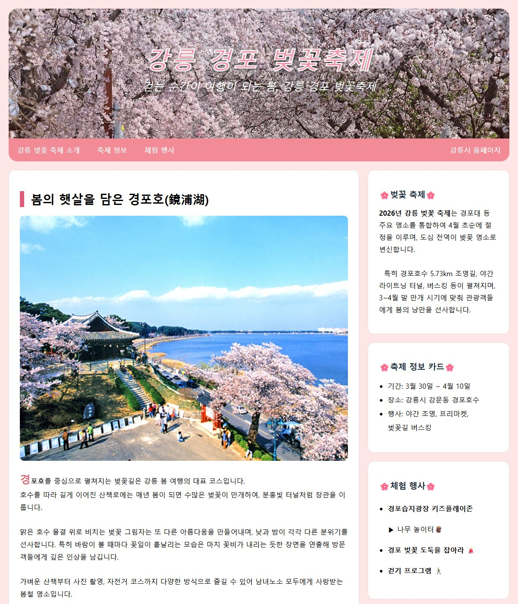

# chap13/labs · 강릉 경포 벚꽃축제 소개 페이지

[상위 폴더 README](../README.md)에서 다룬 개념과 나머지 예제 확인.

## 화면

## 파일

결합·속성·가상 클래스 선택자로 꾸민 강릉 경포 벚꽃축제 소개 페이지.

| 파일 | 내용 | 핵심 코드 |
|---|---|---|
| [palaces.html](palaces.html) | 강릉 경포 벚꽃축제 소개 페이지. 사진 머리글, 스크롤해도 위에 붙는 분홍 메뉴, 경포호 사진 카드 본문, 축제 정보·체험 행사 사이드 칸 | `.header h1 + p`, `.main-card p::first-letter`, `-webkit-text-stroke`, `position: sticky` |
