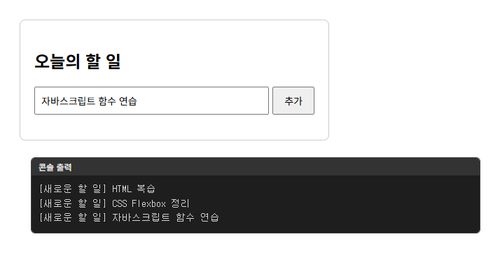
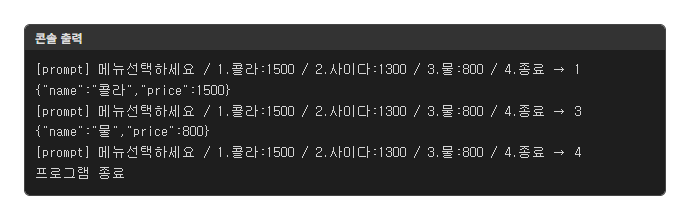
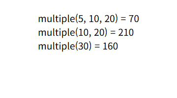
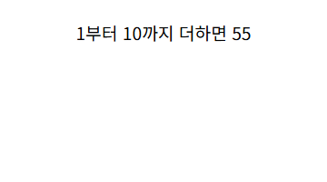
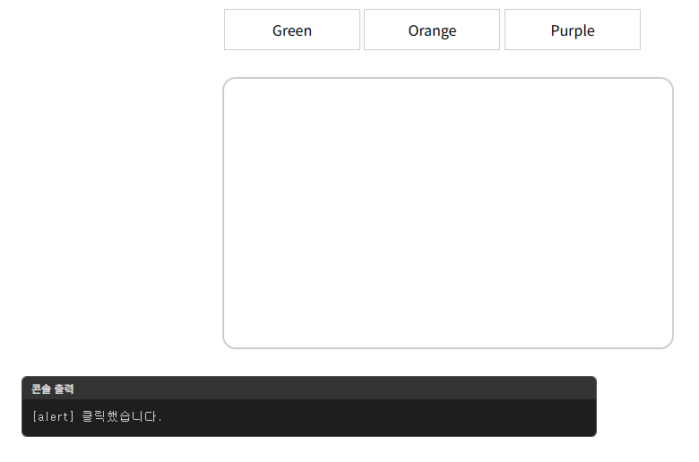
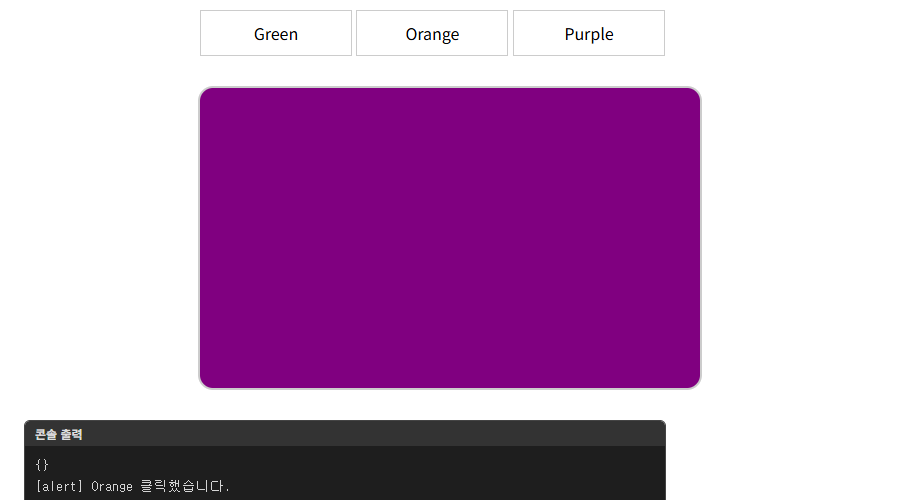

# chap17 · 함수와 이벤트

함수 선언·함수 표현식·화살표 함수·즉시 실행 함수, 변수 범위와 호이스팅, 클릭 이벤트로 배경색과 글자색을 바꾸는 화면과 음료 자판기 메뉴 구현.

Do it! 교재 예제와 연습문제 기반.

## 화면

입력 창이 뜨는 예제는 예시 값을 넣어 실행한 화면. 콘솔 출력과 알림 창 내용은 화면 아래 검은 상자로 함께 표시.

| [todos.html](lab/todos.html) · 할 일 추가 버튼과 콘솔 출력 | [smartMachine.html](smartMachine.html) · 음료 자판기 메뉴 선택 |
|---|---|
|  |  |

| [function-2.html](results/function-2.html) · 매개변수 기본값 적용 결과 | [calcSum.html](results/calcSum.html) · 1부터 입력한 수까지의 합 |
|---|---|
|  |  |

| [event-1.html](results/event-1.html) · 링크 클릭 시 알림 창 | [event-1.html](event-1.html) · Purple 클릭 시 결과 상자 배경색 변경 |
|---|---|
|  |  |

## 다룬 개념

| 개념 | 뜻과 사용 방법 |
|---|---|
| 함수 선언과 호출 | 코드를 `function 이름() {}`으로 묶어 두고 이름 뒤 `()`로 실행하는 문법. `calcSum(10)`으로 1부터 10까지 합 출력 |
| 매개변수와 반환값 | 함수가 받는 값을 담는 변수와 `return`으로 돌려주는 결과. `addNumber(2, 3)`이 두 수의 합을 반환 |
| 매개변수 기본값 | 인수를 넘기지 않았을 때 쓸 값을 매개변수에 미리 지정하는 문법. `multiple(a, b = 5, c = 10)`을 인수 개수를 바꿔 호출 |
| 함수 표현식과 익명 함수 | 이름 없는 함수를 변수에 대입하는 방식. 변수 이름 뒤 `()`로 호출 |
| 즉시 실행 함수 | 선언과 동시에 한 번 실행하는 함수. `(function() { ... }())`로 감싸 페이지를 열 때 바로 이름 입력과 인사말 출력 |
| 화살표 함수 | `function` 대신 `=>`로 줄여 쓰는 함수 표현식. 매개변수가 하나면 괄호, 본문이 한 식이면 중괄호와 `return` 생략 |
| 전역 변수와 지역 변수 | 함수 밖에서 선언해 어디서나 쓰는 변수와 함수 안에서 선언해 그 안에서만 쓰는 변수. `var` 없이 값을 넣은 변수는 전역 변수로 처리 |
| 스코프 | 변수를 사용할 수 있는 범위. `var`는 함수 단위, `let`과 `const`는 중괄호 블록 단위 |
| 호이스팅 | 선언이 범위 맨 위로 끌어올려진 것처럼 동작하는 성질. `var` 변수는 선언 전에 읽으면 `undefined`, 함수 선언은 선언 줄보다 앞에서 호출 가능 |
| `let` 선언 전 참조 | `let` 변수를 선언 줄보다 먼저 읽으면 `undefined` 대신 `ReferenceError` 발생 |
| 재선언과 재할당 | 같은 이름으로 다시 선언하는 일과 값만 바꾸는 일. `var`는 재선언 허용, `let`과 `const`는 같은 범위 재선언 시 `SyntaxError` |
| 이벤트와 이벤트 처리기 | 클릭처럼 사용자가 일으키는 동작과 그때 실행할 함수. HTML 속성 `onclick`, 요소의 `onclick` 속성, `addEventListener()` 순서로 연결 방법 비교 |
| 콜백 함수 | 다른 함수에 인수로 넘겨 나중에 실행되게 하는 함수. `addEventListener("click", display)`처럼 괄호 없이 함수 이름 전달 |
| `preventDefault()` | 링크 이동처럼 브라우저가 원래 하는 동작을 취소하는 메서드. 링크 클릭 시 페이지 이동 대신 결과 상자 배경색만 변경 |
| 객체 리터럴 | 이름과 값을 짝지어 중괄호로 묶은 자료. 메뉴 번호마다 음료 이름과 가격을 담은 객체로 자판기 메뉴 구성 |

## 파일별 내용

| 파일 | 내용 | 핵심 코드 |
|---|---|---|
| [add-1.html](add-1.html) | 외부 파일 js/add-1.js를 연결해 1부터 10까지 합을 콘솔 출력 | `<script src="./js/add-1.js">` |
| [js/add-1.js](js/add-1.js) | 1부터 n까지 더하는 함수 선언과 호출 | `function calcSum(n)`, `for`, `calcSum(10)` |
| [no-function.html](no-function.html) | 예제 시작 파일. 함수 없이 2와 3을 더할 빈 스크립트 영역 | 빈 `<script>` |
| [using-function.html](using-function.html) | 예제 시작 파일. 함수로 2와 3을 더할 빈 스크립트 영역 | 빈 `<script>` |
| [calcSum.html](calcSum.html) | 예제 시작 파일. 1부터 n까지 더하기 화면 틀 | `display: flex` |
| [function-1.html](function-1.html) | 예제 시작 파일. `addNumber(2, 3)` 호출과 출력 코드, 함수 선언을 넣을 자리 | `addNumber(2, 3)`, `document.write()` |
| [function-2.html](function-2.html) | 예제 시작 파일. 매개변수 기본값 코드를 넣을 빈 스크립트 영역 | 빈 `<script>` |
| [function-3.html](function-3.html) | 예제 시작 파일. 익명 함수 코드를 넣을 빈 스크립트 영역 | 빈 `<script>` |
| [function-4.html](function-4.html) | 예제 시작 파일. 즉시 실행 함수 자리와 강조 글자 스타일 | `.accent` |
| [function-5.html](function-5.html) | 예제 시작 파일. 매개변수가 있는 즉시 실행 함수를 넣을 빈 스크립트 영역 | 빈 `<script>` |
| [arrow-1.html](arrow-1.html) | 예제 시작 파일. 화살표 함수로 바꿀 함수 표현식을 주석으로 둔 화면 | 주석 처리한 `function()` |
| [arrow-2.html](arrow-2.html) | 예제 시작 파일. 이름을 받아 인사말을 출력하는 함수 표현식 | `let hi = function(user)` |
| [arrow-3.html](arrow-3.html) | 예제 시작 파일. 두 수를 더해 돌려주는 함수 표현식 | `let sum = function(a, b)` |
| [var-1.html](var-1.html) | 예제 시작 파일. `var` 변수 선언 코드를 넣을 빈 스크립트 영역 | 빈 `<script>` |
| [var-2.html](var-2.html) | var-1.html과 같은 예제 시작 파일 | 빈 `<script>` |
| [var-3.html](var-3.html) | 전역 변수 `x`와 함수 안에서 선언 전에 읽은 지역 변수 `y`를 출력해 호이스팅 확인 | `var x`, `var y`, `console.log()` |
| [var-4.html](var-4.html) | 예제 시작 파일. 재선언과 재할당 코드를 넣을 빈 스크립트 영역 | 빈 `<script>` |
| [var-5.html](var-5.html) | 예제 시작 파일. `let`으로 1부터 10까지 더할 빈 스크립트 영역 | 빈 `<script>` |
| [var-6.html](var-6.html) | 예제 시작 파일. `let` 재선언 코드를 넣을 빈 스크립트 영역 | 빈 `<script>` |
| [var-7.html](var-7.html) | `const`로 선언한 이름을 템플릿 리터럴로 출력, 재선언 코드를 이어 쓸 자리 | `const user` |
| [var-8.html](var-8.html) | 예제 시작 파일. `let` 선언 전 참조 코드를 넣을 빈 스크립트 영역 | 빈 `<script>` |
| [event-1.html](event-1.html) | 링크의 HTML 속성으로 알림 창 함수 연결, 결과 상자 배경색 변경 함수와 `window.onload` 안의 목록 클릭 처리 작성 | `onclick="msg()"`, `window.onload`, `querySelector("#result")` |
| [event-2.html](event-2.html) | 예제 시작 파일. 결과 상자 배경색을 바꾸는 함수만 있고 링크에 연결할 자리 | `changeBg(color)` |
| [event-3.html](event-3.html) | 버튼 클릭 시 문서 배경을 빨간색으로 변경, 미리 만든 함수를 요소의 `onclick`에 대입 | `querySelector("#change")`, `onclick = changeColor` |
| [event-4.html](event-4.html) | 버튼 클릭 시 문단 글자색을 빨간색으로 변경, 익명 함수와 이름 있는 함수를 각각 리스너로 등록 | `addEventListener("click", ...)`, `style.color` |
| [event-5.html](event-5.html) | 링크 글자를 소문자로 바꿔 색 이름으로 쓰고 링크마다 클릭 리스너를 붙여 결과 상자 배경색 변경 | `querySelectorAll('ul li a')`, `textContent.toLowerCase()`, `preventDefault()` |
| [callbackEx.html](callbackEx.html) | 알림 창 함수를 이름만 넘겨 버튼 클릭 리스너로 등록하는 콜백 예제 | `addEventListener("click", display)` |
| [smartMachine.html](smartMachine.html) | 음료 메뉴 객체를 입력 창에 목록으로 보여 주고 고른 번호의 이름과 가격을 콘솔 출력, 종료 번호를 고르면 반복 종료 | 객체 리터럴, `while (true)`, `break` |
| [quiz-1.html](quiz-1.html) | 연습문제 시작 파일. 빈 스크립트 영역 | 빈 `<script>` |
| [sol-1.html](sol-1.html) | 연습문제 1 풀이. 두 수가 같으면 곱, 다르면 합을 돌려주는 함수 | `function sumMulti(x, y)`, `return` |
| [quiz-2.html](quiz-2.html) | 연습문제 시작 파일. 빈 화면 | `<body>` |
| [sol-2.html](sol-2.html) | 연습문제 2 풀이. 두 숫자를 입력받아 크기 비교 결과를 알림 창 출력, 함수 선언보다 앞에서 호출 | `compareTwo(num1, num2)`, `if`·`else if` |

`css/`: function.css는 event 예제의 메뉴 목록과 결과 상자, main.css는 add-1.html 화면 가운데 정렬 스타일. `images/`: 꽃 사진.

### lab/ · 오늘의 할 일 입력

| 파일 | 내용 | 핵심 코드 |
|---|---|---|
| [todos.html](lab/todos.html) | 할 일 입력창과 추가 버튼, 목록 영역으로 구성한 화면, todo.js 연결 | `<input id="todoInput">`, `<button id="addBtn">` |
| [todo.js](lab/todo.js) | 추가 버튼 클릭 시 입력값의 앞뒤 공백을 지우고 콘솔 출력, 빈 값 확인과 입력창 비우기는 주석으로 둔 연습 코드 | `addBtn.onclick = printTodo`, `value.trim()` |

### results/ · 예제 완성 코드

위 예제 시작 파일과 같은 이름으로 짝을 이루는 완성 코드.

| 파일 | 내용 | 핵심 코드 |
|---|---|---|
| [no-function.html](results/no-function.html) | 함수 없이 2와 3의 합을 알림 창 출력 | `alert()` |
| [using-function.html](results/using-function.html) | 같은 덧셈을 함수로 묶어 호출 | `function addNumber()` |
| [calcSum.html](results/calcSum.html) | 입력한 수까지 1부터 더한 합을 문서에 출력, 취소하면 실행하지 않음 | `calcSum(parseInt(userNumber))`, `!== null` |
| [function-1.html](results/function-1.html) | 두 매개변수를 더해 돌려주는 함수 선언과 호출 | `addNumber(num1, num2)`, `return` |
| [function-2.html](results/function-2.html) | 인수 개수를 바꿔 호출하며 매개변수 기본값 적용 결과 출력 | `multiple(a, b = 5, c = 10)` |
| [function-3.html](results/function-3.html) | 변수에 대입한 익명 함수 실행 결과 출력 | `let sum = function(a, b)` |
| [function-4.html](results/function-4.html) | 즉시 실행 함수로 이름을 입력받아 강조 인사말 출력 | `(function() { ... }())`, `prompt()` |
| [function-5.html](results/function-5.html) | 인수를 넘기는 즉시 실행 함수로 두 수의 합 계산 | `(function(a, b) { ... }(100, 200))` |
| [arrow-1.html](results/arrow-1.html) | 인사말을 돌려주는 함수를 중괄호와 `return`을 생략한 화살표 함수로 작성 | `() => "안녕하세요?"` |
| [arrow-2.html](results/arrow-2.html) | 매개변수 하나인 화살표 함수로 인사말 출력 함수 작성 | `user => { ... }` |
| [arrow-3.html](results/arrow-3.html) | 두 수의 합을 돌려주는 화살표 함수 | `(a, b) => a + b` |
| [var-1.html](results/var-1.html) | 함수 안 지역 변수를 함수 밖에서 읽을 때 오류가 나는 상황 확인 | 전역 `var sum`, 지역 `var result` |
| [var-2.html](results/var-2.html) | `var` 없이 값을 넣은 변수가 전역 변수가 되는 상황 확인 | `result = 10 * 20` |
| [var-3.html](results/var-3.html) | 함수 선언보다 앞에서 호출하고 선언 전 지역 변수를 읽어 호이스팅 확인 | `displayNumber()`, `var y` |
| [var-4.html](results/var-4.html) | 반복문 안에서 `var` 변수를 다시 선언해 바깥 값이 덮어써지는 상황 확인 | `var seed`, `for (var i ...)` |
| [var-5.html](results/var-5.html) | 함수 안 `let` 변수를 함수 밖에서 읽을 때 `ReferenceError` 확인 | `let result` |
| [var-6.html](results/var-6.html) | 같은 블록에서 `let` 변수를 다시 선언할 때 `SyntaxError` 확인 | `let x` 재선언 |
| [var-7.html](results/var-7.html) | `const` 변수를 같은 이름으로 다시 선언할 때 오류 확인 | `const user` 재선언 |
| [var-8.html](results/var-8.html) | `let` 변수를 선언 전에 읽을 때 `ReferenceError` 확인 | `let y` |
| [event-1.html](results/event-1.html) | 링크마다 HTML 속성으로 알림 창 연결 | `onclick="alert(...)"` |
| [event-2.html](results/event-2.html) | 링크마다 색 이름을 인수로 넘겨 결과 상자 배경색 변경 | `onclick="changeBg('green')"` |
| [event-3.html](results/event-3.html) | 위 event-3.html과 같은 예제 | `onclick = changeColor` |
| [event-4.html](results/event-4.html) | 이름 있는 함수 하나를 클릭 리스너로 등록해 문단 글자색 변경 | `addEventListener('click', changeColor)` |
| [event-5.html](results/event-5.html) | 링크마다 클릭 리스너를 붙여 결과 상자 배경색 변경, 기본 동작 막기는 주석 처리 | `querySelectorAll()`, `addEventListener()` |

`results/css/`: 위 css/function.css와 같은 스타일.

## 이벤트 연결 방식 비교

| 구분 | HTML 속성 | 요소 속성 | 이벤트 리스너 |
|---|---|---|---|
| 작성 방법 | `<a onclick="changeBg('green')">` | `요소.onclick = 함수` | `요소.addEventListener('click', 함수)` |
| 예제 | results/event-1.html, results/event-2.html | event-3.html | event-4.html, event-5.html |
| 특징 | HTML과 코드가 한 태그에 섞임 | 스크립트에서 연결, 이벤트마다 함수 하나 | 스크립트에서 연결, 같은 이벤트에 함수 여러 개 등록 가능 |
