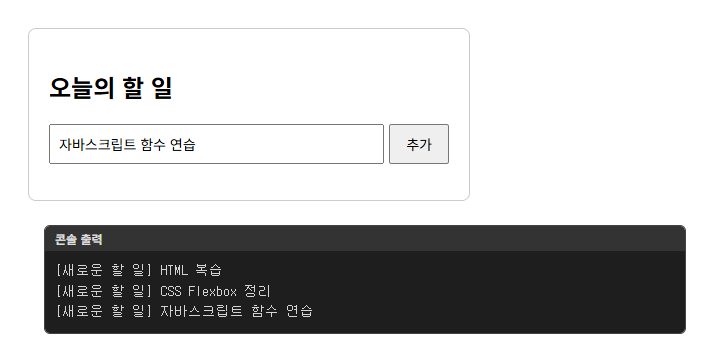

# chap17/lab · 오늘의 할 일 입력

[상위 폴더 README](../README.md)에서 다룬 개념과 나머지 예제 확인.

## 화면

## 파일

| 파일 | 내용 | 핵심 코드 |
|---|---|---|
| [todos.html](todos.html) | 할 일 입력창과 추가 버튼, 목록 영역으로 구성한 화면, todo.js 연결 | `<input id="todoInput">`, `<button id="addBtn">` |
| [todo.js](todo.js) | 추가 버튼 클릭 시 입력값의 앞뒤 공백을 지우고 콘솔 출력, 빈 값 확인과 입력창 비우기는 주석으로 둔 연습 코드 | `addBtn.onclick = printTodo`, `value.trim()` |
