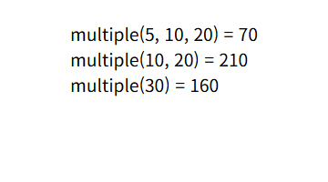
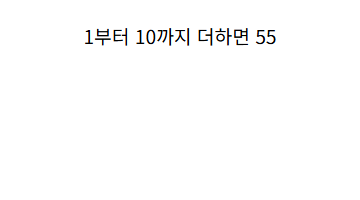
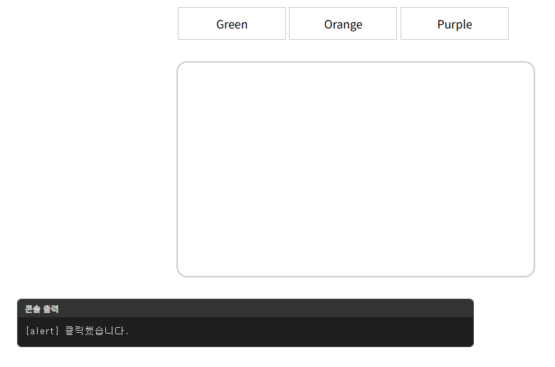
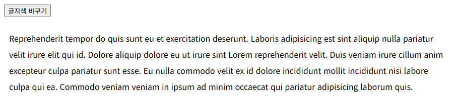

# chap17/results · 예제 완성 코드

[상위 폴더 README](../README.md)에서 다룬 개념과 나머지 예제 확인.

## 화면

| [function-2.html](function-2.html) · 매개변수 기본값 적용 결과 | [calcSum.html](calcSum.html) · 1부터 입력한 수까지의 합 |
|---|---|
|  |  |

| [event-1.html](event-1.html) · 링크 클릭 시 알림 창 | [event-4.html](event-4.html) |
|---|---|
|  |  |

## 파일

상위 폴더 예제 시작 파일과 같은 이름으로 짝을 이루는 완성 코드.

| 파일 | 내용 | 핵심 코드 |
|---|---|---|
| [no-function.html](no-function.html) | 함수 없이 2와 3의 합을 알림 창 출력 | `alert()` |
| [using-function.html](using-function.html) | 같은 덧셈을 함수로 묶어 호출 | `function addNumber()` |
| [calcSum.html](calcSum.html) | 입력한 수까지 1부터 더한 합을 문서에 출력, 취소하면 실행하지 않음 | `calcSum(parseInt(userNumber))`, `!== null` |
| [function-1.html](function-1.html) | 두 매개변수를 더해 돌려주는 함수 선언과 호출 | `addNumber(num1, num2)`, `return` |
| [function-2.html](function-2.html) | 인수 개수를 바꿔 호출하며 매개변수 기본값 적용 결과 출력 | `multiple(a, b = 5, c = 10)` |
| [function-3.html](function-3.html) | 변수에 대입한 익명 함수 실행 결과 출력 | `let sum = function(a, b)` |
| [function-4.html](function-4.html) | 즉시 실행 함수로 이름을 입력받아 강조 인사말 출력 | `(function() { ... }())`, `prompt()` |
| [function-5.html](function-5.html) | 인수를 넘기는 즉시 실행 함수로 두 수의 합 계산 | `(function(a, b) { ... }(100, 200))` |
| [arrow-1.html](arrow-1.html) | 인사말을 돌려주는 함수를 중괄호와 `return`을 생략한 화살표 함수로 작성 | `() => "안녕하세요?"` |
| [arrow-2.html](arrow-2.html) | 매개변수 하나인 화살표 함수로 인사말 출력 함수 작성 | `user => { ... }` |
| [arrow-3.html](arrow-3.html) | 두 수의 합을 돌려주는 화살표 함수 | `(a, b) => a + b` |
| [var-1.html](var-1.html) | 함수 안 지역 변수를 함수 밖에서 읽을 때 오류가 나는 상황 확인 | 전역 `var sum`, 지역 `var result` |
| [var-2.html](var-2.html) | `var` 없이 값을 넣은 변수가 전역 변수가 되는 상황 확인 | `result = 10 * 20` |
| [var-3.html](var-3.html) | 함수 선언보다 앞에서 호출하고 선언 전 지역 변수를 읽어 호이스팅 확인 | `displayNumber()`, `var y` |
| [var-4.html](var-4.html) | 반복문 안에서 `var` 변수를 다시 선언해 바깥 값이 덮어써지는 상황 확인 | `var seed`, `for (var i ...)` |
| [var-5.html](var-5.html) | 함수 안 `let` 변수를 함수 밖에서 읽을 때 `ReferenceError` 확인 | `let result` |
| [var-6.html](var-6.html) | 같은 블록에서 `let` 변수를 다시 선언할 때 `SyntaxError` 확인 | `let x` 재선언 |
| [var-7.html](var-7.html) | `const` 변수를 같은 이름으로 다시 선언할 때 오류 확인 | `const user` 재선언 |
| [var-8.html](var-8.html) | `let` 변수를 선언 전에 읽을 때 `ReferenceError` 확인 | `let y` |
| [event-1.html](event-1.html) | 링크마다 HTML 속성으로 알림 창 연결 | `onclick="alert(...)"` |
| [event-2.html](event-2.html) | 링크마다 색 이름을 인수로 넘겨 결과 상자 배경색 변경 | `onclick="changeBg('green')"` |
| [event-3.html](event-3.html) | 상위 폴더 event-3.html과 같은 예제 | `onclick = changeColor` |
| [event-4.html](event-4.html) | 이름 있는 함수 하나를 클릭 리스너로 등록해 문단 글자색 변경 | `addEventListener('click', changeColor)` |
| [event-5.html](event-5.html) | 링크마다 클릭 리스너를 붙여 결과 상자 배경색 변경, 기본 동작 막기는 주석 처리 | `querySelectorAll()`, `addEventListener()` |

`css/`: 상위 폴더 css/function.css와 같은 스타일.
