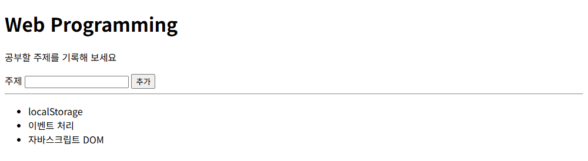
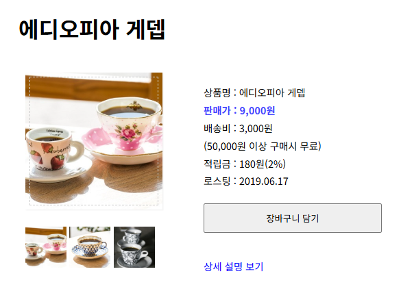
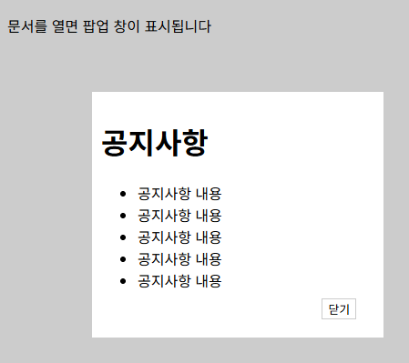
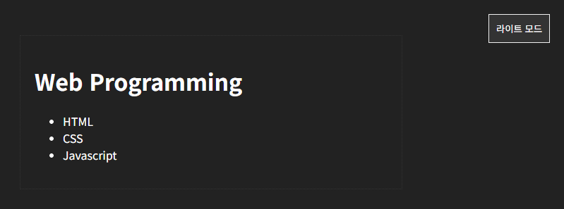
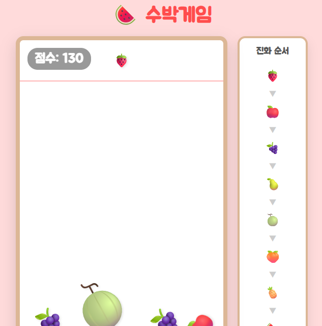

# chap19 · DOM 조작과 이벤트 처리

문서 객체 모델로 요소를 찾아 내용·속성·스타일·클래스를 바꾸고 노드를 추가·삭제하는 공부 주제 목록, 라이트박스, 레이어 팝업, 다크 모드 전환 구현.

Do it! 교재 예제와 연습문제 기반.

## 화면

버튼·썸네일을 누르거나 과일을 떨어뜨린 뒤의 화면.

| [create.html](results/create.html) · 공부 주제 목록 추가 | [index.html](index.html) · 커피 상품 상세 화면 |
|---|---|
|  |  |

| [lightbox.html](results/lightbox.html) · 썸네일 클릭 후 라이트박스 | [popup-layer.html](popup-layer.html) · 레이어 팝업 |
|---|---|
|  |  |

| [mode.html](results/mode.html) · 다크 모드 전환 후 | [suika.html](results/suika.html) · 과일을 몇 개 떨어뜨린 수박게임 |
|---|---|
|  |  |

## 다룬 개념

| 개념 | 뜻과 사용 방법 |
|---|---|
| DOM | 브라우저가 HTML 문서를 요소·텍스트·속성 노드의 나무 구조로 바꾼 객체 모델. 스크립트가 노드를 찾아 고치면 화면이 바로 바뀜 |
| 요소 선택 | `querySelector()`는 선택자에 맞는 첫 요소, `querySelectorAll()`은 맞는 요소 전부를 가져오는 메서드 |
| 노드 리스트 | `querySelectorAll()`이 돌려주는 요소 묶음. 배열처럼 인덱스와 `length`, `forEach()`로 요소마다 처리 |
| `innerText`·`innerHTML`·`textContent` | 요소 안 내용을 읽고 쓰는 속성. `innerText`는 화면에 보이는 글자, `innerHTML`은 태그를 포함한 내용, `textContent`는 숨긴 요소까지 포함한 전체 글자 |
| 속성 변경 | 요소의 `src`, `alt` 같은 속성값을 바꾸는 방법. 클릭이나 마우스 오버 때 이미지 파일 교체 |
| `style` 속성 | 요소의 CSS 값을 스크립트에서 바꾸는 방법. 사각형을 초록 원으로 바꾸고 빈 값을 넣어 원래 모양으로 복원 |
| `classList` | 요소의 클래스 목록을 다루는 속성. `add`와 `remove`로 붙이고 떼며 `toggle`은 있으면 떼고 없으면 붙이고 `contains`로 포함 여부 확인 |
| 노드 생성과 추가 | `createElement()`로 요소 노드, `createTextNode()`로 텍스트 노드를 만들고 `appendChild()`로 부모 끝에, `insertBefore()`로 첫 자식 앞에 추가 |
| 속성 노드 | `createAttribute()`로 속성 노드를 만들어 값을 넣고 `setAttributeNode()`로 요소에 붙이는 방식 |
| 노드 삭제 | `remove()`는 요소 스스로 삭제, `removeChild()`는 부모 요소가 자식 요소 삭제 |
| 이벤트 연결 | 요소의 `onclick` 같은 속성에 함수를 대입하거나 `addEventListener()`로 리스너 등록. `click`, `mouseover`, `mouseout`, `change`, `mousemove` 이벤트 처리 |
| `DOMContentLoaded` | HTML을 모두 읽고 DOM 구성을 마친 시점에 발생하는 이벤트. 이 안에서 버튼과 체크 상자를 찾아 리스너 등록 |
| event 객체 | 이벤트가 일어날 때 처리 함수에 넘어오는 정보 묶음. `pageX`, `pageY`로 클릭 위치, `target`으로 실제 클릭한 요소 확인 |
| `this` | 이벤트 처리 함수 안에서 이벤트가 연결된 요소 자신. 클릭한 이미지의 `src`, 클릭한 체크 표시의 부모 항목에 접근 |
| 이벤트 위임 | 자식마다 리스너를 붙이지 않고 부모 하나에 붙인 뒤 `event.target`으로 클릭한 자식을 구분하는 방법. 목록 `ul`에 리스너를 두고 클릭한 `li` 삭제 |
| `preventDefault()` | 폼 버튼을 누르면 페이지가 새로 고침되는 기본 동작을 취소하는 메서드. 입력값만 목록에 추가 |

## 파일별 내용

| 파일 | 내용 | 핵심 코드 |
|---|---|---|
| [domTree.html](domTree.html) | DOM 나무 구조를 살펴볼 제목과 이미지만 있는 문서 | `<h1>`, `` |
| [index.html](index.html) | 예제 시작 파일. 커피 상품 상세 화면, 요소 하나·여러 개 선택과 반복 출력 단계를 주석으로 정리 | `#heading`, `#small-pic > img` |
| [text-1.html](text-1.html) | 예제 시작 파일. 일부 항목을 숨긴 원두 정보 목록, 내용 속성별 출력 자리 | `style="display: none"` |
| [text-2.html](text-2.html) | 예제 시작 파일. 제목과 커피잔 이미지, 클릭 시 글자와 이미지를 바꿀 순서를 주석으로 정리 | `#heading`, `#cup` |
| [domCss.html](domCss.html) | 예제 시작 파일. 마우스를 올릴 사각형과 전환 효과 스타일 | `transition: 1s` |
| [event-1.html](event-1.html) | 예제 시작 파일. 고양이 이미지와 이미지 교체 함수, 요소 선택·클릭·마우스 오버 연결 순서를 주석으로 정리 | `changePic()` |
| [event-2.html](event-2.html) | 예제 시작 파일. 이미지 클릭 처리 코드를 넣을 빈 스크립트 영역 | 빈 `<script>` |
| [event-3.html](event-3.html) | 예제 시작 파일. event 객체 코드를 넣을 빈 스크립트 영역 | 빈 `<script>` |
| [event-4.html](event-4.html) | 예제 시작 파일. `this` 코드를 넣을 빈 스크립트 영역 | 빈 `<script>` |
| [event-5.html](event-5.html) | 예제 시작 파일. 이미지 교체·복원 함수와 `mouseover`·`mouseout` 리스너를 붙일 자리 | `changePic()`, `originPic()` |
| [event-6.html](event-6.html) | 예제 시작 파일. domCss.html과 같은 사각형 화면, 리스너로 배경색과 모서리를 바꿀 순서를 주석으로 정리 | `#rect` |
| [classList.html](classList.html) | 테두리 클래스를 붙인 제목과 클래스 두 개를 함께 붙인 목록 항목 화면 | `class="blueText drawBorder"` |
| [button-1.html](button-1.html) | 예제 시작 파일. 동의 체크 상자와 비활성 버튼 화면 | `<button disabled>` |
| [button-2.html](button-2.html) | 예제 시작 파일. button-1과 같은 화면, `toggle()` 코드를 넣을 자리 | `<button disabled>` |
| [nodeList.html](nodeList.html) | 예제 시작 파일. 버튼을 누르면 목록에 항목을 더할 `addLi()` 함수의 단계별 주석 | `onclick="addLi(); this.onclick='';"` |
| [nodeList-2.html](nodeList-2.html) | 예제 시작 파일. 버튼을 누르면 이미지를 더할 `addImg()` 함수의 단계별 주석 | `onclick="addImg(); this.onclick='';"` |
| [create.html](create.html) | 예제 시작 파일. 공부 주제 입력 폼, 버튼 리스너 안에 요소 생성·빈 값 확인·추가 단계를 주석으로 정리 | `preventDefault()`, `subject.focus()` |
| [delete.html](delete.html) | 입력한 공부 주제를 목록 끝에 추가, 삭제 기능을 더할 시작 코드 | `DOMContentLoaded`, `createElement("li")`, `createTextNode()`, `appendChild()` |
| [remove1.html](remove1.html) | 예제 시작 파일. 클릭하면 삭제할 항목 하나가 있는 목록 | `<li id="bad-li">` |
| [remove2.html](remove2.html) | 예제 시작 파일. 할 일 목록과 항목마다 리스너를 붙일 반복문 틀 | `todoItems.forEach()` |
| [lightbox.html](lightbox.html) | 예제 시작 파일. 나무 사진 썸네일 목록과 큰 사진을 띄울 라이트박스 영역, 표시·감추기 단계를 주석으로 정리 | `data-src`, `#lightbox` |
| [popup-layer.html](popup-layer.html) | 문서 위에 겹친 공지사항 레이어를 닫기 버튼으로 감추기 | `querySelector(".popup > button")`, `style.display = 'none'` |
| [quiz-1.html](quiz-1.html) | 연습문제 시작 파일. 체크 표시가 붙은 할 일 목록 | `` |
| [sol-1.html](sol-1.html) | 연습문제 1 풀이. 체크 표시를 누르면 해당 할 일을 회색 취소선으로 표시 | `querySelectorAll(".check")`, `this.parentNode`, `textDecoration` |
| [quiz-2.html](quiz-2.html) | 연습문제 시작 파일. 빈 화면 | `<body>` |
| [sol-2.html](sol-2.html) | 연습문제 2 풀이. 행·열 개수를 입력받아 칸마다 좌표 글자를 넣은 표 생성 | `createElement("table")`, 중첩 `for`, `appendChild()` |

`css/`: subject.css는 create·delete, product.css는 index, nodelist.css는 nodeList 예제, lightbox.css는 라이트박스 화면 스타일. dom.css와 nameList.css는 상품 화면과 이름 목록용 스타일. `images/`: 고양이 그림, 커피잔 사진, 나무 사진과 썸네일, 책 그림.

### results/ · 예제 완성 코드

위 예제 시작 파일을 완성한 코드와 같은 주제로 더 만든 화면.

| 파일 | 내용 | 핵심 코드 |
|---|---|---|
| [text-1.html](results/text-1.html) | 숨긴 항목이 있는 목록을 세 가지 내용 속성으로 각각 콘솔 출력해 차이 비교 | `innerText`, `innerHTML`, `textContent` |
| [text-2.html](results/text-2.html) | 제목 클릭 시 글자를 추천 문구로 바꾸는 처리, 이미지 교체 코드는 주석 처리 | `heading.onclick` |
| [domCss.html](results/domCss.html) | 사각형에 마우스를 올리면 초록 원, 벗어나면 원래 모양으로 전환 | `mouseover`, `mouseout`, `style.borderRadius` |
| [event-6.html](results/event-6.html) | domCss.html과 같은 예제, 전환 효과 없는 사각형 | `addEventListener("mouseover", ...)` |
| [event-1.html](results/event-1.html) | 고양이 이미지 클릭 시 알림 창 표시 | `cat.onclick = () => alert(...)` |
| [event-2.html](results/event-2.html) | 이미지 클릭 시 다른 고양이 그림으로 교체 | `cat.onclick = changePic`, `cat.src` |
| [event-3.html](results/event-3.html) | 화면 클릭 위치 좌표를 알림 창 출력 | `event.pageX`, `event.pageY` |
| [event-4.html](results/event-4.html) | 클릭한 이미지의 파일 경로를 `this`로 읽어 출력 | `this.src` |
| [event-5.html](results/event-5.html) | 마우스를 올리면 이미지 교체, 벗어나면 원래 이미지 | `addEventListener("mouseover", changePic, false)` |
| [button-1.html](results/button-1.html) | 동의 체크 상태에 따라 버튼 활성·비활성 전환과 클래스 교체 | `change`, `classList.add`, `classList.remove`, `disabled` |
| [button-2.html](results/button-2.html) | 같은 기능을 `toggle`의 두 번째 인수로 줄여 작성 | `classList.toggle('enabled', this.checked)` |
| [mode.html](results/mode.html) | 버튼 클릭 시 본문 클래스를 바꿔 라이트·다크 모드 전환, 버튼 글자 변경 | `classList.toggle`, `classList.contains` |
| [nodeList.html](results/nodeList.html) | 버튼 클릭 시 목록 끝에 TypeScript 항목 추가 | `createElement('li')`, `createTextNode()`, `appendChild()` |
| [nodeList-2.html](results/nodeList-2.html) | 버튼 클릭 시 책 이미지 요소를 만들어 영역에 추가 | `createElement('img')`, `imgEl.src`, `imgEl.alt` |
| [nodeList-2v1.html](results/nodeList-2v1.html) | 같은 이미지 추가를 속성 노드를 만들어 붙이는 방식으로 작성 | `createAttribute()`, `setAttributeNode()` |
| [createV1.html](results/createV1.html) | 입력한 공부 주제를 목록 끝에 추가, 페이지 로드 뒤 버튼 `onclick`에 함수 대입 | `window.onload`, `appendChild()` |
| [create-before.html](results/create-before.html) | 입력한 공부 주제를 목록 맨 앞에 추가 | `insertBefore(newItem, itemList.childNodes[0])` |
| [create.html](results/create.html) | 앞뒤 공백을 지운 입력값이 비어 있으면 안내 후 입력창으로 돌아가고, 값이 있으면 목록 맨 앞에 추가 | `trim()`, `textContent`, `insertBefore()`, `focus()` |
| [delete.html](results/delete.html) | 주제 추가와 함께 목록 항목 클릭 시 확인 창을 거쳐 삭제, 부모 목록 하나에 리스너 등록 | `event.target.tagName`, `confirm()`, `remove()` |
| [remove1.html](results/remove1.html) | 항목 클릭 시 부모 목록이 해당 항목 삭제 | `removeChild()` |
| [remove2.html](results/remove2.html) | 할 일 항목마다 클릭 리스너를 붙여 클릭한 항목 삭제 | `forEach()`, `this.remove()` |
| [lightbox.html](results/lightbox.html) | 썸네일 클릭 시 같은 순번의 큰 사진을 어두운 배경 위에 표시, 배경 클릭 시 감추기 | `pics.forEach(function (pic, index) {...})`, `style.display` |
| [lightbox2.html](results/lightbox2.html) | lightbox.html과 같은 예제 | `style.display = "block"` |
| [suika.html](results/suika.html) | Matter.js 물리 엔진으로 과일을 떨어뜨려 같은 과일끼리 합치는 수박게임, 과일은 이모지를 담은 요소로 그리고 물리 좌표에 맞춰 위치 갱신 | `Matter.Engine`, `Events.on(engine, "collisionStart")`, `mousemove`, `style.transform` |

`results/css/`, `results/images/`: 위 css·images 폴더와 같은 스타일과 그림. product.css만 상품 영역 선택자가 `.container`.
