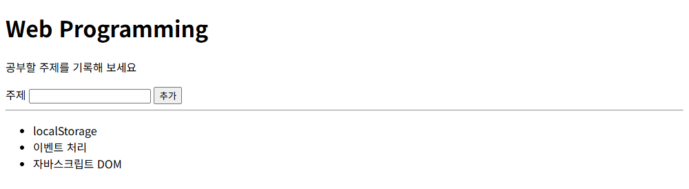
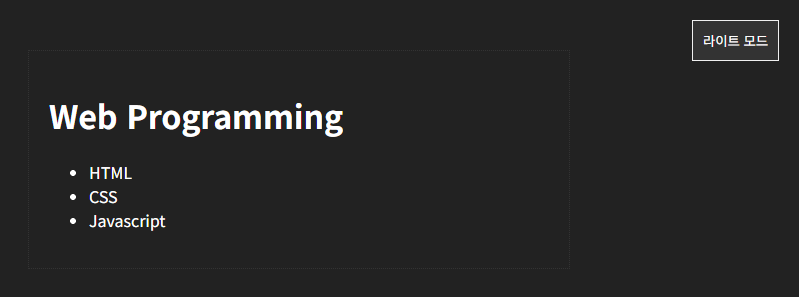
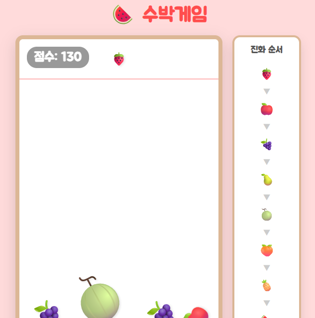
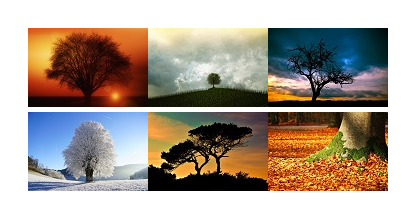
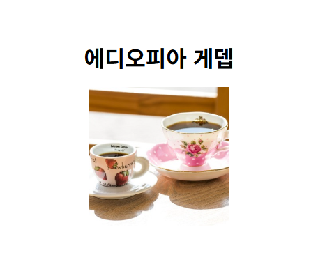

# chap19/results · 예제 완성 코드

[상위 폴더 README](../README.md)에서 다룬 개념과 나머지 예제 확인.

## 화면

| [create.html](create.html) · 공부 주제 목록 추가 | [lightbox.html](lightbox.html) · 썸네일 클릭 후 라이트박스 |
|---|---|
|  |  |

| [mode.html](mode.html) · 다크 모드 전환 후 | [suika.html](suika.html) · 과일을 몇 개 떨어뜨린 수박게임 |
|---|---|
|  |  |

| [lightbox2.html](lightbox2.html) | [text-2.html](text-2.html) |
|---|---|
|  |  |

## 파일

상위 폴더 예제 시작 파일을 완성한 코드와 같은 주제로 더 만든 화면.

| 파일 | 내용 | 핵심 코드 |
|---|---|---|
| [text-1.html](text-1.html) | 숨긴 항목이 있는 목록을 세 가지 내용 속성으로 각각 콘솔 출력해 차이 비교 | `innerText`, `innerHTML`, `textContent` |
| [text-2.html](text-2.html) | 제목 클릭 시 글자를 추천 문구로 바꾸는 처리, 이미지 교체 코드는 주석 처리 | `heading.onclick` |
| [domCss.html](domCss.html) | 사각형에 마우스를 올리면 초록 원, 벗어나면 원래 모양으로 전환 | `mouseover`, `mouseout`, `style.borderRadius` |
| [event-6.html](event-6.html) | domCss.html과 같은 예제, 전환 효과 없는 사각형 | `addEventListener("mouseover", ...)` |
| [event-1.html](event-1.html) | 고양이 이미지 클릭 시 알림 창 표시 | `cat.onclick = () => alert(...)` |
| [event-2.html](event-2.html) | 이미지 클릭 시 다른 고양이 그림으로 교체 | `cat.onclick = changePic`, `cat.src` |
| [event-3.html](event-3.html) | 화면 클릭 위치 좌표를 알림 창 출력 | `event.pageX`, `event.pageY` |
| [event-4.html](event-4.html) | 클릭한 이미지의 파일 경로를 `this`로 읽어 출력 | `this.src` |
| [event-5.html](event-5.html) | 마우스를 올리면 이미지 교체, 벗어나면 원래 이미지 | `addEventListener("mouseover", changePic, false)` |
| [button-1.html](button-1.html) | 동의 체크 상태에 따라 버튼 활성·비활성 전환과 클래스 교체 | `change`, `classList.add`, `classList.remove`, `disabled` |
| [button-2.html](button-2.html) | 같은 기능을 `toggle`의 두 번째 인수로 줄여 작성 | `classList.toggle('enabled', this.checked)` |
| [mode.html](mode.html) | 버튼 클릭 시 본문 클래스를 바꿔 라이트·다크 모드 전환, 버튼 글자 변경 | `classList.toggle`, `classList.contains` |
| [nodeList.html](nodeList.html) | 버튼 클릭 시 목록 끝에 TypeScript 항목 추가 | `createElement('li')`, `createTextNode()`, `appendChild()` |
| [nodeList-2.html](nodeList-2.html) | 버튼 클릭 시 책 이미지 요소를 만들어 영역에 추가 | `createElement('img')`, `imgEl.src`, `imgEl.alt` |
| [nodeList-2v1.html](nodeList-2v1.html) | 같은 이미지 추가를 속성 노드를 만들어 붙이는 방식으로 작성 | `createAttribute()`, `setAttributeNode()` |
| [createV1.html](createV1.html) | 입력한 공부 주제를 목록 끝에 추가, 페이지 로드 뒤 버튼 `onclick`에 함수 대입 | `window.onload`, `appendChild()` |
| [create-before.html](create-before.html) | 입력한 공부 주제를 목록 맨 앞에 추가 | `insertBefore(newItem, itemList.childNodes[0])` |
| [create.html](create.html) | 앞뒤 공백을 지운 입력값이 비어 있으면 안내 후 입력창으로 돌아가고, 값이 있으면 목록 맨 앞에 추가 | `trim()`, `textContent`, `insertBefore()`, `focus()` |
| [delete.html](delete.html) | 주제 추가와 함께 목록 항목 클릭 시 확인 창을 거쳐 삭제, 부모 목록 하나에 리스너 등록 | `event.target.tagName`, `confirm()`, `remove()` |
| [remove1.html](remove1.html) | 항목 클릭 시 부모 목록이 해당 항목 삭제 | `removeChild()` |
| [remove2.html](remove2.html) | 할 일 항목마다 클릭 리스너를 붙여 클릭한 항목 삭제 | `forEach()`, `this.remove()` |
| [lightbox.html](lightbox.html) | 썸네일 클릭 시 같은 순번의 큰 사진을 어두운 배경 위에 표시, 배경 클릭 시 감추기 | `pics.forEach(function (pic, index) {...})`, `style.display` |
| [lightbox2.html](lightbox2.html) | lightbox.html과 같은 예제 | `style.display = "block"` |
| [suika.html](suika.html) | Matter.js 물리 엔진으로 과일을 떨어뜨려 같은 과일끼리 합치는 수박게임, 과일은 이모지를 담은 요소로 그리고 물리 좌표에 맞춰 위치 갱신 | `Matter.Engine`, `Events.on(engine, "collisionStart")`, `mousemove`, `style.transform` |

`css/`, `images/`: 상위 폴더의 css·images 폴더와 같은 스타일과 그림. product.css만 상품 영역 선택자가 `.container`.
