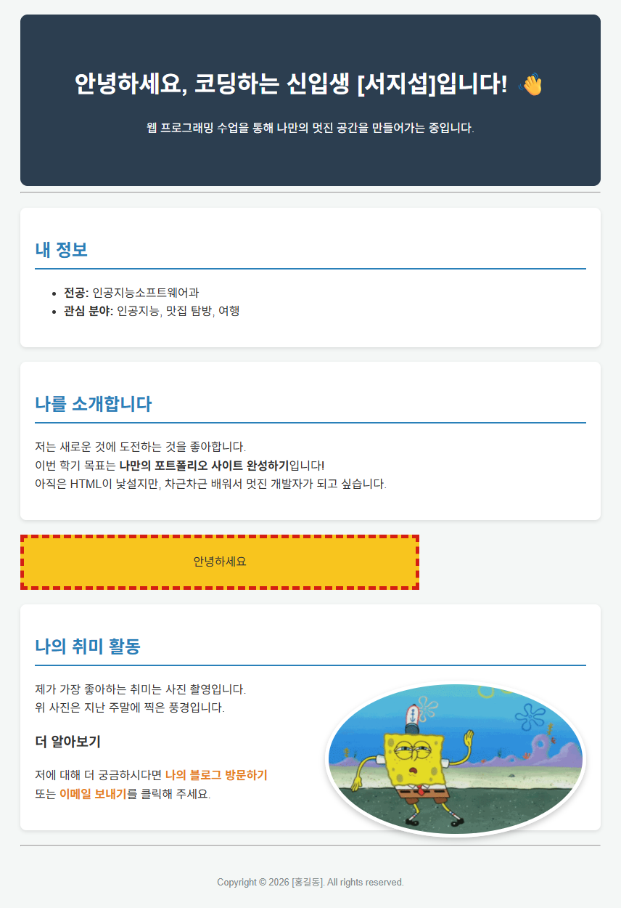

# web_practice/01 · 자기소개 페이지

[상위 폴더 README](../README.md)에서 다룬 개념과 나머지 예제 확인.

## 화면

## 파일

외부 스타일 시트를 연결해 꾸민 자기소개 페이지.

| 파일 | 내용 | 핵심 코드 |
|---|---|---|
| [index.html](index.html) | 자기소개 페이지. 인사말 머리글, 전공·관심 분야 목록, 소개 글, 점선 테두리 인라인 스타일 상자, 누르면 새 창으로 열리는 취미 사진, 블로그·메일 링크, 바닥글 | `<link rel="stylesheet" href="style.css">`, `style="..."`, `target="_blank"`, `mailto:` |
| [style.css](style.css) | 페이지 너비 제한과 가운데 정렬, 남색 머리글, 그림자 있는 흰 구역 카드, 오른쪽에 띄운 둥근 사진, 마우스를 올리면 밑줄이 생기는 링크 | `max-width: 800px`, `margin: 0 auto`, `box-shadow`, `float: right`, `border-radius: 50%`, `a:hover` |

`my_photo.gif`: 취미 사진.
