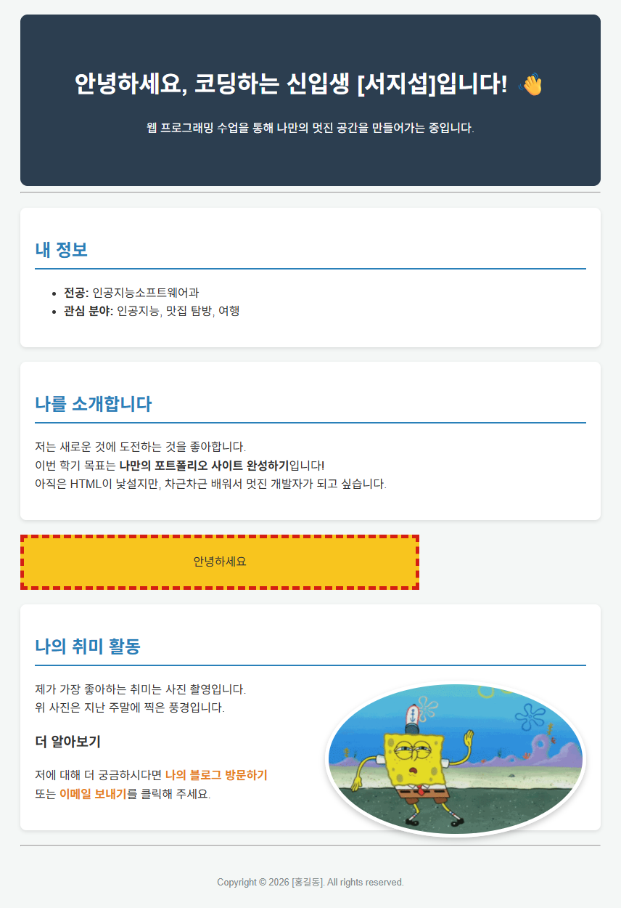
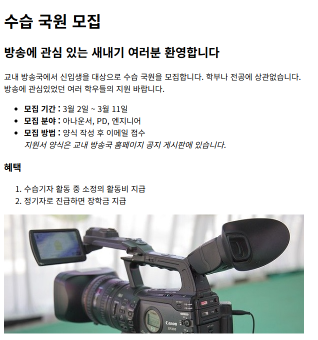
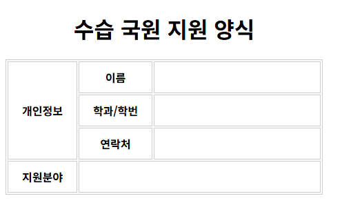

# web_practice · HTML 문서 구조와 태그

HTML 문서 틀과 글자·목록·표·이미지·동영상·링크 태그로 만든 소개 페이지 모음. 레드향 소개, 교내 방송국 모집 안내와 지원 양식, 자기소개 페이지, BLT 샌드위치 소개 페이지 구성.

## 화면

| [index.html](01/index.html) · 자기소개 페이지 | [practice_1.html](practice_1.html) · 교내 방송국 수습 국원 모집 안내 |
|---|---|
|  |  |

| [practice_2.html](practice_2.html) · 셀을 합친 수습 국원 지원 양식 |   |
|---|---|
|  |   |

## 다룬 개념

| 개념 | 뜻과 사용 방법 |
|---|---|
| HTML 문서 구조 | 웹 문서의 뼈대. `<!doctype html>`로 HTML5 문서임을 알리고, `<head>`에 문자 인코딩과 탭 제목, `<body>`에 화면 내용 |
| 주석 | `<!-- -->` 사이에 쓴, 화면에 나오지 않는 메모. 첫 웹 문서에서 태그 역할 설명에 사용 |
| 글자 꾸밈 태그 | 문장 일부의 의미나 모양을 바꾸는 태그. `<strong>`·`<b>` 굵게, `<em>`·`<i>` 기울임, `<blockquote>` 인용 단락, `
` 가로줄, `&nbsp;` 띄어쓰기 문자 |
| 목록 | 항목을 나열하는 태그. `<ul>` 순서 없는 목록, `<ol>` 번호 목록, `<li>` 각 항목 |
| 표 | 내용을 행과 열로 정리하는 태그. `<caption>` 표 제목, `<th>` 제목 칸, `<td>` 내용 칸, `rowspan`·`colspan`으로 세로·가로 칸 합치기, `border-collapse: collapse`로 겹친 테두리를 한 줄로 정리 |
| 이미지·동영상 | ``로 사진, `<video controls>`로 재생 막대가 있는 동영상 삽입. `<figure>`와 `<figcaption>`으로 사진·영상에 설명 연결 |
| 링크 | 다른 곳으로 이동하는 `<a href>`. `#recipe` 같은 아이디로 같은 페이지 안 이동, `target="_blank"`로 새 창 열기, `mailto:`로 메일 프로그램 열기 |
| 외부 스타일 시트 | CSS를 별도 파일로 두고 `<link rel="stylesheet">`로 연결하는 방식. 자기소개 페이지에 적용 |
| 인라인 스타일 | 태그의 `style` 속성 안에 쓰는 CSS. 점선 테두리 상자와 사진 너비 지정에 사용 |

## 파일별 내용

| 파일 | 내용 | 핵심 코드 |
|---|---|---|
| [test.html](test.html) | 첫 웹 문서. 주석으로 문서 선언과 `<title>` 역할을 설명하고, 본문에 HTML·CSS·JS 역할 정리 | `<!DOCTYPE html>`, `<!-- -->`, ` ` |
| [web.html](web.html) | `<html>`·`<head>` 없이 제목과 문단 태그만 쓴 HTML 조각, 웹 개발 기술 이름 나열 | `<h1>`, `
` |
| [2.html](2.html) | 레드향 소개 글. 글자 사이에 공백 문자를 넣은 제목, 가로줄, 강조·굵게·기울임 글자, 인용 단락, 샐러드 레시피·상품 구성 소제목 | `&nbsp;`, `
`, `<strong>`, `<b>`, `<i>`, `<blockquote>` |
| [practice_1.html](practice_1.html) | 종합 예제 1. 교내 방송국 수습 국원 모집 안내문, 모집 정보 목록, 혜택 번호 목록, 마이크 사진 | `<ul>`, `<ol>`, `<em>`, `` |
| [practice_2.html](practice_2.html) | 종합 예제 2. 수습 국원 지원 양식 표, 개인정보 제목 칸을 세로로 합치고 입력 칸을 가로로 합친 구성 | `rowspan="3"`, `colspan="2"`, `colspan="3"` |
| [practice_3.html](practice_3.html) | 서지섭/서지섭.html과 같은 BLT 샌드위치 소개 페이지의 다른 판, 관련 사이트 링크와 일부 문구가 다름 | `<table>`, `<video controls>`, `<a href="#recipe">` |

`BLT sand.jpg`, `BLT sand2.jpg`, `BLT sand3.jpg`, `Download.mp4`: BLT 샌드위치 페이지의 사진과 조리 동영상. `mic.jpg`: 모집 안내문 사진. `LetsgoBLT.png`: BLT 샌드위치 소개 페이지 화면 캡처.

## 01 · 자기소개 페이지

외부 스타일 시트를 연결해 꾸민 자기소개 페이지.

| 파일 | 내용 | 핵심 코드 |
|---|---|---|
| [01/index.html](01/index.html) | 자기소개 페이지. 인사말 머리글, 전공·관심 분야 목록, 소개 글, 점선 테두리 인라인 스타일 상자, 누르면 새 창으로 열리는 취미 사진, 블로그·메일 링크, 바닥글 | `<link rel="stylesheet" href="style.css">`, `style="..."`, `target="_blank"`, `mailto:` |
| [01/style.css](01/style.css) | 페이지 너비 제한과 가운데 정렬, 남색 머리글, 그림자 있는 흰 구역 카드, 오른쪽에 띄운 둥근 사진, 마우스를 올리면 밑줄이 생기는 링크 | `max-width: 800px`, `margin: 0 auto`, `box-shadow`, `float: right`, `border-radius: 50%`, `a:hover` |

`01/my_photo.gif`: 취미 사진.

## 서지섭 · BLT 샌드위치 소개 페이지

베이컨·양상추·토마토로 만드는 BLT 샌드위치를 주제로, 여러 HTML 태그를 써서 음식 소개와 레시피를 정리한 페이지.

| 파일 | 내용 | 핵심 코드 |
|---|---|---|
| [서지섭/서지섭.html](서지섭/서지섭.html) | 대표 사진과 소개 문단, 빵·속재료·소스를 구분한 재료 표, 기본 재료 목록, 조리 순서 번호 목록, 아이올리 소스 레시피, 조리 동영상, 완성 사진과 설명, 출처 인용, 관련 사이트 링크, 맨 위로 이동 링크 | `rowspan="2"`, `border-collapse: collapse`, `<video controls>`, `<figure>`, `<a href="#recipe">`, `<a href="#container">` |

`서지섭/`의 사진과 `Download.mp4`: 페이지에 쓴 BLT 샌드위치 사진과 조리 동영상.

